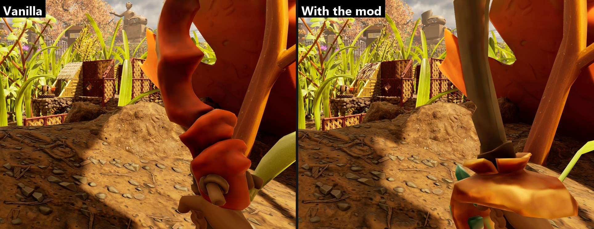



# Manifest reference

The manifest is `content/main.lua`. It describes what a mod adds and changes. A mod may split it over several `.lua` files in `content/`. They are merged in file name order. Files in `content/scripts/` are gameplay scripts ([Scripting](scripting.md)), files in `content/data/` are data files.

Row and field names come from the game. Look them up in the [game data export](game-data.md).

## Contents

- [Shape of a manifest](#shape-of-a-manifest)
- [assets](#assets)
- [Common rules for new rows](#common-rules-for-new-rows)
- [items](#items), [recipes](#recipes), [buildings](#buildings), [rows](#rows), [imports](#imports)
- [skins](#skins), [shop](#shop), [storage](#storage), [signs](#signs), [markers](#markers), [world](#world), [level](#level), [foliage](#foliage), [levels](#levels), [classes and creatures](#classes), [quests](#quests)
- [patches](#patches) and [values](#values)
- [Rules between mods](#rules-between-mods)
- [loot](#loot)
- [Text](#text)
- [Order of work and errors](#order-of-work-and-errors)

## Shape of a manifest

```lua
return {
    id = "MyMod",
    namespace = "MyMod",
    assets = {},
    items = {}, recipes = {}, buildings = {}, rows = {}, imports = {},
    skins = {},
    patches = {},
    loot = {},
}
```

| Key | Type | Default | Meaning |
| --- | --- | --- | --- |
| `id` | string | the mod id | Must equal `id` in `mod.json`. |
| `namespace` | string | the mod id | Prefix of every row the mod creates: `<namespace>_<name>`. Letters, digits, `_` and `-`, starts with a letter, at most 64 characters. All files of a mod must use the same one. |
| `assets` to `loot` | lists | empty | The sections below. |

Other keys are ignored.

A manifest can also return a function. It is called once at game start with the mod's settings and returns the table:

```lua
return function(settings)
    return {id = "MyMod", patches = {
        {table = "AllItemsTable", row = "SpearTier3", set = {CritChance = settings.critChance or 0.25}},
    }}
end
```

`settings` holds the values from `settings.json` with every default from `settings.schema.json` filled in ([Mod folder and mod.json](create-a-mod.md#settings)). Changing a setting in the game does not run the manifest again. Only scripts see live changes.

Manifests run in a sandbox. Available: `assert`, `error`, `ipairs`, `next`, `pairs`, `pcall`, `xpcall`, `select`, `type`, `tonumber`, `tostring`, `rawequal`, `rawget`, `rawlen`, `rawset`, `setmetatable`, `getmetatable` and the `string`, `table`, `math` and `utf8` libraries. Not available: `print`, `require`, `io`, `os`, `load`, `dofile`, `debug`, `coroutine`. A manifest that runs too long (about 200 million steps) stops with "manifest step limit exceeded".

## assets

Assets are loaded before anything else and stay loaded for the session.

```lua
assets = {
    {path = "/Game/Mods/MyMod/Icons/T_Icon.T_Icon", expectedClass = "/Script/Engine.Texture2D"},
    {path = "/Game/Mods/MyMod/Blueprints/BP_Lamp.BP_Lamp_C", kind = "class", expectedClass = "/Script/Engine.Actor"},
}
```

| Key | Default | Meaning |
| --- | --- | --- |
| `path` | required | Object path under `/Game/`: `/Game/Folder/Name.Name`. |
| `kind` | `"object"` | `"class"` loads a Blueprint class (path ends in `_C`). |
| `expectedClass` | none | Class path the asset must be. For a class asset, the class it must derive from. |

List an asset when a field refers to your texture, sound or class by path. Tables need no entry: a table that a patch, row, import or row reference names by object path loads with the mod.

Errors such as "Asset could not be loaded" or "Asset class mismatch" turn the mod off.

## Common rules for new rows

Items, recipes, buildings, rows and imports create new rows by copying an existing one.

- `name` becomes the row name `<namespace>_<name>`. Letters, digits, `_` and `-`, starts with a letter, at most 64 characters.
- `template` is the existing row to copy. It must exist in the target table. While it does not, the mod waits ("not ready").
- `fields` sets fields of the copy: `{FieldName = value}`. Nested fields use dots. Values are described in [Values](#values).
- `exactName = true` keeps `name` as it is, without the namespace. Use it only for rows that other assets look up by their exact name. With `upsert = true` as well, a row of that name that already exists gets the fields set instead of being a collision.
- The same row may not be declared twice in a manifest ("duplicate row declaration"). A row name another mod already uses is a collision and turns the mod off.

## items

New rows in `AllItemsTable`.

```lua
items = {
    {
        name = "Dagger",
        template = "SwordAntRed",
        displayName = "dagger.name",
        description = "dagger.description",
        fields = {Tier = 2, CritChance = 0.1, Icon = "/Game/Mods/MyMod/Icons/T_Dagger.T_Dagger"},
        model = {mesh = "/Game/Mods/MyMod/Meshes/SM_Dagger.SM_Dagger"},
    },
}
```

| Key | Meaning |
| --- | --- |
| `name`, `template`, `fields` | See [Common rules](#common-rules-for-new-rows). |
| `displayName`, `description` | Keys of the mod's language files, see [Text](#text). A number uses a text the game already has. |
| `ammo` | Ammunition of a ranged weapon: `{{item = "SplinterShot", attack = {table = attackTable, row = "MyMod_Shot"}}}`. `item` is a full row name. |
| `model` | The item's own 3D model, see [Models](models.md). |

## recipes

New rows in `CraftingRecipeTable`.

```lua
recipes = {
    {
        name = "Dagger",
        template = "BowWorkbench",
        crafts = "Dagger",
        ingredients = {{item = "AcornShell", count = 3}, {item = "MyMod_Ingot", count = 1}},
        unlocked = false,
        fields = {CategoryTag = {unreal = '(TagName="Recipe.Crafting.Tools.Ranged")'}},
    },
}
```

| Key | Meaning |
| --- | --- |
| `crafts` | Short name of an item of this mod. To craft a game item or another mod's item, set `fields["CraftedItem.RowName"]` instead. |
| `ingredients` | List of `{item = full row name, count = 1 or more}`. Replaces `Requirements`. |
| `unlocked` | `true`: the recipe is known from the start. Otherwise it has to be unlocked, for example at the Ranger terminal ([Add an item with a recipe](tutorial-item.md#5-sell-the-recipe-at-the-ranger-terminal)). |
| `result` | Full row name of a game item or another mod's item to craft. Use one of `crafts` or `result`. |
| `station` | Where it is crafted: `Workbench`, `Forge` (the Oven), `Kiln`, `DryingRack`, `CookingStation`, `Mixer`, `RoastingSpit` and others, see [Stations](tutorial-station.md#stations). A full tag (`ItemProcessing.Refining`) is used as written. Default: the template's station. |
| `hours` | Production time in game hours at a station that takes time, such as the Oven (1.5 by default) or the Jerky Rack. |
| `count` | How many items one craft makes. |
| `category` | Tab of the crafting menu as a tag, for example `"Recipe.Crafting.Materials.Refined"`. |
| `fields` | Any other field of the recipe row. |

## buildings

New rows in `BuildingsTable`. The game tells buildings apart by their Blueprint class, so a new building needs its own class ([Make a building with a script](tutorial-building.md)).

```lua
buildings = {
    {
        name = "SlotMachine",
        template = "LampGnat",
        displayName = "slotMachine.name", description = "slotMachine.description",
        fields = {["PlacementData.Actor"] = "/Game/Mods/MyMod/Blueprints/BP_SlotMachine.BP_SlotMachine_C"},
        model = {skeletal = "/Game/Mods/MyMod/Meshes/SK_SlotMachine.SK_SlotMachine", poseable = true},
    },
}
```

Text comes from the string table `game/buildings`. The building appears in the build menu once a `BuildingRecipeTable` row points at it (see [rows](#rows)).

## rows

New rows in any table: attacks, status effects, building recipes, terminal entries.

```lua
rows = {
    {table = "BuildingRecipeTable", template = "LampGnat", name = "SlotMachine", fields = {
        Building = {handle = {table = "BuildingsTable", row = "MyMod_SlotMachine"}},
        Requirements = {ingredients = {{item = "Clay", count = 4}}},
    }},
}
```

| Key | Meaning |
| --- | --- |
| `table` | A `GlobalTableData` name or a loaded table's object path. |
| `template`, `name`, `fields` | See [Common rules](#common-rules-for-new-rows). |

Rows are created before items, so items can point at new attacks and effects.

## imports

Copies rows from another table, for example a terminal entry from a different terminal table.

```lua
imports = {
    {source = "/Game/Releases/Release_0_3_0/Blueprints/DataTables/TechTreeTables/Table_TechTree_PumpkinPatch.Table_TechTree_PumpkinPatch",
     table = "/Game/Blueprints/Items/TechTreeTables/Table_TechTree_InitialData.Table_TechTree_InitialData",
     rows = {{row = "SmithingSpicy", name = "Arsenal", fields = {Cost = 500}}}},
}
```

| Key | Meaning |
| --- | --- |
| `source` | Object path of the table to copy from. It is loaded automatically. |
| `table` | Target table. Its row type must match the source exactly. |
| `rows` | `{row = source row, name = new short name (default: same as row), fields = {...}}` |

## skins

A skin gives an existing item or building its own model, without a new row. The game's item keeps its name, stats and recipe. Only the look changes.

```lua
skins = {
    {item = "SwordAntRed", model = {mesh = "/Game/_Augusta/Art/Items/Weapons/Sword_Toenail_Scimitar_Pirate/SM_Sword_Toenail_Scimitar_Pirate.SM_Sword_Toenail_Scimitar_Pirate"}},
    {building = "LampGnat", model = {mesh = "/Game/Mods/MyMod/Meshes/SM_Lamp.SM_Lamp"}},
}
```

| Key | Meaning |
| --- | --- |
| `item` | Row in `AllItemsTable`. |
| `building` | Row in `BuildingsTable`. Use one of `item` or `building`. |
| `model` | Same as `model` on new items and buildings ([Models](models.md)). |



When two mods skin the same row, the later one in load order is used. The picture shows the Crimson Saber with the Pirate Toenail Scimitar's model. A skin made with game assets only needs no cooking.

## shop

Entries at the Ranger terminal. A new entry:

```lua
shop = {
    {name = "Arsenal", cost = 500, title = "arsenal.title", description = "arsenal.description", recipes = {"Ingot", "Helmet"}},
    {entry = "SteelGear_Arsenal", recipes = {"Rifle"}},
}
```

| Key | Meaning |
| --- | --- |
| `name` | New entry `<namespace>_<name>`. Use one of `name` or `entry`. |
| `entry` | Full row name of an existing entry to add unlocks to. |
| `cost` | Price in Raw Science. Only with `name`. |
| `title`, `description` | Keys of the mod's language files. |
| `recipes`, `buildings` | Short names of this mod's crafting and building recipes. |
| `unlocks` | Other rows: `{{table = "CraftingRecipeTable", row = "Bow"}}`. |
| `category` | Terminal tab tag. Default: the template's tab. |
| `terminal` | Object path of the terminal table. Default: `Table_TechTree_InitialData`. |
| `template` | `{table, row}` of the entry to copy. Default: `SmithingSpicy` from `Table_TechTree_PumpkinPatch`. |

A `name` entry becomes an [import](#imports) plus an `append` patch on `UnlockData`. An `entry` becomes only the patch. Tutorial: [Sell recipes at the Ranger terminal](tutorial-shop.md).

## storage

Chest sizes. A new chest sets its size on the building:

```lua
buildings = {
    {name = "Chest", template = "StorageBig", storage = {slots = 60}, fields = {...}},
}
```

A game chest gets a new size through the top-level list:

```lua
storage = {
    {building = "StorageBig", slots = 50},
}
```

| Key | Meaning |
| --- | --- |
| `building` | Row in `BuildingsTable` of a chest. |
| `slots` | Number of slots, 1 to 1000. The game's chests have 20 (Storage Basket), 40 (Storage Chest) and 60 (Large Storage Chest). |

When two mods size the same chest, the later one in load order is used. The size applies to new chests and to chests already built, including chests loaded from a save. If the size goes down again, for example when the mod is removed, a chest keeps the items past the new size in the save, but has more items than slots. Empty the extra slots before lowering a size. Tutorial: [Add a storage chest](tutorial-storage.md).

## signs

Pictures for Sign Frames and Picture Frames.

```lua
signs = {
    {name = "Rifle", picture = "/Game/Mods/MyMod/Textures/T_Sign_Rifle.T_Sign_Rifle", icon = "/Game/Mods/MyMod/Icons/T_SignIcon_Rifle.T_SignIcon_Rifle"},
}
```

| Key | Meaning |
| --- | --- |
| `name` | New row `<namespace>_<name>` in the game's default sign set. |
| `picture` | Texture on the frame. |
| `material` | A ready material for the frame instead of `picture`, for example another game sign. |
| `icon` | Texture in the picture list. Default: `picture`. |

For a `picture`, the framework makes the frame material in the game from the game's sign material. Tutorial: [Add pictures for signs](tutorial-signs.md).

## markers

Icons and colors players pick for Trail Markers.

```lua
markers = {
    icons = {
        {name = "Mod", texture = "/Game/Mods/MyMod/Icons/T_Marker_Mod.T_Marker_Mod", text = "marker.mod"},
    },
    colors = {"FFC83D"},
}
```

| Key | Meaning |
| --- | --- |
| `icons[].name` | Short name of the icon. |
| `icons[].texture` | The icon over the world and in the Icon Selector. The marker's color tints it: a white tile with a dark symbol, like the game's icons. |
| `icons[].map` | Another texture for the map. Default: `texture`. |
| `icons[].text` | Text key of the icon's name. |
| `colors` | Colors as hex. |

They come after the game's own icons and colors, in load order. A marker keeps its choice by place in the list. Without the mod it shows no icon. Tutorial: [Add marker icons and colors](tutorial-markers.md).

## world

Items and game objects placed once per saved world.

```lua
world = {
    {item = "ArsenalWeapons_Rifle", at = {-114700, 121850, -2680}},
    {item = "Ingot", count = 3, at = {-114600, 121950, -2680}},
}
```

| Key | Meaning |
| --- | --- |
| `item` | Full row name, or the short name of an item of this mod. |
| `count` | 1 to 999. Default 1. |
| `at` | Position `{x, y, z}`. The console command `cfwhere` prints the player's. |
| `actor` | Instead of `item`: a game Blueprint class (`/Game/....BP_X_C`) placed once, such as a mushroom or a pickup. The game saves it with what happens to it. |
| `rotate` | With `actor`: `{pitch, yaw, roll}`. |

Tutorial: [Place items in the world](tutorial-world.md).

## level

Changes to objects placed in the game's map: move them, turn them, remove them or change their fields.

```lua
level = {
    {class = "SpawnedItem", item = "CanteenCharcoal", move = {-115162, 121257, -2690}},
    {class = "SpawnedItem", item = "SlimeMold", near = {-112936, 120890, -3853}, radius = 50, remove = true},
}
```

| Key | Meaning |
| --- | --- |
| `class` | Class path of a Blueprint, or a native class name such as `SpawnedItem` (items lying in the world). |
| `item` | Only pickups holding this item row. |
| `name` | Only the actor with this name. |
| `mesh` | Only actors showing this static mesh, for example `SM_Root_Grp_01`. Use it with `class = "StaticMeshActor"` for the rocks, roots and walls of the map. |
| `near`, `radius` | Only actors within `radius` (default 200) of `{x, y, z}`. |
| `all` | `true` selects every actor of the class. One of `item`, `name`, `near` or `all` is required. |
| `move`, `rotate` | New position `{x, y, z}`, new rotation `{pitch, yaw, roll}`. |
| `remove` | `true` hides the actor and turns off its collision. |
| `set`, `add`, `subtract`, `multiply`, `divide` | `{Field = value}` on each selected actor, as in [classes](#classes). |

A pickup with `item` and `move` is not moved itself: the original is hidden and a copy with the same count is placed at `move`, once per saved world, while the original is still in the world. Far from the player the game keeps pickups only as data the framework cannot move, so this works wherever the player is. The console command `cfnear 1000` lists the pickups within 10 m as ready entries.

The console command `cfmap 1000` lists the map pieces and foliage within 10 m as ready `level` and `foliage` entries.

When two mods edit the same selection, the later one in load order is used. Tutorial: [Change the map](tutorial-level.md).

## foliage

Removes grass, weeds and other foliage of one mesh around a point. The game draws foliage as many copies of one mesh, so foliage has no actors for `level`.

```lua
foliage = {
    {mesh = "SM_Weed_Tall_A", near = {-114700, 121200, -2840}, radius = 1500},
    {mesh = "SM_Grass_Blade_E", near = {-114700, 121200, -2840}, radius = 900},
}
```

| Key | Meaning |
| --- | --- |
| `mesh` | Static mesh name of the foliage. |
| `near` | Position `{x, y, z}`. |
| `radius` | 1 to 20000. Default 300. |

The game's foliage manager removes it, as when a player cuts it: creatures no longer climb it, paths go through, and the world saves it as removed. Turning the mod off does not bring it back in a world that was saved with it. A weed may leave its stump, which is another mesh. In multiplayer the host removes it and the game passes it on to the other players.

## levels

Levels of the mod streamed into the world after each world load. See [Change the map](tutorial-level.md#3-new-objects-a-level-of-the-mod).

```lua
levels = {
    "/Game/Mods/SnackbarMap/Maps/L_SnackbarPicnic",
    {map = "/Game/Mods/MyMod/Maps/L_Camp", at = {0, 0, 120}, rotate = {0, 90, 0}},
},
```

| Key | Meaning |
| --- | --- |
| `map` | The level path. A plain string is the same as `{map = "..."}`. |
| `at` | Moves the whole level by `{x, y, z}`. Default `{0, 0, 0}`. |
| `rotate` | Turns the whole level, `{pitch, yaw, roll}`. Default `{0, 0, 0}`. |

The level is loaded again after each load and is gone with the mod turned off. Its objects have no saved state. Objects that need one (plants, mushrooms, pickups) go in [world](#world) with `actor`, and the game saves them.

## classes

Fields of a game class's defaults and of its components, for example the health of a creature.

```lua
classes = {
    {class = "/Game/Blueprints/Creatures/Weevil/Base/BP_Weevil.BP_Weevil_C", multiply = {["HealthComponent.MaxHealth"] = 3}},
},
creatures = {
    {creature = "Aphid", health = 40},
},
```

| Key | Meaning |
| --- | --- |
| `class` | Class path of a game Blueprint. |
| `set`, `add`, `subtract`, `multiply`, `divide` | `{Property = value}`, or `["Component.Property"]` for a component of the class. Values are numbers. `set` also takes `true`/`false` or `{unreal = "..."}`. All but `set` start from the game's value. |
| `creature` | Row in `Table_CharacterData`. The framework finds its class. |
| `health`, `healthMultiplier` | Short forms for `HealthComponent.MaxHealth`. |

A `creatures` entry with `name` and `template` adds a new creature instead: its own row copied from the template, with `displayName`, `health`, `scale`, `spawns` and `model` (see [Add creatures](tutorial-creatures.md)). `model = {skeletal = ..., animClass = ..., materials = {Slot = {base = ..., textures = {...}}}}` swaps the creature's mesh. Slots not in `materials` keep the game's material of the same name. `class` instead names a Blueprint class to spawn, such as a game creature's class.

The value applies to the class and to its actors already in the world. When two mods change the same field of a class, the later one in load order is used. Tutorial: [Add creatures](tutorial-creatures.md).

## quests

Quests in the game's quest list, run by the game on world variables of the mod (`variables.json`).

```lua
quests = {
    {name = "Radio", title = "quest.title", description = "quest.description",
     start = {variable = "radioQuest", equals = 1},
     objectives = {
         {text = "quest.visit", done = {variable = "radioVisited", equals = 1}, marker = "AmberRadio"},
         {text = "quest.parts", count = {variable = "parts", max = 3}},
     }},
}
```

| Key | Meaning |
| --- | --- |
| `name` | New row `<namespace>_<name>` in the game's side quest table. |
| `title`, `description` | Text keys. |
| `start` | Condition on a world variable that starts the quest. |
| `objectives` | In order. Each starts when the one before is done and is hidden until then. The quest is done with the last. Each has `text`, and `done` (a condition) or `count` (`{variable, max}`), and an optional `marker` (actor tag). |
| `sticky` | `false`: not pinned to the screen when it starts. Default `true`. |

A condition is `{variable = name, equals = n}`, or `notEqual`, `above`, `below`, `atLeast`, `atMost`. Tutorial: [Add quests](tutorial-quests.md).

## patches

A patch changes fields of existing rows, from the game or another mod.

```lua
patches = {
    {table = "AllItemsTable", row = "SpearTier3", set = {RecycleReward = 20, Tier = 2}},
    {table = "/Game/Blueprints/Attacks/AllAttacks.AllAttacks", row = "SwordAntRed*", multiply = {["DamageData.Damage"] = 1.5}},
    {table = "CraftingRecipeTable", row = {"SpearTier3", "SwordAntRed"}, add = {CraftedItemCount = 1}},
}
```

| Key | Meaning |
| --- | --- |
| `table` | A `GlobalTableData` name or a table's object path. |
| `row` | A row name, or a list of them. `*` matches any part of a name: `SwordAntRed*` is every row whose name starts with `SwordAntRed`. Rows of your own mod include the namespace. |
| `set` | `{Field = value}`: replaces the values. |
| `add`, `subtract`, `multiply`, `divide` | `{Field = number}`: changes numbers. Use whole results on integer fields. Dividing by 0 is an error. |
| `append` | `{Field = list}`: adds `{handles = ...}` or `{unreal = "(...)"}` entries to a list. |

A field inside a struct is written with dots: `["DamageData.Damage"]`. Array indices are not supported. Set the whole array instead. One patch can use several of `set`, `add`, `subtract`, `multiply`, `divide` and `append`. They apply in that order.

A named row that does not exist yet makes the mod wait ("not ready") until it does. `*` matches the rows the table has when the mod applies: the game's rows and those of mods before it in load order. A `*` that matches nothing is an error.

The game reads many tables through composite tables, such as `Table_AllItems` and `AllAttacks`, which hold copies of the rows of smaller tables. A change to a smaller table, such as `CreatureAttacks`, also goes to every composite that includes it.

## Values

| Form | Use |
| --- | --- |
| `5`, `0.25`, `true`, `"Name"` | Numbers, booleans, names and soft object paths (`"/Game/..."`). |
| `{unreal = "..."}` | Anything else, in Unreal's text format: `{unreal = '(TagName="Recipe.Crafting.Tools.Ranged")'}`, `{unreal = "()"}` for an empty list, a class reference. |
| `{handle = {table = "AllItemsTable", row = "Twig"}}` | A reference to a row. |
| `{unreal = '(TagName="My.New.Tag")'}` | A gameplay tag the game does not have. It is written as it is: it matches itself and, in a tag list, its parent tags. The game's own tag list does not change.
| `{handles = {{table = ..., row = ...}, ...}}` | A list of row references. With `template = '(Attacks={handles},...)'` the list is placed inside a larger value. |
| `{ingredients = {{item = "Twig", count = 4}}}` | Recipe requirements. |
| `{text = "rush.name"}` | A text of the mod's language files, for fields such as `DisplayData.Name`. |

The [game data export](game-data.md) shows every field in the format `{unreal = ...}` accepts. A value the game rejects fails before the row changes.

## Rules between mods

| Situation | Result |
| --- | --- |
| Two mods change different fields of one row | Both apply. |
| Two mods `set` the same field | The later mod in load order wins. |
| A mod `set`s a list other mods `append`ed to before it | The `set` replaces the list. |
| One mod writes a struct, another a field inside it | The later mod in load order wins for that part. |
| Two mods add a row with the same exact name | The later mod sets its fields on the row. |
| Several mods add, subtract, multiply or divide the same field | Applied in load order. |
| Several mods `append` to the same list | All entries are added. |

No mod is turned off because of another one: everything else of the earlier mod still applies. The UE4SS log names each case, for example `GameTweaks overrides MyMod: allattacks / swordantred / damagedata.damage`, and `cfstatus` lists them. To change which mod wins, change the load order in the mod manager. Applying again after the game reloads a table never multiplies twice.

## loot

Drops of creatures, grass, containers and food come from a component in each actor's Blueprint. Loot rules change them.

```lua
loot = {
    {source = "BP_Weevil_C", item = "WeevilNose", set = {chance = 1}},
    {source = "BP_Ant_*", item = "AntHead", multiply = {chance = 2}},
    {source = "BP_Gnat_C", item = "FuzzGnat", add = {count = 1}},
    {source = "BP_Snail_*", item = "SnailSlime", remove = true},
    {source = "BP_Ladybug_*", drop = {item = "MyMod_Ingot", count = 1, chance = 0.25}},
}
```

| Key | Meaning |
| --- | --- |
| `source` | Class name of the actor, for example `BP_Weevil_C`. `*` matches any part. |
| `item` | Row name of a drop the class already has. |
| `set`, `add`, `subtract`, `multiply`, `divide` | `{chance = n}`, `{count = n}` or `{multiplier = n}` for that drop. `chance` is from 0 to 1. |
| `remove = true` | Sets the chance of that drop to 0. |
| `drop = {item, count = 1, chance = 1}` | Adds a new drop. The rule itself has no `item` key. |

Rules always start from the original drops, so they never stack on repeated application. When two mods set the same drop value, or one removes what another sets, the later one in load order wins. Class names and their drops are in `loot.json` of the [game data export](game-data.md#loot).

## Text

Names, descriptions and other texts come from the mod's language files, `text/<language>.json`, one key per text. Text fields of the manifest take the key: `displayName`, `description`, `title`. A table field that holds a text takes `{text = "key"}`. The packer builds the game's text tables from the files and the mod manager registers them. No Unreal Engine is needed. Tutorial: [Add text and translations](tutorial-localization.md).

## Order of work and errors

The framework applies a mod in this order: assets, models, imports, buildings, rows, items, recipes, patches. Loot rules apply after all mods.

| Message | Meaning |
| --- | --- |
| `not ready: <table>.<row>` | A row or table the mod needs does not exist yet. The mod waits. Later mods in load order wait too. |
| `row collision` | Two mods with the same namespace add a row of the same name. The mod is turned off. |
| `invalid ...`, `... must be ...` | A mistake in the manifest. The mod is turned off. |

`cfstatus` in the game console shows the state of each mod. See [Troubleshooting](troubleshooting.md).

