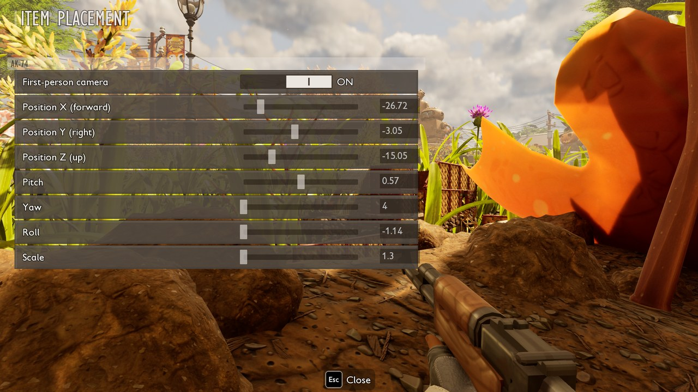



# Models

An item, a building or a creature with its own 3D model gets its own classes, made the way the game makes its item variants. The classes are children of the template's classes and change only the mesh, the material and the placement. The game then spawns them like its own, in the hand, on the ground, far away and back, and after a save. Tutorials: [Add a weapon with your own model](tutorial-model.md), [Make a building with a script](tutorial-building.md), [Add creatures](tutorial-creatures.md).

A model takes two parts:

1. An `item`, `building` or `creature` entry in `SourceArt/assets.json`. The cook tool builds the classes from it.
2. `model = "<entry name>"` on the item, building or creature in the manifest.

```json
{"type": "material", "folder": "Materials", "name": "MI_Gun",
 "parent": "/Game/_Augusta/Art/Items/Weapons/Gun_Paintball/Textures/MI_Weapon_Gun_Paintball_Equip.MI_Weapon_Gun_Paintball_Equip",
 "textures": {"Albedo": "/Game/Mods/MyMod/Textures/T_Gun_C.T_Gun_C"},
 "vectors": {"Emissive Color": [6, 1.5, 1, 1]}},
{"type": "item", "name": "Gun", "template": "SplinterCannon", "mesh": "Meshes/SM_Gun", "material": "Materials/MI_Gun",
 "equipped": {"attach": "SkeletalMesh", "hide": ["SkeletalMesh", "ArrowMesh"], "location": [-26.7, -3, -15], "scale": 1.3}}
```

```lua
items = {
    {name = "Gun", template = "SplinterCannon", model = "Gun"},
},
```

## Item entry

| Key | Meaning |
| --- | --- |
| `name` | Entry name. The classes are `Items/BP_<name>_Equipped` and `Items/BP_<name>_World`. |
| `template` | Row of the game item whose classes are the parents. Use the same template as the manifest item. |
| `row` | The item's row. Default `<mod id>_<name>`, the row the manifest item gets. A skin names the game row it changes, for example `SwordAntRed`. |
| `mesh` | Static mesh, `Meshes/SM_X` inside the mod or a full game path. |
| `skeletal` | Skeletal mesh instead of `mesh`. |
| `animation` | Animation that loops on the skeletal mesh. |
| `poseable` | `true`: scripts move the bones ([Scripting](scripting.md#buildings)). Not together with `animation`. |
| `material` | Material instance of the mod, for example `Materials/MI_Gun`. Without it the mesh shows its own materials. |
| `equipped` | Placement in the hand, or `false` to keep the template's held class, for example for a crafting material. |
| `world` | Placement on the ground, or `false` to keep the template's world class. |

Placement keys:

| Key | Meaning |
| --- | --- |
| `location` | Offset in cm: forward, right, up. |
| `rotation` | Pitch, yaw, roll in degrees. |
| `scale` | A number or `[x, y, z]`. |
| `attach` | Template component the model is attached to, for example `SkeletalMesh` of a ranged weapon. Without it a static mesh replaces the template's mesh. |
| `hide` | Template components to hide. A hidden static mesh is emptied, a hidden skeletal mesh keeps its sockets for aiming and firing. |

A skeletal or poseable model, or one with `attach`, is a component of its own named `Model`. The template's mesh is then emptied unless the model is attached.

## Building entry

The same keys as an item entry, without `equipped` and `world`. `location`, `rotation`, `scale` and `hide` are on the entry itself. The class is `Buildings/BP_<name>` and names its row in its defaults.

| Key | Meaning |
| --- | --- |
| `collision` | Skeletal models only. `true` (default) adds an invisible blocking box the size of the model. `false` lets players walk through, for example turning windmill blades. |

## Creature entry

The class is `Creatures/BP_<mod id>_<name>`, a child of the template creature's class. It names its row in its defaults.

| Key | Meaning |
| --- | --- |
| `name`, `template`, `row` | As for an item. `template` is a row of `Table_CharacterData`. |
| `skeletal` | The creature's skeletal mesh. |
| `materials` | `{"Slot": material}`. Slots named like a slot or a material of the template's model keep the template's material. |
| `animClass` | Animation Blueprint class for a model on its own skeleton. Not tested in the game yet. |
| `scale` | Size as a multiple of the template's, 0.1 to 10. |

A `habitat` entry places one of the game's encounters for a creature in the mod level `Habitats/L_Habitats`. Its keys are in [Add creatures](tutorial-creatures.md#4-its-habitat).

## Material

A `material` entry is an instance of a game material with the mod's textures, so no shaders are shipped.

| Key | Meaning |
| --- | --- |
| `parent` | Object path of a game material. The paintball gun material suits most props and hand-held items. |
| `textures` | `{"Parameter": texture path}`. The paintball material uses `Albedo`, `Normal`, `RMA` (roughness, metallic, ambient occlusion), `Emissive Texture`, `FresnelMask` and `SSSMask`. |
| `vectors` | `{"Parameter": [r, g, b, a]}`. `Emissive Color` above 1 makes the glow brighter. |
| `scalars` | `{"Parameter": number}`. |

Parameter names come from the material. Open it in FModel to see them ([Explore the game files](tutorial-game-files.md)).

## Skins

A skin gives a game item or building the classes of a model without a new row. The entry names the game row with `row`:

```json
{"type": "item", "name": "PirateSaber", "row": "SwordAntRed", "template": "SwordAntRed",
 "mesh": "/Game/_Augusta/Art/Items/Weapons/Sword_Toenail_Scimitar_Pirate/SM_Sword_Toenail_Scimitar_Pirate"}
```

```lua
skins = {
    {item = "SwordAntRed", model = "PirateSaber"},
},
```

A skin can follow a choice setting of the mod: `{item = "SwordAntRed", choice = "look", models = {Pirate = "PirateSaber"}}`. A value without a model keeps the game's classes. A changed setting applies to items made from then on.

## Far away and saved

Far from the player the game keeps an item or a creature as a short record and restores it from it. The cook tool writes that record for each item and creature class, under `/Game/LiteData/Mods/<mod id>/`, where the game looks for it. The framework adds the records to the game's list when the game starts. Without a record the game does not spawn the class at all.

## Item Placement



Item Placement is a tool for mod authors. Turn on **Developer mode** in the mod manager's **Settings** and the Mods Menu mod, which adds the button. Hold the mod item in the game, open the pause menu and choose **Item Placement**. The button appears only while you hold an item with its own classes.

| Row | Changes |
| --- | --- |
| First-person camera | Switches the camera to check the item in both views. Both views use the same values. |
| Position X, Y, Z | Forward, right and up, in cm |
| Pitch, Yaw, Roll | Rotation in degrees |
| Scale | Size of the model |

Drag a slider or type an exact number next to it, and the held model moves right away. Closing the screen writes the values to `%LOCALAPPDATA%\G2Launcher\Tuning\<name>.json.txt`. Copy `location`, `rotation` and `scale` into the `"equipped"` key of the item entry and cook the mod again.

## Static meshes and PadSM2

The game's engine expects an extra value in each static mesh section that the stock Unreal 5.7 cook does not write. Such meshes crash the game. **Cook & Pack** in the [editor plugin](editor-plugin.md) and `Tools/cook_assets.py` cook static meshes unversioned and patch them with [PadSM2](https://github.com/hypermodule/PadSM2) automatically. Skeletal meshes, animations, textures and sounds need no patch.

## Text on models

Scripts can put text on a model with `building.label`, in the game's fonts. See [Scripting](scripting.md#text-on-a-model).

