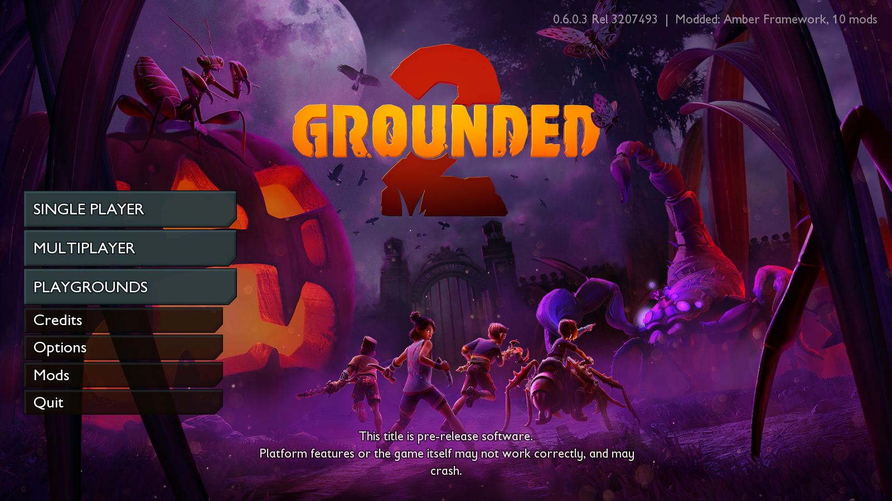
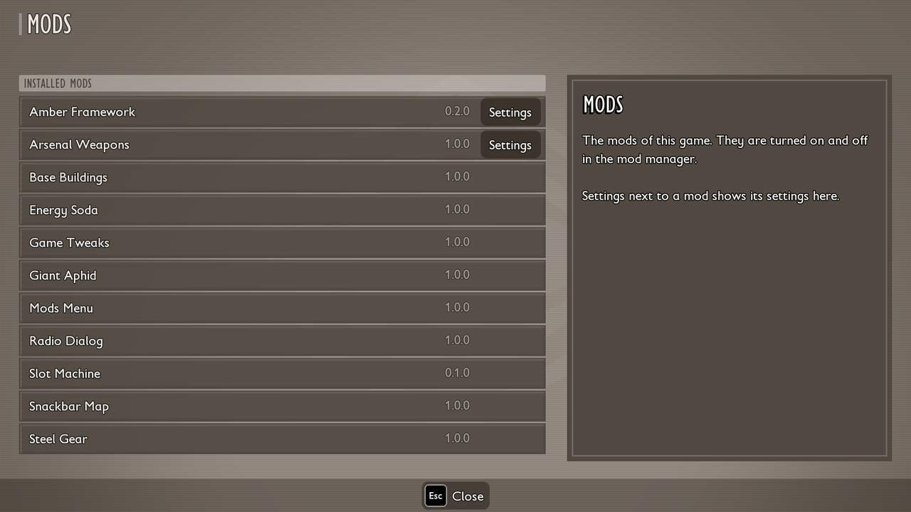



# Mods screen in the game

**Mods** in the main menu and the pause menu opens the Mods screen. It comes from the Mods Menu mod (`AmberModMenu`), which installs like any other mod.

- The list shows the mods that are on, each with its version. Mods are turned on and off in the [mod manager](play-manager.md).
- Mods with settings have a **Settings** button. Click it to show the settings on the right, and click it again to close them.
- Next to a slider you can type an exact number.
- **Reset** next to a setting restores its default. **Reset all to defaults** at the bottom restores all of them.
- A change applies at once when it only changes values. A change that needs a restart is named when you close the screen.

The load order is changed in the mod manager too.


