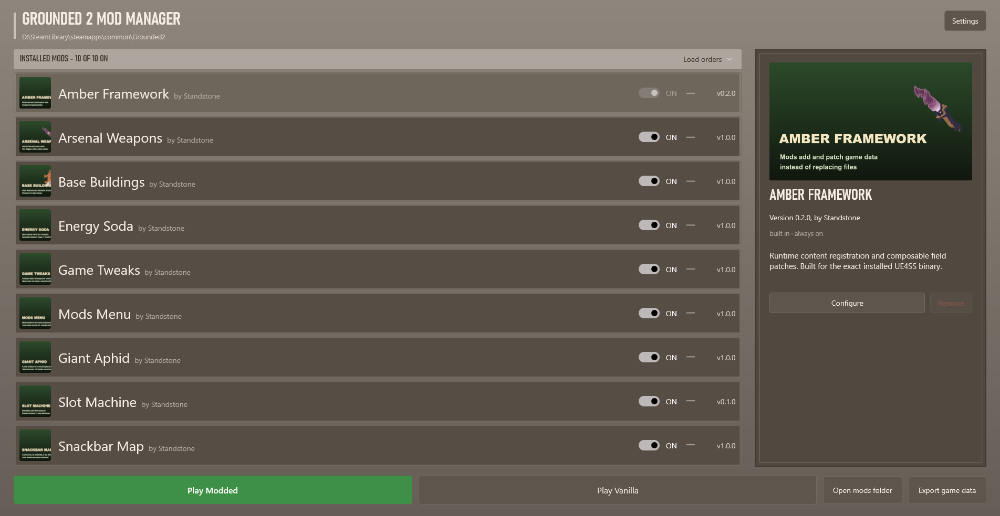
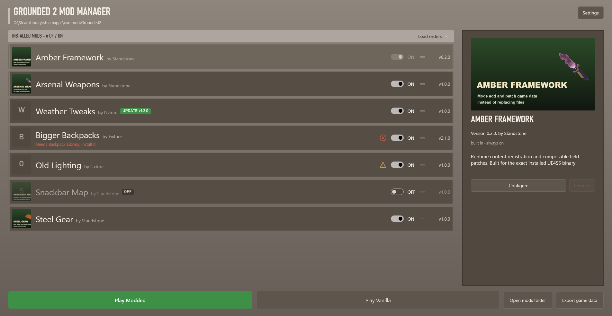



# Mod manager

Mods are installed and launched with **Grounded 2 Mod Manager** (`Grounded2ModManager.exe`).

## Installing mods

Drag a mod folder or archive (.zip, .rar, .7z) onto the mod manager window. An archive can hold several mods, and each one is installed. Installing a mod you already have updates it and keeps your settings.

Click a mod to see its picture, description, author, links and settings on the right. Right-click a mod to move or remove it.

## Mod status

| Mark | Meaning |
| --- | --- |
| **UPDATE v1.2.0** | A newer version is available. The link is in the mod's details. |
| **OFF** | The mod is turned off. |
| Yellow sign | Made for a different game version and may not work. Hover over the sign for details. |
| Red sign | A required mod is missing, for example "Requires: Backpack Library". If the mod gives a download link, it is in the details. |

Updates are checked for mods that link to Nexus Mods or GitHub, at most once every few hours. To turn this off, open **Settings** and switch off **Check for mod updates**.

## Playing

- **Play Modded** starts the game with the mods that are on.
- **Play Vanilla** starts the game without mods.

Mods are added when the game starts and removed when it closes, so the game files stay as they were. If the PC or the mod manager crashed during a game, everything is cleaned up the next time the mod manager starts.

With mods active, the version line in the game's main menu ends with "Modded: Amber Framework, N mods".

## Load order

Mods load from top to bottom. Drag a mod by its handle to move it.

If two mods change the same value, for example the damage of one sword, the mod lower in the list wins. Both mods stay on, and everything else they change still applies.

**Load orders** above the list saves the current order and on/off state under a name, so you can switch between setups. Saved orders are files in `%LOCALAPPDATA%\G2Launcher\Orders` and can be shared. If a saved order lists mods you don't have, you are told which ones.

## Mod settings

**Configure** opens a mod's settings. Each setting shows its default and has a **Reset** button. **Reset all** restores every default, and **Save** keeps your changes. The same settings are also in the game.

## Game data export

**Export game data** saves every data table of your game as JSON. The game runs hidden for about a minute. Mod authors use the files to look up names. See [Game data](game-data.md).


