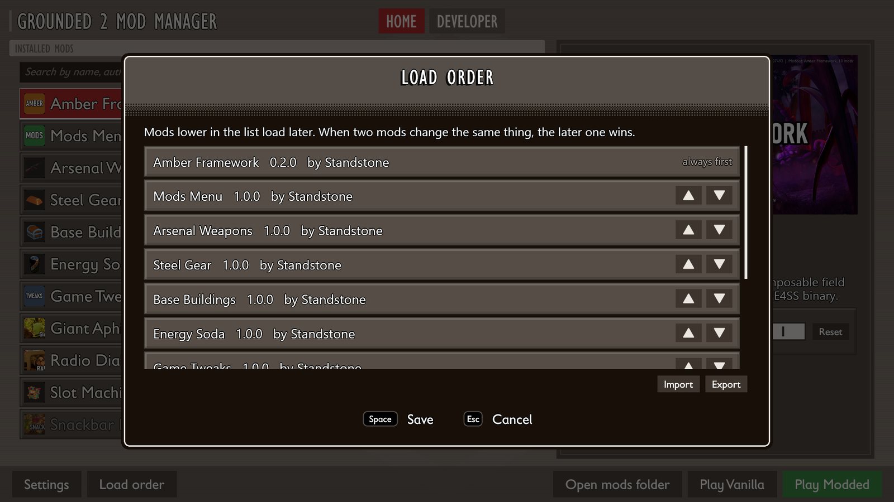



# Mod manager

Mods are installed and launched with **Grounded 2 Mod Manager** (`Grounded2ModManager.exe`).

## Installing mods

Drag a mod folder or archive (.zip, .rar, .7z) onto the mod manager window. An archive can hold several mods, and each one is installed. Installing a mod you already have updates it and keeps your settings.

Click a mod to see its picture, description, author, links and settings on the right. **Remove mod** next to its name deletes it.

The field above the list searches mod names, authors, descriptions and tags. Next to it you can show the mods of one author and sort the list by load order, name, author or install date. Sorting only changes what you see. The load order stays as it is.

## Mod status

| Mark | Meaning |
| --- | --- |
| Green arrows | A newer version is on the mod's page. Click the icon to open the page. |
| Red sign | A required mod is missing, for example Backpack Library. Click the icon to copy the message. If the mod gives a download link, a button for it is in the details. |
| Yellow sign | Made for a different game version and may not work. Click the icon to copy the message. |
| OFF | The mod is turned off. |

Hover over an icon to read what it means. Updates are checked for mods that link to Nexus Mods or GitHub, at most once every few hours. To turn this off, open **Settings** and switch off **Check for mod updates**.

## Playing

- **Play Modded** starts the game with the mods that are on.
- **Play Vanilla** starts the game without mods.

If a mod has a problem, **Play Modded** first lists all problems in one window. **Play anyway** starts the game without the mods whose required mod is missing.

Mods are added when the game starts and removed when it closes. Only UE4SS and Amber Framework stay in the game folder, from the [first setup](play-setup.md). If the PC or the mod manager crashed during a game, everything is cleaned up the next time the mod manager starts.

With mods active, the version line in the game's main menu ends with "Modded: Amber Framework, N mods".

## Load order

**Load order** at the bottom opens the list of all mods in the order they load. Drag a mod or use its arrows to move it, then press **Save**. Amber Framework always loads first.

If two mods change the same value, for example the damage of one sword, the mod lower in the list wins. Both mods stay on, and everything else they change still applies.

**Export** saves the order and which mods are on to a file, which you can share. **Import** reads such a file. If it lists mods you don't have, you are told which ones.

## Mod settings

A mod's settings are under its description on the right, grouped the way its author chose. A change is saved at once. **Reset** puts one setting back to its default, shown when you hover over the button. The same settings are also in the game's [Mods screen](play-in-game.md).

## Settings

**Settings** at the bottom left holds the game folder, the mods folder, the update check and **Developer mode**. **Select...** next to a folder opens a folder picker.

Developer mode is for making mods. It adds the **Developer** tab and Item Placement in the game's pause menu. Playing with mods does not need it.

## Developer tab

The Developer tab runs the framework's tools for mod authors:

- **New mod** makes a mod folder in `ModSource` from a template.
- **Unreal project** sets up the project models and Blueprints are cooked in.
- **Build** cooks and packs a mod and installs it in the mod list. **Pack and play** also starts the game.
- **Game files** unpacks game files by part of their name, or all of them.
- **Game data** exports every data table of the game, see [Game data](game-data.md).

The tools write what they do in **Output** on the right. **Stop** ends the one that is running.


