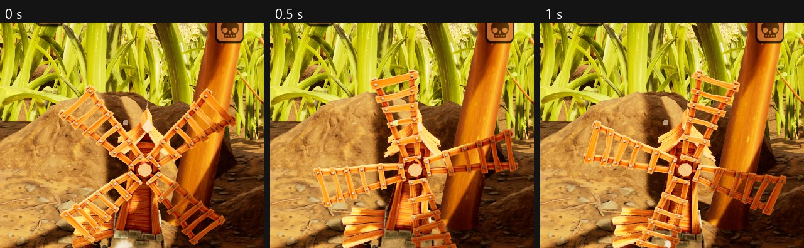



# Add an animated model

<p class="download-stub">Download the finished tutorial project: Windmill.zip</p>

A model can move on its own: blades that turn, a flag that waves, a part that bobs. The example is the Windmill of `ModSource/BaseBuildings`, a decoration whose blades turn all the time. The steps below build it as a separate mod, Windmill. The example's files are in `ModSource/BaseBuildings/SourceArt`.

The finished mod is in `ModSource/Tutorials/Windmill`.



Unreal Engine and Blender are needed ([Authoring setup](authoring.md)).

## 1. The model

The animation is made from a model whose moving parts are separate objects. The example script `Tools/ExampleArt/rig_animated_model.py` gives each moving part a bone, makes a looping animation and writes an FBX and an icon. It is described in `SourceArt/rig.json`:

```json
{
  "name": "SK_Windmill",
  "source": "ModSource/Windmill/SourceArt/Windmill/windmill-stylized.gltf",
  "fbx": "Build/Windmill/SK_Windmill.fbx",
  "icon": "Build/Windmill/T_WindmillIcon.png",
  "drop": ["Cube.051", "Cube.045"],
  "up": "y",
  "heightCm": 220,
  "material": "Material",
  "albedoHint": "Base_Color",
  "animation": "A_Windmill_Spin",
  "frames": 90,
  "fps": 30,
  "iconDirection": [1.0, -0.45, 0.2],
  "parts": {
    "Blades": {"objects": ["Circle.013"], "spin": 1, "axis": "x"}
  }
}
```

| Key | Meaning |
| --- | --- |
| `name` | Name of the skeletal mesh in the game. |
| `source` | The model, glTF. |
| `fbx`, `icon` | Where the tool writes the FBX for the import and the icon picture. |
| `drop` | Objects of the model to delete before export, such as helper objects a download brings along. |
| `up`, `heightCm` | For a building or decoration: the model's up axis and its height in the game. A held item uses `grip`, `tip` and `lengthCm` instead. |
| `material`, `albedoHint` | The model's material and the name part of its color texture, for the icon. |
| `animation`, `frames`, `fps` | Name and length of the loop: 90 frames at 30 per second is 3 seconds. |
| `iconDirection` | Direction the icon camera looks from, `[x, y, z]`. |
| `parts` | Moving parts: the objects of each part, and `spin` (whole turns per loop, around `axis`) or `sway` (`[x, y, z]` in cm, back and forth). |

Object names come from the model. Blender shows them in its outliner.

## 2. Assets

`SourceArt/assets.json` runs the rig first and imports the result with its animation:

```json
{
  "destination": "/Game/Mods/Windmill",
  "blender": [{"script": "Tools/ExampleArt/rig_animated_model.py", "spec": "SourceArt/rig.json"}],
  "assets": [
    {"type": "skeletalmesh", "source": "Build/Windmill/SK_Windmill.fbx", "folder": "Meshes", "name": "SK_Windmill",
     "fallbackMaterial": "/Engine/BasicShapes/BasicShapeMaterial.BasicShapeMaterial", "animation": "A_Windmill_Spin"},
    {"type": "generated", "folder": "Meshes", "name": "SK_Windmill_Skeleton"},
    {"type": "generated", "folder": "Meshes", "name": "A_Windmill_Spin"},
    {"type": "blueprint", "parent": "/Script/Maine.Building", "folder": "Blueprints", "name": "BP_Windmill"}
  ]
}
```

The textures, icon and text entries are the same as in [Add a decoration](tutorial-decor.md).

## 3. The manifest

The building gets `skeletal` and `animation` instead of `mesh`:

```lua
model = {
    skeletal = asset("Meshes/SK_Windmill"),
    animation = asset("Meshes/A_Windmill_Spin"),
    material = { ... },
    building = {component = "RootComponent", hide = {}, collision = false},
},
```

The animation loops for as long as the building stands. `collision = false` leaves out the collision box the framework would make from the model's size. The decoration then only uses the template's collision.

The same `skeletal` and `animation` keys work for held items: put them in the item's `model`.

## Check

[Build and install](build.md) the mod, buy the Windmill at the Ranger terminal and build it. The blades turn.

