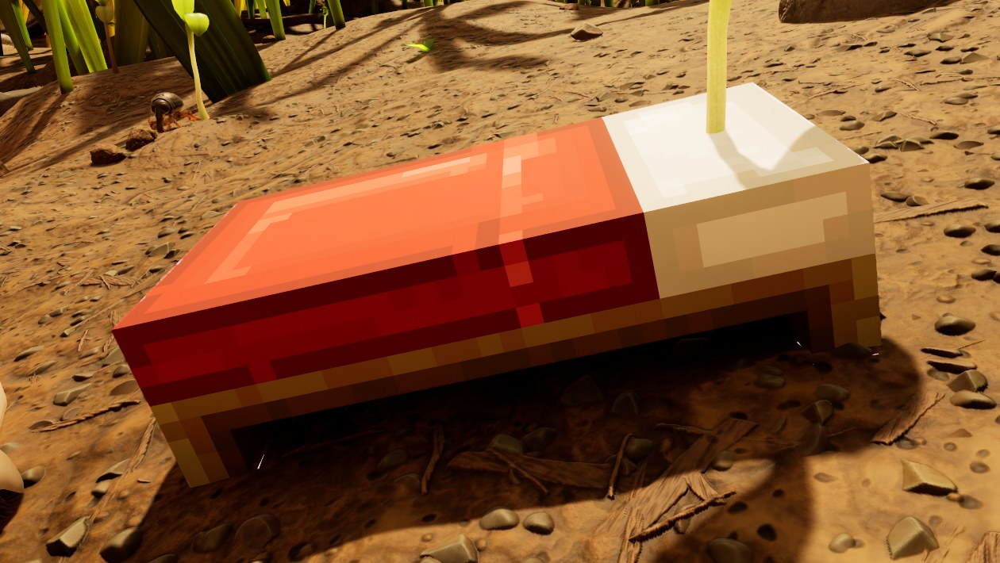



# Add a bed

<p class="download-stub">Download the finished tutorial project: MinecraftBed.zip</p>

This page makes Minecraft Bed, a mod with a new bed to build and the same look for the game's Simple Bed. The player sleeps in both like in any bed of the game.

The finished mod is in `ModSource/Tutorials/MinecraftBed`.



Read [Add a storage chest](tutorial-storage.md) first. This page makes a building class the same way.

## 1. The model

The model is a `.glb` file. `SourceArt/MinecraftBed_model.json` prepares it in Blender. `kind` is `building` and `widthCm` is the length of the bed:

```json
{
  "name": "SM_MinecraftBed",
  "kind": "building",
  "source": "ModSource/Tutorials/MinecraftBed/SourceArt/SM_Bed_A.glb",
  "frontAxis": "+X",
  "widthCm": 310,
  "albedo": "ModSource/Tutorials/MinecraftBed/SourceArt/Textures/T_MinecraftBed_C.png",
  "iconSize": 128, "iconRoll": 0, "iconDirection": [1.0, -0.8, 0.7],
  "fbx": "Build/Tutorials/MinecraftBed/SM_MinecraftBed.fbx",
  "icon": "Build/Tutorials/MinecraftBed/T_RenderedIcon.png"
}
```

The model takes its colors from one strip of the texture, a palette. Its entry uses `"kind": "pixel"`, which leaves out the mips, so the colors of the strip do not blend at a distance:

```json
{"type": "texture", "kind": "pixel", "source": "ModSource/Tutorials/MinecraftBed/SourceArt/Textures/T_MinecraftBed_C.png", "folder": "Textures", "name": "T_MinecraftBed_C"}
```

## 2. The bed's class

The bed needs its own class. Its `template` is the game's Simple Bed, so the copy keeps sleeping. The second entry is the look for the Simple Bed itself, and `row` names the game row it goes on:

```json
{"type": "building", "name": "Bed", "template": "BedSimple", "mesh": "Meshes/SM_MinecraftBed", "material": "Materials/MI_MinecraftBed"},
{"type": "building", "name": "SimpleBedLook", "row": "BedSimple", "template": "BedSimple", "mesh": "Meshes/SM_MinecraftBed", "material": "Materials/MI_MinecraftBed"}
```

## 3. The manifest

```lua
buildings = {
    {
        name = "Bed",
        template = "BedSimple",
        displayName = "bed.name",
        description = "bed.description",
        fields = {
            ["IconSoft"] = asset("Icons/T_MinecraftBedIcon"),
        },
        model = "Bed",
    },
},
rows = {
    {table = "BuildingRecipeTable", template = "BedSimple", name = "Bed", fields = {
        ["Building"] = {handle = {table = "BuildingsTable", row = "MinecraftBed_Bed"}},
        ["Requirements"] = {ingredients = {{item = "GrassPlank", count = 6}, {item = "FiberRaw", count = 8}, {item = "Sap", count = 2}}},
    }},
},
shop = {
    {name = "Bedding", cost = 150, title = "bedding.title", description = "bedding.description", buildings = {"Bed"}},
},
```

## 4. The look of the Simple Bed

A setting chooses the look. `Game` has no model and keeps the game's bed:

```lua
skins = {
    {building = "BedSimple", choice = "simpleBed", models = {Minecraft = "SimpleBedLook"}},
},
```

`settings.schema.json` declares the choice:

```json
{"key": "simpleBed", "label": "Simple Bed look", "type": "choice", "choices": ["Game", "Minecraft"], "default": "Minecraft"}
```

Tutorial on such settings: [A choice of looks in the settings](tutorial-presets.md).

## Check

[Build and install](build.md) the mod and load a save. Buy Blocky Bedding at the Ranger terminal, build the Minecraft Bed and sleep in it. Build a Simple Bed, which has the same look under its own name.

