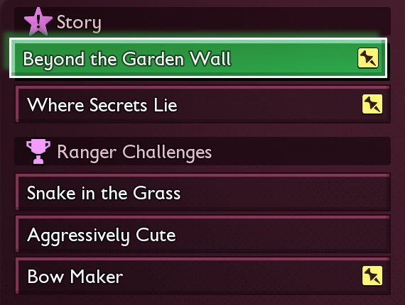



# Add a Ranger challenge

<p class="download-stub">Download the finished tutorial project: ExtraChallenges.zip</p>

A mod can add challenges to the game's Ranger Challenges list. This page makes Extra Challenges, a mod with three of them: craft two bows, build a bed and kill three gnats. Each one is a class of the mod on the game's own challenge template, so the game starts it, saves its progress and pays its Raw Science like its own.

The finished mod is in `ModSource/Tutorials/ExtraChallenges`.



Unreal Engine is needed to cook the classes. See [Build and install](build.md).

## 1. The challenges

`SourceArt/assets.json`:

```json
{
  "destination": "/Game/Mods/ExtraChallenges",
  "assets": [
    {"type": "challenge", "name": "Bows", "title": "bounty.bows.title", "craft": ["Bow"], "count": 2, "reward": 150},
    {"type": "challenge", "name": "Bed", "title": "bounty.bed.title", "build": ["BedSimple"], "reward": 200},
    {"type": "challenge", "name": "Gnats", "title": "bounty.gnats.title", "kill": "Stats.Creatures.Gnat.Normal", "creature": "bounty.gnats.creature", "count": 3, "reward": 100}
  ]
}
```

| Key | Meaning |
| --- | --- |
| `name` | Name of the challenge in this mod. Keep it once the mod is out, since the save keeps the challenge under it. |
| `title` | Key of the mod's text files: the challenge's name. |
| `craft` | Full rows in `AllItemsTable`. Crafting any of them counts. |
| `build` | Full rows in `BuildingsTable`. Building any of them finishes the challenge. |
| `kill` | The gameplay tag of a creature. The [manifest reference](manifest.md#bounties) lists the tags of the game's challenges. |
| `creature` | With `kill`: key of the mod's text files, the creature's name in the objective. |
| `count` | How many to craft or kill. The default is 1. |
| `reward` | Raw Science. The default is 100. |

## 2. The manifest

```lua
bounties = {
    {challenge = "Bows", after = 0},
    {challenge = "Bed", after = 1},
    {challenge = "Gnats", after = 2},
},
```

`after` is the challenge's place in the game's order: how many of the list's challenges come before it.

## 3. The text

`text/enus.json`:

```json
{
  "bounty.bows.title": "Bow Maker",
  "bounty.bed.title": "A Good Night",
  "bounty.gnats.title": "Gnat Hunter",
  "bounty.gnats.creature": "Gnat"
}
```

The objective line comes from the game: Craft: Sprig Bow (0/2).

## In the game

The game keeps three challenges active. A mod's challenge waits for a free slot and takes it in its place in the order. A challenge counts toward the game's completed challenges like any other. A `build` challenge of a building the player already has is done at once.

Without the mod its challenges are gone from the list, and the save still loads.

## Check

[Build and install](build.md) the mod and load a save where the Ranger Challenges are open. Finish an active challenge: Bow Maker takes its slot. Craft two Sprig Bows and the reward comes in.

