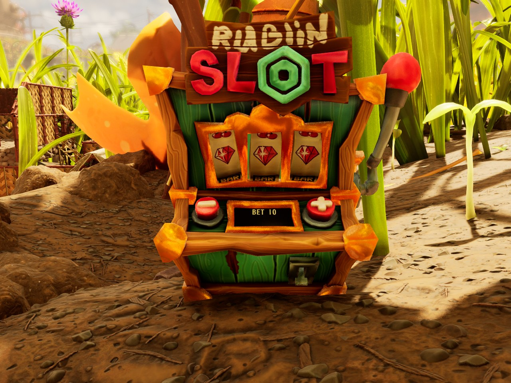



# Make a building with a script

<p class="download-stub">Download the finished tutorial project: SlotMachine.zip</p>

This tutorial walks through the Slot Machine example, `ModSource/SlotMachine`. It is a building with its own rigged model. A script moves its lever and reels, shows text on its screen and pays out prizes. Open the example files next to this page.



Read [Add an item with a recipe](tutorial-item.md) and [Add a weapon with your own model](tutorial-model.md) first.

## 1. The model

The slot machine is a skeletal mesh with bones for the parts that move: `b_lever`, `b_slot_01` to `b_slot_03`, `b_button_plus`, `b_button_minus` and `b_body`.

```json
{"type": "skeletalmesh", "source": "ModSource/SlotMachine/SourceArt/SlotMachine/SK_SlotMachine.fbx",
 "folder": "Meshes", "name": "SK_SlotMachine"},
{"type": "generated", "folder": "Meshes", "name": "SK_SlotMachine_Skeleton"}
```

The `generated` entry tells the cook tool that the import creates the skeleton asset, so it is packed as well.

Give each moving part its own bone and weight it fully to that bone. A script turns and moves bones, but it cannot move single vertices.

## 2. The building class

The game tells buildings apart by their class. Two buildings with the same class are the same building to the game, in saves and in the build menu. A new building therefore needs its own class. A `building` entry in `SourceArt/assets.json` makes it, together with a material for the model:

```json
{"type": "material", "folder": "Materials", "name": "MI_SlotMachine",
 "parent": "/Game/_Augusta/Art/Items/Weapons/Gun_Paintball/Textures/MI_Weapon_Gun_Paintball_Equip.MI_Weapon_Gun_Paintball_Equip",
 "textures": {"Albedo": "/Game/Mods/SlotMachine/Textures/T_SlotMachine_C.T_SlotMachine_C"}},
{"type": "building", "name": "SlotMachine", "template": "StatueAphid", "skeletal": "Meshes/SK_SlotMachine", "poseable": true,
 "material": "Materials/MI_SlotMachine"}
```

- The class `BP_SlotMachine` is a child of the aphid statue's class, a plain decoration, so it places and saves like the statue.
- `poseable` makes the model a component whose bones a script moves.
- The model gets an invisible blocking box from its bounds, so the player cannot walk through it.

## 3. The manifest

`content/slot_machine.lua`, shortened:

```lua
return {
    id = "SlotMachine",
    buildings = {
        {
            name = "SlotMachine",
            template = "StatueAphid",
            displayName = "slotMachine.name",
            description = "slotMachine.description",
            fields = {CozinessContribution = 2},
            model = "SlotMachine",
        },
    },
    rows = {
        {table = "BuildingRecipeTable", template = "LampGnat", name = "SlotMachine", fields = {
            Building = {handle = {table = "BuildingsTable", row = "SlotMachine_SlotMachine"}},
            Requirements = {ingredients = {{item = "Clay", count = 4}, {item = "Sap", count = 3}, {item = "QuartzShard", count = 1}}},
            CategoryTag = {unreal = '(TagName="Recipe.Building.Decoration.Decor.Furniture")'},
        }},
    },
}
```

- The building row copies the aphid statue's row. `model = "SlotMachine"` points it at the class of step 2.
- The recipe row in `BuildingRecipeTable` puts the building in the build menu. `CategoryTag` picks the tab.
- The full example also sells the building at the Ranger terminal with a `shop` entry. See [Sell recipes at the Ranger terminal](tutorial-shop.md#a-building-at-the-terminal).

## 4. The script

Scripts are files in `content/scripts/`. A script returns a function that gets the `api` table. A shortened version of `content/scripts/slot_machine.lua`:

```lua
return function(api, settings)
    local machines = {}

    api.onBuilding("SlotMachine_SlotMachine", function(building)
        machines[building.key()] = {building = building, bet = 10}
        building.label("screen", "BET 10", {
            bone = "b_body",
            offset = {X = -0.02, Y = 0.19, Z = 0.53},
            rotation = {Pitch = 28, Yaw = -90, Roll = 180},
            size = 9,
            color = {1, 0.85, 0.3},
        })
    end)

    api.onKey("E", function()
        for _, machine in pairs(machines) do
            if machine.building.valid() and api.aimedBone(machine.building, {"b_lever"}, 400, 45) then
                if api.science.remove(machine.bet) then
                    machine.building.turn("b_lever", "x", 60)
                    api.after(300, function() machine.building.turn("b_lever", "x", 0) end)
                end
            end
        end
    end)
end
```

- `onBuilding` runs for each slot machine that appears, also for machines loaded from a save.
- `label` puts text on the model in the game's font. `offset` and `rotation` are in the bone's space. Change them until the text sits on the screen. The angle is yours to choose.
- `aimedBone` returns the bone the player looks at within 400 cm, at most 45 cm off the line of sight.
- `turn` rotates a bone around one of its axes, in degrees.

The full script animates the reels in steps of 60 degrees, picks three symbols with `api.random`, and pays Raw Science with `api.science.add` or throws an item with `api.drop`. All functions are listed in [Scripting](scripting.md).

The machine also has sounds. `api.playSoundAt` plays a sound asset at a place, so it comes from the machine and fades with distance. Each sound is a `sound` entry in `SourceArt/assets.json`.

## 5. Keep buildings when the mod is removed

Add `"preserve": true` to `mod.json`. Each save then records where the mod's buildings stand and what they hold, including buildings of a [skin](models.md#skins). The game drops them while the mod is removed, and when it is installed again they come back with their items. Without it, placed buildings of a removed mod are lost on the next save. Each mod keeps up to 64 buildings and 512 item stacks. Items come back with their count, slot, durability and upgrade level. A bonus enhancement and a spoil timer start over, and items of a mod that is gone cannot come back. See [Removing mods](play-removing.md).

## Check

[Build and install](build.md) the mod. In the game, open the build menu and find the slot machine under furniture. The menu shows your model. Place it, look at the lever and press E.

If the building does not appear in the menu, see [Troubleshooting](trouble-buildings.md#a-building-is-missing-from-the-build-menu).

Next: [Add a storage chest](tutorial-storage.md).

