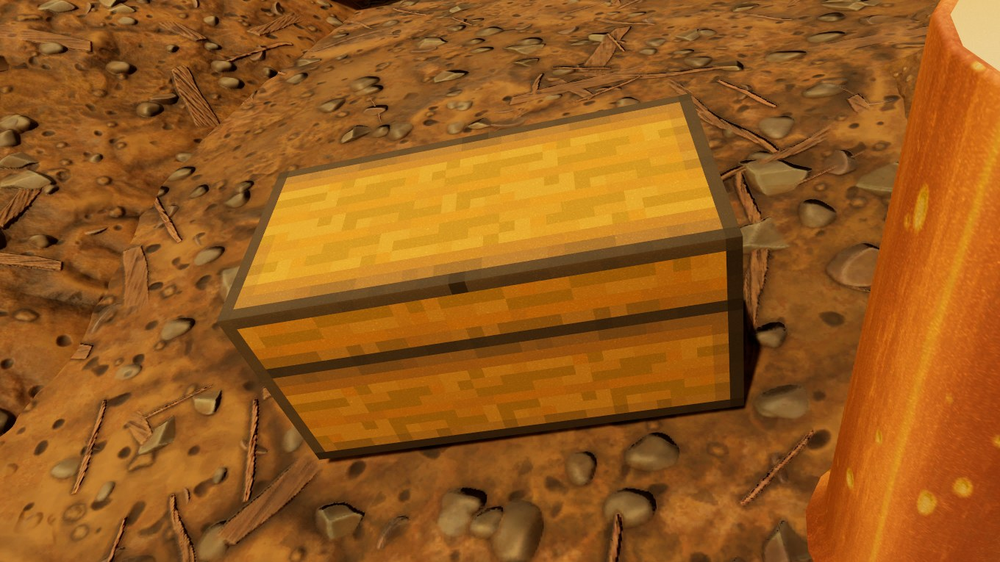
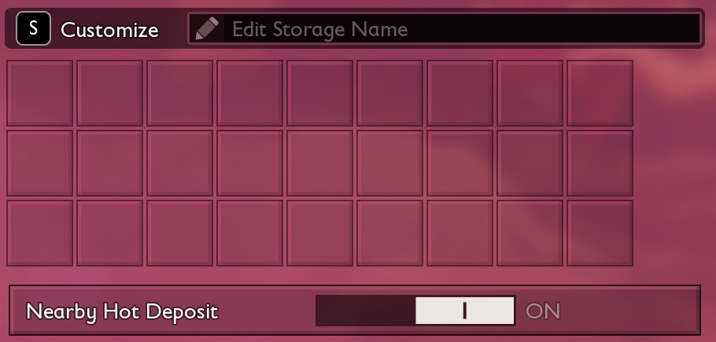



# Replace a game chest

<p class="download-stub">Download the finished tutorial project: MinecraftChest.zip</p>

This page makes Minecraft Chest, a mod that changes the game's Storage Chest: a new model and icon, 27 slots in rows of 9, and a sound when it opens and closes. The chest keeps its name, recipe and place in the build menu.

The finished mod is in `ModSource/Tutorials/MinecraftChest`.





Read [Add a storage chest](tutorial-storage.md) first. It explains the model step used here.

## 1. The model and material

The model's entry names the game's row with `row`, which makes it a [skin](models.md#skins):

```json
{"type": "building", "name": "ChestLook", "row": "StorageBig", "template": "StorageBig", "mesh": "Meshes/SM_MinecraftChest", "material": "Materials/MI_MinecraftChest"}
```

`StorageBig` is the row of the Storage Chest. The other chests are `Storage` (Storage Basket) and `StorageTier3` (Large Storage Chest).

The material uses the game chest's material as its parent, with that material's parameter names:

```json
{"type": "material", "folder": "Materials", "name": "MI_MinecraftChest",
 "parent": "/Game/Art/Items/Buildings/Storage_Medium/Textures/V01/MI_Storage_Medium_A_V01.MI_Storage_Medium_A_V01",
 "textures": {"Diffuse": "/Game/Mods/MinecraftChest/Textures/T_MinecraftChest_C.T_MinecraftChest_C",
              "Normal": "/Game/Mods/MinecraftChest/Textures/T_MinecraftChest_N.T_MinecraftChest_N",
              "RMA": "/Game/Mods/MinecraftChest/Textures/T_MinecraftChest_RMA.T_MinecraftChest_RMA"}}
```

The game's sunlight is strong, so a texture made for another game can look pale. This one is the original at 70% brightness.

## 2. The manifest

```lua
skins = {
    {building = "StorageBig", model = "ChestLook"},
},
storage = {
    {building = "StorageBig", slots = 27},
},
patches = {
    {table = "BuildingsTable", row = "StorageBig", set = {IconSoft = asset("Icons/T_MinecraftChestIcon")}},
},
```

The sounds are listed as assets, so a missing file shows up when the mod loads:

```lua
assets = {
    {path = asset("Icons/T_MinecraftChestIcon"), expectedClass = "/Script/Engine.Texture2D"},
    {path = asset("Audio/SFX_ChestOpen"), expectedClass = "/Script/Engine.SoundWave"},
    {path = asset("Audio/SFX_ChestClose"), expectedClass = "/Script/Engine.SoundWave"},
},
```

## 3. The sounds

Each sound is a `.wav` file with an entry in `SourceArt/assets.json`:

```json
{"type": "sound", "source": "ModSource/Tutorials/MinecraftChest/SourceArt/Sounds/SFX_ChestOpen.wav", "folder": "Audio", "name": "SFX_ChestOpen", "falloffDistance": 5000, "volume": 0.9}
```

A script plays them with the window, in `content/scripts/chest_sounds.lua`. `columns` sets the rows of 9:

```lua
local audio = "/Game/Mods/MinecraftChest/Audio/"

return function(api)
    api.onWindow{
        building = "StorageBig",
        columns = 9,
        onOpen = function() api.playSound(audio .. "SFX_ChestOpen.SFX_ChestOpen") end,
        onClose = function() api.playSound(audio .. "SFX_ChestClose.SFX_ChestClose") end,
    }
end
```

## Chests in a save

A skin and a size apply to chests built from then on. Chests already in a world keep the game's model, their 40 slots and their items. They do get the sounds and the rows of 9, since those go by the row.

Chests built with the mod use its class, so `mod.json` has `"preserve": true`. While the mod is removed they are gone from the world, and when it is installed again they come back with their items. [What is kept](tutorial-building.md#5-keep-buildings-when-the-mod-is-removed).

## Check

[Build and install](build.md) the mod and load a save. Build a Storage Chest, open it and close it. The window shows 27 slots and each action plays its sound.

