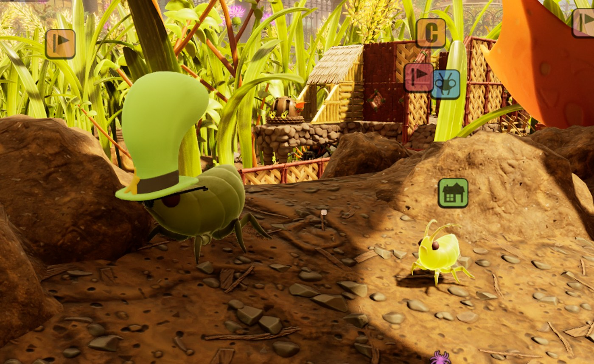
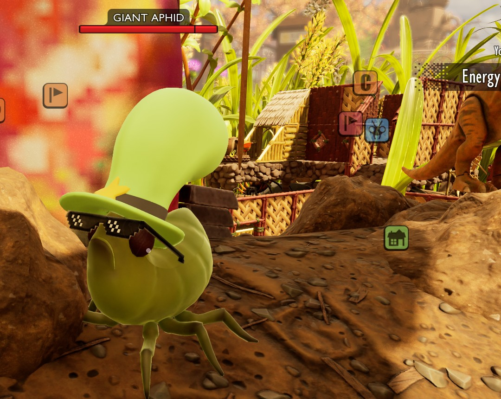



# Add creatures

<p class="download-stub">Download the finished tutorial project: GiantAphid.zip</p>

A mod can add a creature with its own name, health, size and model, and give it a habitat where it lives. The example `ModSource/GiantAphid` adds the Giant Aphid. It is twice the size of an aphid, has 120 health and wears a hat and glasses. Three of them live east of the Snackbar.

The creature gets a class of its own when the mod is built, a child of the class of the game creature it is based on. Its habitat is one of the game's encounters, the same thing that keeps the game's own creatures in their places. The game handles both like its own content. It saves the creatures, keeps a killed one dead and brings new ones after the respawn time.





The name comes from the mod's language files ([Add text and translations](tutorial-localization.md)).

## 1. The creature

```lua
return {
    id = "GiantAphid",
    creatures = {
        {
            name = "Aphid",
            template = "Aphid",
            model = "Aphid",
            displayName = "aphid.name",
            health = 120,
            wanderRange = 1200,
            loot = {
                {item = "AphidMeat", set = {count = 3}},
            },
        },
    },
    levels = {"/Game/Mods/GiantAphid/Habitats/L_Habitats"},
}
```

| Key | Meaning |
| --- | --- |
| `name` | The creature's row name. The framework adds the namespace (`GiantAphid_Aphid`). |
| `template` | The game creature it is based on, a row of `Table_CharacterData`, for example `Aphid`, `Weevil` or `Spider_Wolf`. Its behaviour and attacks are used. |
| `model` | The `creature` entry of `SourceArt/assets.json` that makes its class, see the next section. |
| `class` | Instead of `model`, a Blueprint class of the mod's own, a child of a game creature's class. |
| `displayName` | The name, a key of the mod's language files. |
| `health` | Health. |
| `wanderRange`, `loot` | How far it roams and what it drops, see section 5. |

`levels` loads the level with the creature's habitat, see section 4.

## 2. Its class

The `creature` entry of `SourceArt/assets.json` makes the class `Creatures/BP_GiantAphid_Aphid` and its AI class `Creatures/BP_GiantAphid_AphidAI`. The mod's id in the name keeps them apart from the game's `BP_Aphid` and from other mods' classes.

```json
{"type": "creature", "name": "Aphid", "template": "Aphid", "skeletal": "Meshes/SK_GiantAphid", "scale": 2,
 "materials": {"M_MagicHat": "Materials/MI_GiantAphid_Hat", "M_CoolGlasses": "Materials/MI_GiantAphid_Glasses"}}
```

| Key | Meaning |
| --- | --- |
| `name` | The class name, and the name `model` and habitats use. |
| `template` | The game creature whose class it derives from. |
| `skeletal` | The creature's model, a `skeletalmesh` entry of the mod. |
| `materials` | Materials by slot name, `material` entries of the mod or game materials. A slot named like a slot or a material of the template's model keeps the template's material. |
| `animClass` | An animation Blueprint for a model on its own skeleton, see below. |
| `scale` | Size as a multiple of the template's, 0.1 to 10. The model, the collision capsule and the creature's far record grow with it. |

## 3. Its own model

The Giant Aphid's model is the game's aphid mesh edited in Blender, with a hat and glasses added. It stays on the aphid's skeleton, so the game's animations, hit areas and behaviour work on it.

1. Export the template's mesh with its textures. The mesh path is in the template's Blueprint. For the aphid it is `/Game/Art/Creatures/Aphid02/Mesh/SK_Aphid02`.

   ```powershell
   Build\AssetExport\asset-export.exe export /Game/Art/Creatures/Aphid02/Mesh/SK_Aphid02
   ```

   `asset-export` is built from `Tools/AssetExport` of the framework repository, with a `config.json` that names the game's `Paks` folder. It is not in the modder kit yet.

2. Open the mesh in Blender and save it as a `.blend` in the mod's `SourceArt`. Blender opens the `.glb` from step 1 directly. A `.psk` needs a PSK add-on.
3. Add and remove parts. Weight new parts to the game's bones. A part may use several material slots, each with its own UV map. Colors may be color attributes, which are baked into textures.
4. Do not move, turn or add bones. The game's animations set every bone, so a moved bone pulls the mesh out of shape.
5. Material slots named like the game's (`MI_Aphid02_Body`, `MI_Aphid02_Eye_V02`) keep the game's materials. New slots get their own.

`SourceArt/creature.json` prepares the model for the engine.

```json
{
  "source": "ModSource/GiantAphid/SourceArt/SK_GiantAphid.blend",
  "name": "SK_GiantAphid",
  "fbx": "Build/GiantAphid/SK_GiantAphid.fbx",
  "gameSkeleton": "/Game/Art/Creatures/Aphid02/Mesh/aphid02_Skeleton",
  "referencePose": "Build/GiantAphid/aphid02_Skeleton.json",
  "bake": {
    "M_MagicHat": "Build/GiantAphid/T_GiantAphid_Hat.png",
    "M_CoolGlasses": "Build/GiantAphid/T_GiantAphid_Glasses.png"
  },
  "rigid": {"M_MagicHat": "head_JNT", "M_CoolGlasses": "head_JNT"}
}
```

| Key | Meaning |
| --- | --- |
| `gameSkeleton` | The template's skeleton. It is next to the mesh in the [game files](tutorial-game-files.md). |
| `referencePose` | Where the skeleton's exact bone positions are saved. The bones of the model are set to them, and a model whose bones are more than 1 cm off stops with an error. |
| `bake` | Material slots whose color attributes become a texture. |
| `rigid` | Material slots that follow one bone only, such as a hat on the head. |

The creature file is a helper. A finished FBX already on the game's skeleton can go straight to the `skeletalmesh` entry below.

`SourceArt/assets.json` runs the creature file as a Blender step, lists the mesh with the game skeleton and makes the materials of the new slots. Shortened, the full file also lists the textures the materials use:

```json
"blender": [{"script": "Tools/prepare_creature_model.py", "spec": "SourceArt/creature.json"}],
"assets": [
  {"type": "skeletalmesh", "source": "Build/GiantAphid/SK_GiantAphid.fbx", "folder": "Meshes", "name": "SK_GiantAphid",
   "skeleton": "/Game/Art/Creatures/Aphid02/Mesh/aphid02_Skeleton", "fallbackMaterial": "/Engine/BasicShapes/BasicShapeMaterial.BasicShapeMaterial",
   "physicsAsset": "generate"},
  {"type": "texture", "kind": "color", "source": "Build/GiantAphid/T_GiantAphid_Hat.png", "folder": "Textures", "name": "T_GiantAphid_Hat"},
  {"type": "material", "folder": "Materials", "name": "MI_GiantAphid_Hat",
   "parent": "/Game/Art/Characters/Clothing/Grub_Armor/Textures/V01/MI_ArmorGrub_HelmMain_V01.MI_ArmorGrub_HelmMain_V01",
   "textures": {"Albedo": "Textures/T_GiantAphid_Hat", "Normal": "Textures/T_Flat_N", "RMA": "Textures/T_GiantAphid_Hat_RMA"}}
]
```

`parent` is a game material. `RMA` holds roughness, metallic and ambient occlusion in its red, green and blue channels.

### Own skeleton and animations

A model does not have to use the template's skeleton. A creature with a skeleton of its own needs its own animation Blueprint, made in Unreal for that skeleton and cooked with the mod. No example does this yet, so it is not tested in the game. The `creature` entry names it.

```json
{"type": "creature", "name": "Beetle", "template": "Weevil", "skeletal": "Meshes/SK_Beetle", "animClass": "Animation/ABP_Beetle.ABP_Beetle_C"}
```

- The template's behaviour still runs. Its attacks play animation montages made for the template's skeleton. Give such a creature attack rows whose montages fit your skeleton.
- Hit areas come from the mesh's physics asset. `"physicsAsset": "generate"` on the mesh makes one with a body per bone.

A Blueprint class made in Unreal works too (`class`). The game only spawns it with its far record next to it, at `/Game/LiteData/Mods/<mod>/<folder>/LD_<name>` for `/Game/Mods/<mod>/<folder>/BP_<name>`. A `creature` entry makes both.

## 4. Its habitat

A `habitat` entry of `SourceArt/assets.json` puts one of the game's encounters at a place. The build collects a mod's habitats in the level `Habitats/L_Habitats`, which the manifest loads with `levels`.

```json
{"type": "habitat", "name": "Snackbar", "creature": "Aphid", "count": 3, "at": [-112900, 121800, -2600], "radius": 800, "respawnHours": 24}
```

| Key | Meaning |
| --- | --- |
| `name` | The habitat's name. The save keeps the habitat's state under it, so it should not change once players have the mod. |
| `creature` | A `creature` entry of the mod, or a game creature's row such as `Weevil`. |
| `count` | How many live there, 1 to 20. Default 3. |
| `at` | The habitat's center `[x, y, z]`. The console command `cfwhere` prints your position. |
| `radius` | The creatures appear at random places within this distance of the center. Default 1000. |
| `respawnHours` | Game hours until the killed ones are replaced. Default 24, as most of the game's habitats. |

Encounters do not spawn inside a player's base, so a habitat placed among buildings stays empty. Pick a place away from bases.

A habitat can also be placed by hand. Open the mod's level in Unreal and drag the game's encounter `/Game/_Augusta/Design/Encounters/BP_Encounter` into it. The authoring project has a stand-in of it after any build with a habitat entry. Each encounter placed gets its own ID, which the save uses to find it again.

### Placed once

A `world` entry with `creature` places creatures once in each save, without a habitat. A killed one does not come back.

```lua
world = {
    {creature = "Aphid", count = 1, at = {-114980, 121340, -2630}},
},
```

`yaw` turns them. The creature is the mod's own or a game row.

## 5. Behavior and loot

The creature entry also sets how the creature behaves. The live creature reads these values from its AI class and a far one from its far record, and the framework changes both.

| Key | Meaning |
| --- | --- |
| `wanderRange` | How far it roams from where it spawned, in cm. The game's aphid has 3000. |
| `tetherRange` | How far from where it spawned it may go, in cm. 0, which most game creatures have, means no limit. |
| `stationary` | `true` keeps it in place. The game's behavior trees check it, and some still move the creature in a fight, as the black soldier ant's does. |
| `behavior` | What it does when nothing is around, `"wander"`, `"explore"` or `"none"`. |
| `team` | A row of `Table_Teams`, for example `Ant_Soldier` or `Spider`. The team decides which creatures and players it fights, flees or ignores. |
| `abilities` | Rows of `Table_Abilities`, the attacks its AI picks from in a fight. |
| `attacks` | Rows of `CreatureAttacks` for its basic attack combo. |
| `loot` | [Loot rules](manifest.md#loot) without `source`. They apply to the creature's own class. |
| `behaviorTree` | A behavior tree its AI runs, see below. |

```lua
{name = "Guard", template = "Ant_Soldier_Black", model = "Guard", team = "Ant_Soldier", wanderRange = 500,
 abilities = {"AntBlackSoldierMultistrike"}, loot = {{drop = {item = "MyMod_Ingot", chance = 0.5}}}},
```

An attack plays an animation montage of the creature it was made for. Abilities and attacks of the template fit its skeleton, others may not play. The game has no attack rows for aphids, so a Giant Aphid has nothing to fight with. Own attack rows are copies of game rows made with [rows](manifest.md#rows), named with the namespace, such as `MyMod_Bite`.

The same keys change a game creature, see the end of this page.

### Own behavior tree

`behaviorTree` replaces the behavior tree the creature's AI runs. It takes the object path of a tree, the mod's own or one of the game's in `/Game/AI/Behaviors`.

```lua
{name = "Guard", template = "Ant_Soldier_Black", model = "Guard", behaviorTree = "/Game/Mods/MyMod/AI/BT_Guard.BT_Guard"},
```

The game's creatures run `/Game/AI/Behaviors/CreatureBehavior`. It picks a branch by the blackboard key `BehaviorType`, which the game's AI sets to wander, flee, fight and so on, and each branch runs a smaller tree of the game such as `Wander` or `Flee`. A tree of the mod is made in Unreal.

1. Add the game's blackboard to `SourceArt/assets.json` and build the mod once. The authoring project then has a stand-in of it with all the game's keys.

   ```json
   {"type": "gameAsset", "path": "/Game/AI/GenericBlackboardData"}
   ```

2. Make a Behavior Tree in the mod's folder in the editor, for example `AI/BT_Guard`, with `GenericBlackboardData` as its blackboard. The game's nodes are among the editor's tasks, decorators and services, for example `Maine Move To`, `Set Random Destination`, `Attack` and `Play Emote`. A game tree such as `/Game/AI/Behaviors/Wander` runs inside yours through a Run Behavior task once it is also a `gameAsset` entry.
3. List the tree in `SourceArt/assets.json` and build the mod again.

   ```json
   {"type": "asset", "folder": "AI", "name": "BT_Guard"}
   ```

New creatures start with the tree, and the creatures already in the world switch to it when the mod applies. The game's AI keeps setting `BehaviorType` to wander, flee, fight and so on, so a tree can pick its branches by it as `CreatureBehavior` does. Other keys, such as `TargetLocation`, are written by the tree's own tasks.

### Scripts

A script of the mod reacts to its creatures. `content/scripts/giant_aphid.lua` makes a Giant Aphid drop a honeydew each time it is hit:

```lua
return function(api)
    api.onCreature("GiantAphid_Aphid", function(creature)
        creature.onDamaged(function()
            api.drop("Honeydew", 1, creature.location())
        end)
    end)
end
```

All creature functions are in [Scripting](scripting.md#creatures).

A creature card comes with `card` in the entry, see [Add Data menu categories and cards](tutorial-data.md#3-a-creature-card).

## Check

[Build and install](build.md) the mod and load a save near the habitat. The UE4SS log shows `levels loaded before the save`. The creatures wear the hat and the glasses, walk like aphids, and the bar above them says Giant Aphid. Hit one and a honeydew drops next to it. Kill one, save and load again: its body is still there. After a game day the habitat has three living ones again.

## Changing the game's creatures

The game's own creatures change through [classes](manifest.md#classes) and their row in `Table_CharacterData`. The short form for health is `health` or `healthMultiplier`.

```lua
creatures = {
    {creature = "Weevil", healthMultiplier = 3},
},
```

`ModSource/GameTweaks` gives weevils three times their health this way. The keys of section 5 work here too, except `loot`, which is a [loot rule](manifest.md#loot) on the creature's class. Several rows can use one class and one AI class. `Ant_Soldier_Black` and `Ant_Soldier_Black_Wave` do, so a change to one reaches both. Attacks are rows of `CreatureAttacks` and change with [patches](manifest.md#patches).

