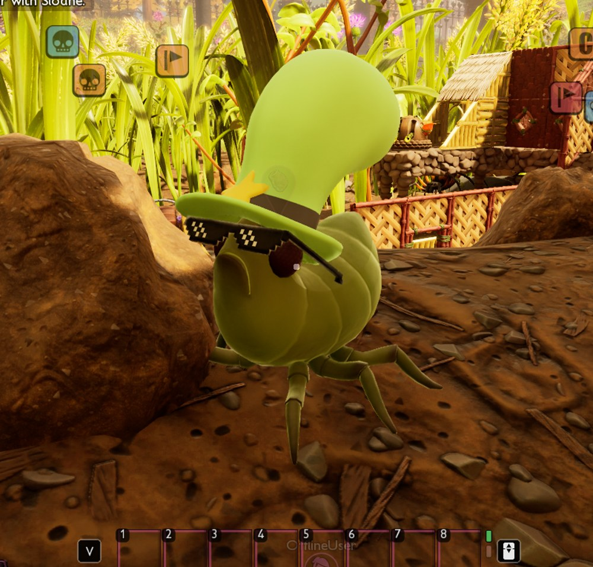



# Add creatures

<p class="download-stub">Download the finished tutorial project: GiantAphid.zip</p>

A mod can add its own creature: a new name, health, size and model, living at places the mod picks. The example `ModSource/GiantAphid` adds the Giant Aphid, twice the size of an aphid with 120 health, in a hat and glasses. Three of them live near the Snackbar.





Unreal Engine is needed only for the model. The name comes from the mod's language files ([Add text and translations](tutorial-localization.md)).

## 1. The creature

```lua
return {
    id = "GiantAphid",
    creatures = {
        {
            name = "Aphid",
            template = "Aphid",
            displayName = "aphid.name",
            health = 120,
            scale = 2,
            spawns = {
                {at = {-114980, 121340, -2630}, count = 3},
            },
        },
    },
}
```

| Key | Meaning |
| --- | --- |
| `name` | The creature's row name. The framework adds the namespace (`GiantAphid_Aphid`). |
| `template` | The game creature it is built on, a row of `Table_CharacterData`: `Aphid`, `Weevil`, `Ant_Worker_Brown`, `Spider_Wolf` and so on. Its body, animations, behaviour and attacks are used. |
| `displayName` | The name, a key of the mod's language files. |
| `health` | Health. |
| `scale` | Size as a multiple of the template's, 0.1 to 10. |
| `spawns` | Where it lives: `at = {x, y, z}` and `count`, 1 to 20. The console command `cfwhere` prints your position. |
| `model` | Its own model, see the next section. |

## 2. Its own model

The model is the template's own mesh, changed in Blender: parts added, parts removed, new materials. It stays on the template's skeleton, so the game's animations, hit areas and behaviour work on it.

1. Export the template's mesh with its textures. The mesh path is in the template's Blueprint. For the aphid it is `/Game/Art/Creatures/Aphid02/Mesh/SK_Aphid02`:

   ```powershell
   Build\AssetExport\asset-export.exe export /Game/Art/Creatures/Aphid02/Mesh/SK_Aphid02
   ```

2. Open the mesh in Blender and save it as a `.blend` in the mod's `SourceArt`. Any format Blender opens works: the `.glb` from step 1, a `.psk` from another tool through a PSK add-on, an `.fbx`.
3. Add and remove parts. Weight new parts to the game's bones. A part may use several material slots, each with its own UV map. Colors may be color attributes, which are baked into textures.
4. Do not move, turn or add bones. The game's animations set every bone, so a moved bone pulls the mesh out of shape.
5. Material slots named like the game's (`MI_Aphid02_Body`, `MI_Aphid02_Eye_V02`) keep the game's materials. New slots get their own.

`SourceArt/creature.json` prepares the model for the engine:

```json
{
  "source": "ModSource/GiantAphid/SourceArt/SK_GiantAphid.blend",
  "name": "SK_GiantAphid",
  "fbx": "Build/GiantAphid/SK_GiantAphid.fbx",
  "gameSkeleton": "/Game/Art/Creatures/Aphid02/Mesh/aphid02_Skeleton",
  "referencePose": "Build/GiantAphid/aphid02_Skeleton.json",
  "bake": {
    "M_MagicHat": "Build/GiantAphid/T_GiantAphid_Hat.png",
    "M_CoolGlasses": "Build/GiantAphid/T_GiantAphid_Glasses.png"
  },
  "rigid": {"M_MagicHat": "head_JNT", "M_CoolGlasses": "head_JNT"}
}
```

| Key | Meaning |
| --- | --- |
| `gameSkeleton` | The template's skeleton. It is next to the mesh in the [game files](tutorial-game-files.md). |
| `referencePose` | Where the skeleton's exact bone positions are saved. The bones of the model are set to them, and a model whose bones are more than 1 cm off stops with an error. |
| `bake` | Material slots whose color attributes become a texture. |
| `rigid` | Material slots that follow one bone only, such as a hat on the head. |

The creature file is a helper. A finished FBX already on the game's skeleton can go straight to the `skeletalmesh` entry below.

`SourceArt/assets.json` runs the creature file as a Blender step and lists the mesh with the game skeleton:

```json
"blender": [{"script": "Tools/prepare_creature_model.py", "spec": "SourceArt/creature.json"}],
"assets": [
  {"type": "skeletalmesh", "source": "Build/GiantAphid/SK_GiantAphid.fbx", "folder": "Meshes", "name": "SK_GiantAphid",
   "skeleton": "/Game/Art/Creatures/Aphid02/Mesh/aphid02_Skeleton", "fallbackMaterial": "/Engine/BasicShapes/BasicShapeMaterial.BasicShapeMaterial"},
  {"type": "texture", "kind": "color", "source": "Build/GiantAphid/T_GiantAphid_Hat.png", "folder": "Textures", "name": "T_GiantAphid_Hat"}
]
```

The manifest gives the creature the model. Slots not listed keep the game's material of the same name:

```lua
model = {
    skeletal = "/Game/Mods/GiantAphid/Meshes/SK_GiantAphid.SK_GiantAphid",
    materials = {
        M_MagicHat = {
            base = "/Game/Art/Characters/Clothing/Grub_Armor/Textures/V01/MI_ArmorGrub_HelmMain_V01.MI_ArmorGrub_HelmMain_V01",
            textures = {
                Albedo = "/Game/Mods/GiantAphid/Textures/T_GiantAphid_Hat.T_GiantAphid_Hat",
                Normal = "/Game/Art/World/ZN00_Global/Textures/T_Flat_N.T_Flat_N",
                RMA = "/Game/Mods/GiantAphid/Textures/T_GiantAphid_Hat_RMA.T_GiantAphid_Hat_RMA",
            },
        },
    },
},
```

`base` is a game material. `RMA` holds roughness, metallic and ambient occlusion in its red, green and blue channels.

### Own skeleton and animations

A model does not have to use the template's skeleton. A creature with a skeleton of its own needs its own animation Blueprint, made in Unreal for that skeleton and cooked with the mod:

```lua
model = {
    skeletal = "/Game/Mods/MyMod/Meshes/SK_Beetle.SK_Beetle",
    animClass = "/Game/Mods/MyMod/Animation/ABP_Beetle.ABP_Beetle_C",
},
```

- The template's behaviour still runs. Its attacks play animation montages made for the template's skeleton. Give such a creature attack rows whose montages fit your skeleton.
- Hit areas come from the mesh's physics asset. `"physicsAsset": "generate"` on the mesh in `assets.json` makes one with a body per bone. Without one the creature keeps the template's.

A Blueprint class of your own that derives from a game creature's Blueprint does not work: the game crashes a moment after such a creature spawns. Use `model` for the look. `class` takes the game's own creature classes.

## 3. In the world

The creatures appear a few seconds after a world loads, at their `spawns`, and move about like the template.

The game does not save creatures a mod adds, so each world load places them again. A killed one comes back on the next load.

## Check

[Build and install](build.md) the mod and load a save near the spawn place. The UE4SS log shows `creature GiantAphid_Aphid at ...: spawned` for each one. Look at one: it wears the hat and the glasses, walks like an aphid, and the bar above it says Giant Aphid.

## Changing the game's creatures

The game's own creatures change through [classes](manifest.md#classes) and their row in `Table_CharacterData`. The short form for health:

```lua
creatures = {
    {creature = "Weevil", healthMultiplier = 3},
},
```

`ModSource/GameTweaks` gives weevils three times their health this way. Attacks are rows of `CreatureAttacks` and change with [patches](manifest.md#patches).

