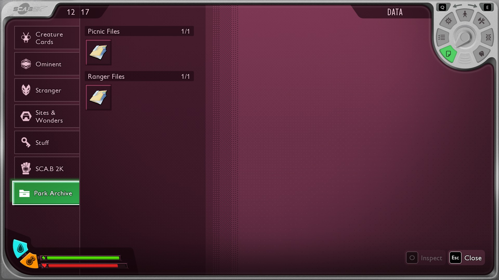
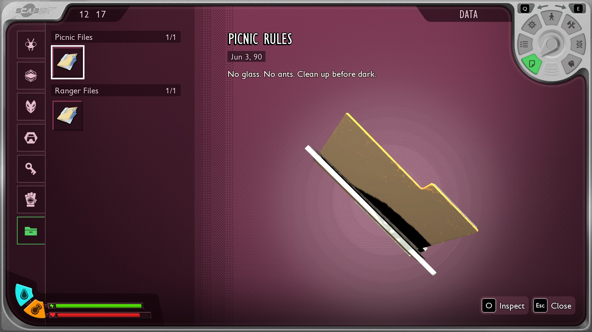
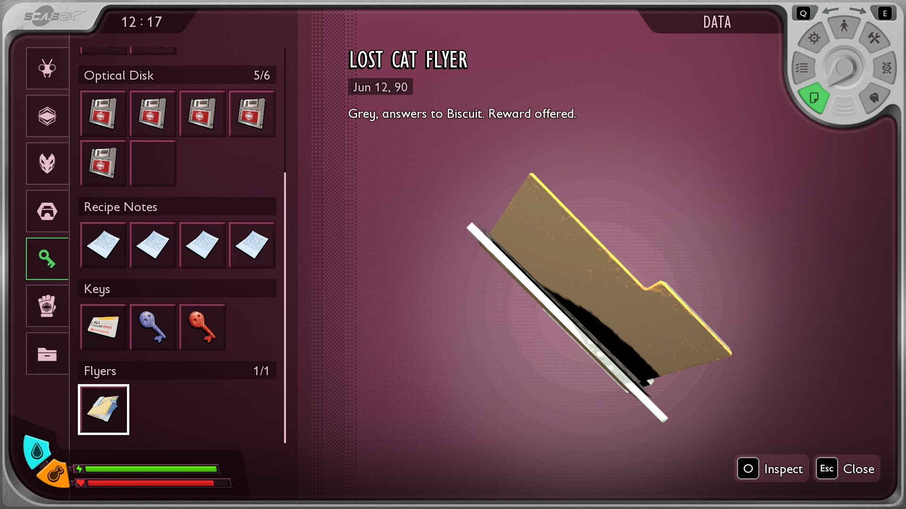
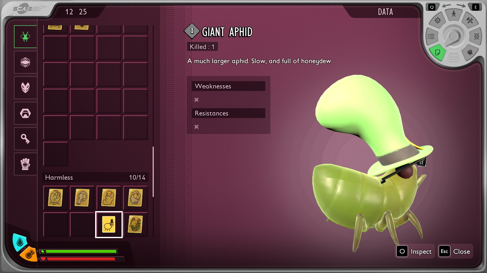



# Add Data menu categories and cards

<p class="download-stub">Download the finished tutorial project: ParkArchive.zip</p>

This page makes Park Archive, a mod with its own category in the Data menu's left list, two sections inside it and one section in the game's Stuff category. Then it gives a creature of a mod its own creature card.

The finished mods are in `ModSource/Tutorials/ParkArchive` and `ModSource/GiantAphid`.









Unreal Engine is needed to cook the icon and the world classes. See [Build and install](build.md).

## 1. The category and the sections

```lua
dataMenu = {
    categories = {
        {name = "ParkArchive", text = "archive.title", icon = "/Game/Mods/ParkArchive/Icons/T_ArchiveIcon.T_ArchiveIcon"},
    },
    sections = {
        {name = "ParkArchive.Picnic", text = "archive.picnic"},
        {name = "ParkArchive.Rangers", text = "archive.rangers"},
        {name = "Stuff.Flyers", text = "stuff.flyers"},
    },
},
```

A section's name starts with the name of its category. That category can be your own or one of the game's: `Entities`, `Ominent`, `Stranger`, `Places` or `Stuff`.

| Key | Meaning |
| --- | --- |
| `name` | The name items use. It becomes the gameplay tag `KeyItem.<name>`, which the framework registers with the engine. |
| `text` | Text key of the name shown in the menu. |
| `icon` | A category's icon, a white shape on a clear background. The game tints it. Default: the Stuff icon. |
| `show` | `untilFound` shows it once the player has one of its items. `always` shows it from the start. `foundOnly` also hides the items not found yet. Default: `untilFound`. |

Items in a mod's category do not count toward the game's final score.

## 2. The items

An item names its category and section:

```lua
items = {
    {name = "PicnicRules", template = "StatueLabNote01", displayName = "note.name", description = "note.text",
     category = "ParkArchive", subcategory = "ParkArchive.Picnic", model = "PicnicRules"},
    {name = "LostCatFlyer", template = "StatueLabNote01", displayName = "flyer.name", description = "flyer.text",
     category = "Stuff", subcategory = "Stuff.Flyers", model = "LostCatFlyer"},
},
```

The rest works like any note, see [Add a note and an audio log](tutorial-notes.md).

## 3. A creature card

A new creature gets a card with `card` in its entry. `ModSource/GiantAphid/content/creatures.lua`:

```lua
{
    name = "Aphid",
    template = "Aphid",
    model = "Aphid",
    displayName = "aphid.name",
    card = {
        template = "BestiaryAphid",
        bestiary = "Aphid",
        displayName = "aphid.name",
        description = "aphid.card",
        icon = "/Game/Mods/GiantAphid/Textures/T_GiantAphid_Card.T_GiantAphid_Card",
        scale = 0.55,
    },
},
```

The player gets it the way the game gives its own: by looking at the creature through the PEEP.R and pressing the peep key.

The cook also makes the card's kill count and the actor that shows the creature on the card, with the materials of the creature's `assets.json` entry. The full list of keys is in the [manifest reference](manifest.md#classes).

The card goes into the template's section. Set `subcategory`, such as `Entities.Angry`, or a section of your own.

A gold card is optional. The game gives it at random when the player harvests the creature, once they have the normal card:

```lua
gold = {template = "BestiaryAphidGold", icon = "/Game/Mods/MyMod/Icons/T_Gold.T_Gold", chance = 0.01},
```

## Other gameplay tags

For a tag that isn't in the Data menu, such as one a condition or a class default of your mod reads:

```lua
gameplayTags = {"MyMod.Stunned"},
```

Tags are registered once per game start, before any mod's rows are made. Players in one multiplayer session need the same mods, because the game compares tags by their place in the list.

## Check

[Build and install](build.md) the mod and load a save. Walk to the Snackbar and press E on the three folders. Open the Data menu: Park Archive is at the bottom of the left list, with Picnic Files and Ranger Files inside, and Flyers is at the end of Stuff.

For the card, install GiantAphid and find the aphids east of the Snackbar. Open the PEEP.R, look at one and press the peep key. The card is under Creature Cards, in Harmless.

