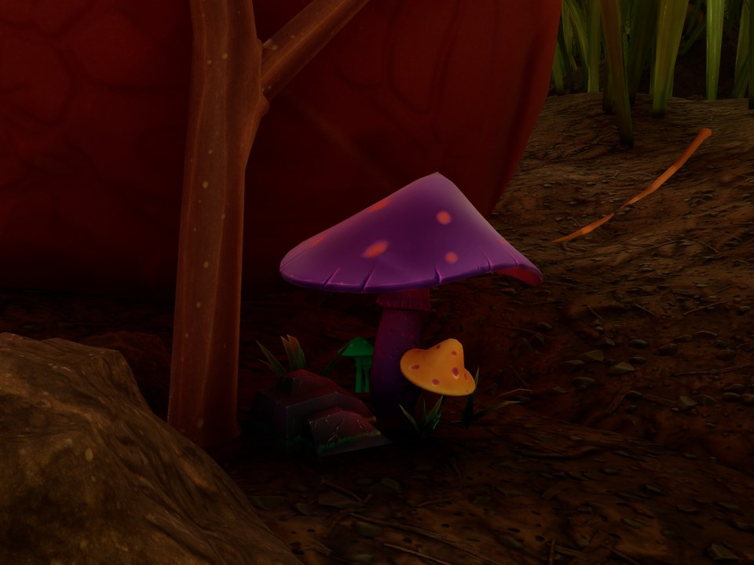



# Add a decoration

<p class="download-stub">Download the finished tutorial project: BaseBuildings.zip</p>

A decoration is a building that only looks nice. It has a model, a recipe in the build menu and a place where it is unlocked. The example is the Glow Mushrooms from `ModSource/BaseBuildings`, a glowing mushroom cluster sold at the Ranger terminal. The steps below build it as a separate mod, GlowMushrooms.



Read [Add a storage chest](tutorial-storage.md) first. A decoration uses the same steps without the storage parts.

## 1. The model and the class

The model is prepared by the Blender step `Tools/ExampleArt/prepare_model.py` with `"kind": "building"` in `SourceArt/GlowMushrooms_model.json`, as in [Add a storage chest](tutorial-storage.md#1-the-model). The source file has two materials, the mushrooms and a grass base with see-through blades. `"material": "mushroms"` keeps only the meshes of the first, because the blades need a see-through material.

The snippets below are shortened: the full `assets.json` of BaseBuildings also has the `staticmesh` entry and the material's other textures. The glow comes from the emissive texture of the model. `Tools/ExampleArt/pack_textures.py` takes it with `--emissive`, and the material turns it up. The `building` entry makes the decoration's class:

```json
{"type": "material", "folder": "Materials", "name": "MI_GlowMushrooms",
 "parent": "/Game/_Augusta/Art/Items/Weapons/Gun_Paintball/Textures/MI_Weapon_Gun_Paintball_Equip.MI_Weapon_Gun_Paintball_Equip",
 "textures": {"Albedo": "/Game/Mods/GlowMushrooms/Textures/T_GlowMushrooms_C.T_GlowMushrooms_C",
              "Emissive Texture": "/Game/Mods/GlowMushrooms/Textures/T_GlowMushrooms_E.T_GlowMushrooms_E"},
 "vectors": {"Emissive Color": [3, 3, 3, 1]}},
{"type": "building", "name": "Mushrooms", "template": "StatueAphid", "mesh": "Meshes/SM_GlowMushrooms",
 "material": "Materials/MI_GlowMushrooms"}
```

The class is a child of the aphid statue's class with the mushrooms in place of the statue. A decoration needs no behavior of its own.

## 2. Row, recipe and terminal entry

```lua
buildings = {
    {name = "Mushrooms", template = "StatueAphid", displayName = "mushrooms.name", description = "mushrooms.description",
     fields = {["IconSoft"] = asset("Icons/T_GlowMushroomsIcon")},
     model = "Mushrooms"},
},
rows = {
    {table = "BuildingRecipeTable", template = "StatueAphid", name = "Mushrooms", fields = {
        ["Building"] = {handle = {table = "BuildingsTable", row = "GlowMushrooms_Mushrooms"}},
        ["Requirements"] = {ingredients = {{item = "FiberRaw", count = 3}, {item = "Sap", count = 2}}},
    }},
},
shop = {
    {name = "GardenDecor", cost = 100, title = "gardenDecor.title", description = "gardenDecor.description", buildings = {"Mushrooms"}},
},
```

- `template = "StatueAphid"` copies a decoration of the game: its build menu tab, health and placement rules. Other decorations to copy from: `StatueWeevil`, `StatueKoi`, `LampGnat`.
- Item names in recipes are row names, not the names shown in the game: Plant Fiber is `FiberRaw`. Look them up in the [game data export](game-data.md).
- `"preserve": true` in `mod.json` keeps built decorations in a world when the mod is removed and installed again.

## Check

[Build and install](build.md) the mod. Buy Garden Decor at the Ranger terminal, open the build menu and place the mushrooms.

