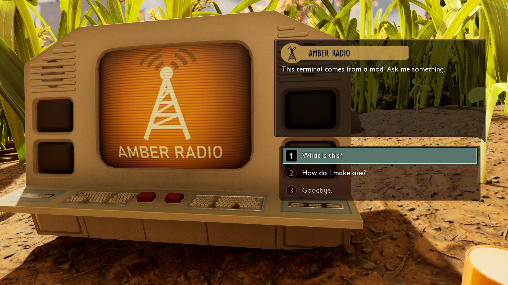
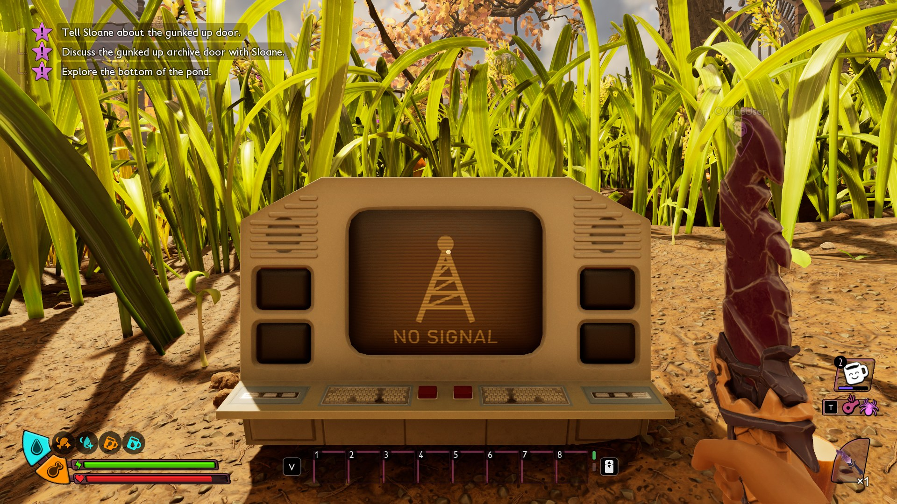
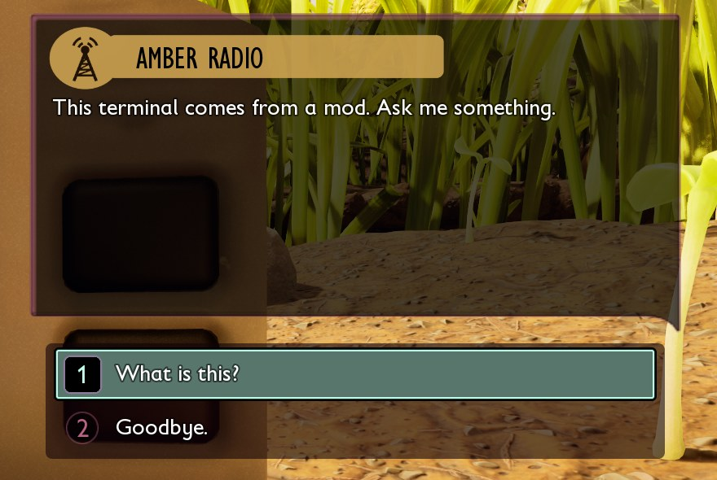
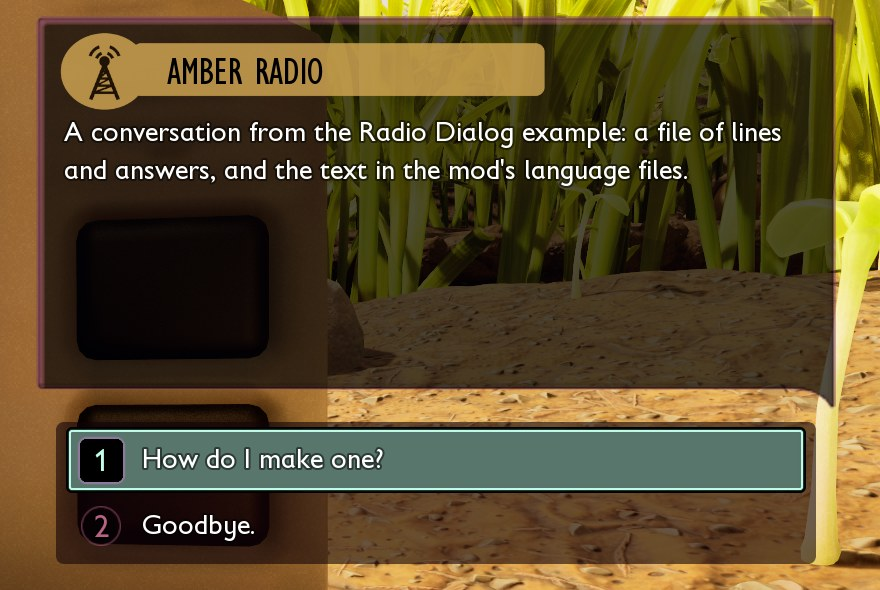
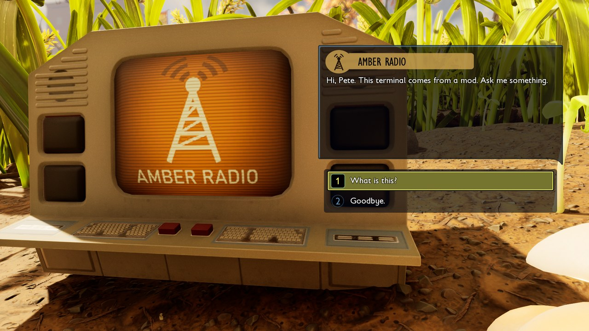
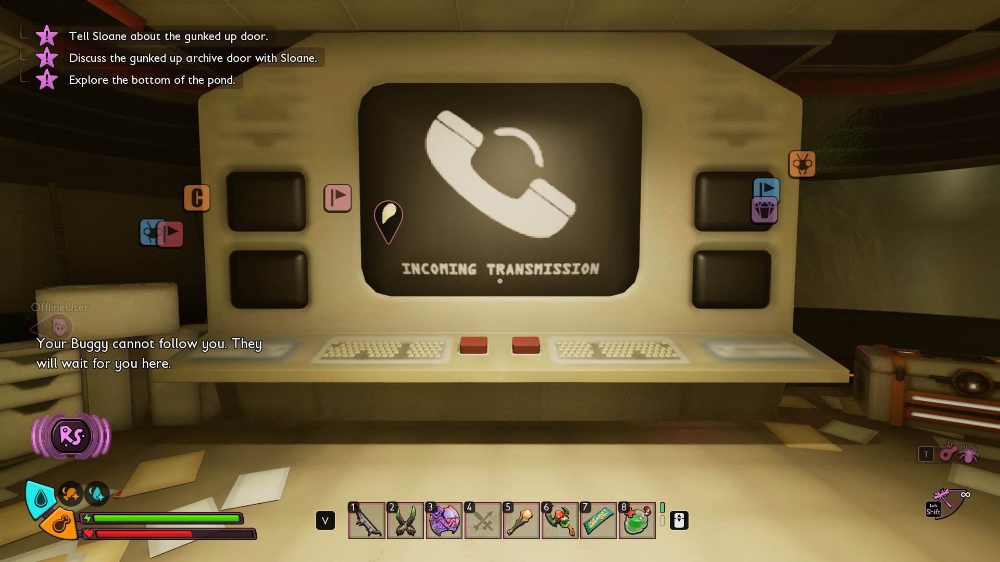
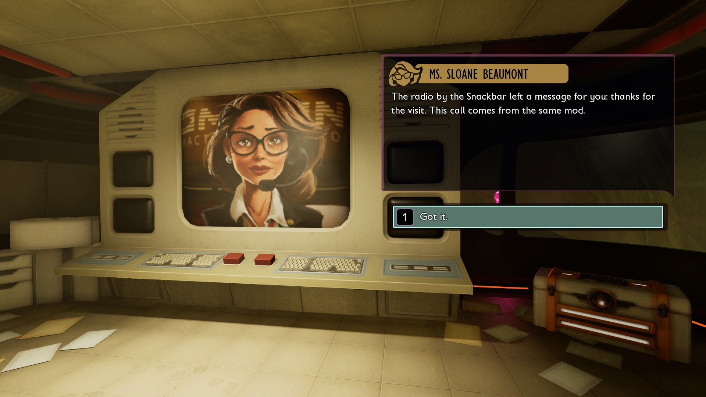



# Add terminal dialogs

<p class="download-stub">Download the finished tutorial project: RadioDialog.zip</p>

A terminal conversation opens the game's dialog window: a speaker says lines and the player picks answers. Lines that play as subtitles in the world, without a window, are in [Add character conversations](tutorial-lines.md).

The example `ModSource/RadioDialog` puts a talking terminal by the Snackbar. Its speaker, Amber Radio, has its own plate behind the name and its own picture on the screen, says a line and offers its answers:



Between calls the terminal shows the mod's idle picture instead of the game's dark screen:



You need Unreal Engine with the authoring project and its conversation classes ([Authoring setup](authoring.md#5-dialogs-the-games-conversation-classes)), because a conversation is an asset of the game's own type.

## 1. Write the conversation

`dialogs/hello.json` in the mod folder:

```json
{
  "speaker": {"name": "dialog.radio"},
  "start": "greet",
  "nodes": {
    "greet": {"say": "dialog.greet", "answers": ["ask", "bye"]},
    "ask":   {"answer": "dialog.ask", "next": "info"},
    "info":  {"say": "dialog.info", "answers": ["bye"]},
    "bye":   {"answer": "dialog.bye"}
  }
}
```

| Key | Meaning |
| --- | --- |
| `speaker` | Who says the lines: a game speaker by name (`Sloane`, `Player`, `Hoops`, `Max`, `Pete`, `Willow`, `Tully`, `BURG.L`, `Subject V`, `Archives`) or id, or `{"name": "<text key>"}` for a speaker of the mod. `Player` is the teen the player plays. A line can have its own `speaker`. |
| `start` | The node the conversation begins with, or a list of nodes with `when`: the conversation begins with the one whose condition holds. |
| `nodes` | Each node is a line of the speaker (`say`) or an answer of the player (`answer`). |
| `say`, `answer` | A text key of the mod's text files. |
| `answers` | The answers offered after a line. |
| `next` | The line that follows an answer or a line, or a list of lines with `when`. A node without `answers` and `next` ends the conversation. |
| `set` | Optional. `{"radioQuest": 1}`: sets world variables of the mod when the line or answer plays, see [Add quests](tutorial-quests.md#3-set-the-variables). |
| `topic` | Optional. A text key: the answer that opens this conversation from Sloane's questions, see [step 5](#5-a-question-for-sloane). |
| `call` | Optional. A world variable of the mod: the conversation is a call that rings the game's terminals, see [step 7](#7-a-call-from-sloane). |
| `when` | Optional. The line or answer is there only while the condition holds, see [step 6](#6-answers-by-condition-and-scripts-on-nodes). |

The file name, `hello`, is the conversation's name in scripts.

## 2. Write the text

`text/enus.json`, next to the mod's other text:

```json
{
  "dialog.radio": "Amber Radio",
  "dialog.greet": "Hello! This line comes from a mod.",
  "dialog.ask": "What can you do?",
  "dialog.info": "I can talk, and you can answer.",
  "dialog.bye": "Goodbye."
}
```

Other languages work as in [Add text and translations](tutorial-localization.md).

## 3. Start it from a script

```lua
return function(api)
    api.onKey("F7", function()
        local at = api.player()
        local terminal = api.conversation.terminal("hello", {at.X + 200, at.Y, at.Z}, {0, 180, 0}, "dialog.radio")
        api.conversation.talk(terminal)
    end)
end
```

| Function | Meaning |
| --- | --- |
| `api.conversation.terminal(name, at, rotate, speaker[, look])` | Places the game's talking terminal at `at = {x, y, z}`, turned by `rotate = {pitch, yaw, roll}`, set to the conversation. `speaker` is optional: the text key of the mod speaker's name as a plain string, or a game speaker's name or id. `look` gives the terminal its own pictures, see [step 4](#4-give-the-terminal-its-own-look). Players talk to it with the interact key. Returns the terminal. |
| `api.conversation.talk(terminal)` | Opens the terminal's conversation for the player, as the interact key does. |
| `api.conversation.call(name)` | Rings the game's terminals. The next talk to a Ranger terminal plays the conversation, see [step 7](#7-a-call-from-sloane). |
| `api.conversation.calling(name)` | Whether the conversation's call still waits for an answer. |
| `api.conversation.on(name, node, fn)` | Calls `fn(player)` on the host when the conversation reaches the node: its line plays or the player picks that answer. `node` is the node's name in the dialog file. |
| `api.conversation.id(name)` | The conversation's id, for the game's own conversation functions. |

## 4. Give the terminal its own look

Three pictures, each optional, are textures of the mod:

| Key | Where it shows | Texture |
| --- | --- | --- |
| `plate` | Behind the speaker's name in the dialog window, on every line of that speaker. | 1024 x 128, white on transparent: the window tints it. The game's plate has the speaker's icon in a circle on the left (0 to 146 px) and the name bar from 120 to 780 px. Draw the icon dark, cut into the white. |
| `screen` | On the terminal's screen during a call. | A picture, or a sheet of frames played as an animation: `{"Textures/T_Screen", frames = {columns, rows}, speed = 1}`. The game's own is 512 x 512 with 2 x 2 frames. |
| `idle` | On the screen between calls. The game's terminal is dark then. | A picture, or a sheet as for `screen`. |

The screen shows about the middle three quarters of a picture's height, so keep text and important parts between 15% and 85% from the top.

List the textures in `SourceArt/assets.json`, the plate as an `icon` and the screen pictures as `color`:

```json
{
  "destination": "/Game/Mods/MyMod",
  "assets": [
    {"type": "texture", "kind": "icon", "source": "ModSource/MyMod/SourceArt/T_Plate.png", "folder": "Textures", "name": "T_Plate"},
    {"type": "texture", "kind": "color", "source": "ModSource/MyMod/SourceArt/T_Screen.png", "folder": "Textures", "name": "T_Screen"},
    {"type": "texture", "kind": "color", "source": "ModSource/MyMod/SourceArt/T_Idle.png", "folder": "Textures", "name": "T_Idle"}
  ]
}
```

Then pass them when placing the terminal. A path that does not start with `/` is inside the mod's folder:

```lua
api.conversation.terminal("hello", at, {0, 180, 0}, "dialog.radio", {
    plate = "Textures/T_Plate",
    screen = {"Textures/T_Screen", frames = {2, 2}, speed = 1},
    idle = "Textures/T_Idle",
})
```

A plate needs a speaker of the mod: the game's own speakers keep their plates.

## 5. A question for Sloane

A conversation with a `topic` joins the list of questions Sloane offers on the game's own Ranger terminals ("How can I help you?"). The answer shows just before the one that ends her list, in her three main conversations of the story (`cv_sloane_main_mvp`, `_garden` and `_resting`). Picking it plays the mod's conversation in the same window. Radio Dialog has one, `dialogs/sloane.json`:

```json
{
  "speaker": "319DE90A-463C49A7-BB63DB9C-BF82916D",
  "topic": "sloane.topic",
  "start": "radio",
  "nodes": {
    "radio": {"say": "sloane.radio", "answers": ["who", "thanks"]},
    "who": {"answer": "sloane.who", "next": "mod"},
    "mod": {"say": "sloane.mod", "answers": ["thanks"]},
    "thanks": {"answer": "sloane.thanks"}
  }
}
```

The speaker is Sloane, so the lines keep her window. `sloane.topic` is a text key like the others ("What is the radio terminal by the Snackbar?"). No script is needed: the packer puts the answer's text into Sloane's text tables, and the framework adds the answer to her conversations when a world loads. The game's own questions and answers stay as they are.

## 6. Answers by condition, and scripts on nodes

An answer or a line with `when` is there only while a world variable of the mod matches. In `dialogs/radio.json` the radio offers "How do I make one?" only after "What is this?", whose line sets `radioAskedWhat`:

```json
"how":      {"answer": "radio.how", "next": "howInfo", "when": {"variable": "radioAskedWhat", "equals": 1}},
"whatInfo": {"say": "radio.whatInfo", "answers": ["how", "bye"], "set": {"radioAskedWhat": 1}},
```





Conditions of the game work the same way:

| Condition | Holds when |
| --- | --- |
| `{"variable": "radioAskedWhat", "equals": 1}` | A world variable of the mod has the value. Also `notEqual`, `above`, `below`, `atLeast`, `atMost`. |
| `{"teen": "Pete"}` | The player talking plays Pete. `Hoops`, `Max`, `Pete` or `Willow`. |
| `{"inParty": "Pete"}` | Someone in the game plays Pete. |
| `{"alone": true}` | The player plays alone. `false` when others are in the game. |

`"not": true` turns a condition around. A list of conditions holds when all of them hold.

The radio greets each teen by name. `start` lists one greeting per teen, and the conversation begins with the one whose condition holds:

```json
"start": ["helloMax", "helloWillow", "helloPete", "helloHoops"],
"nodes": {
  "helloMax":    {"say": "radio.helloMax", "when": {"teen": "Max"}, "answers": ["what", "how", "bye"]},
  "helloWillow": {"say": "radio.helloWillow", "when": {"teen": "Willow"}, "answers": ["what", "how", "bye"]},
```

Exactly one line of such a list should hold at any time. Every player plays one of the four teens, so the four greetings cover everyone.



A script can act when a conversation reaches a node. `content/scripts/radio.lua` gives 50 Raw Science the first time a player says goodbye to the radio:

```lua
api.conversation.on("radio", "bye", function()
    if api.variables.get("radioGift") == 0 then
        api.science.add(50)
        api.variables.set("radioGift", 1)
    end
end)
```

The function runs on the host when the line plays or the player picks the answer. A world variable keeps it from giving the gift again after loading.

## 7. A call from Sloane

When the story of a mod needs the player to talk to Sloane, the mod can call, as the game does: the Ranger terminals ring, and talking to any of them plays the mod's conversation in Sloane's window.

The dialog file names a world variable of the mod in `call`. Radio Dialog has `dialogs/signal.json`:

```json
{
  "speaker": "Sloane",
  "call": "radioCall",
  "start": "signal",
  "nodes": {
    "signal": {"say": "call.signal", "answers": ["ok"]},
    "ok":     {"answer": "call.ok"}
  }
}
```

`radioCall` goes into `variables.json` like the mod's other variables, with `0`. A script starts the call. Radio Dialog calls after its gift:

```lua
api.conversation.call("signal")
```



| What happens | |
| --- | --- |
| The call starts | The variable becomes 1 (2 while a call of the game rings too) and the game's terminals ring. |
| A player talks to a Ranger terminal | The call plays in Sloane's window instead of her usual conversation. The variable goes back to 0 and the ringing stops, unless another call still waits. The next talk is her usual conversation again. |
| The world is saved and loaded | A call that was not answered rings again. |



Calls start on the host. On other players' games `call` returns `false` and does nothing. The call's conversation is a normal dialog of the mod: `when`, `set` and `api.conversation.on` work in it.

## Check

[Build and install](build.md) the mod and load a save. Talk to the radio by the Snackbar: its window has the mod's pictures and the answers of the file. Say goodbye to it: the Ranger terminals ring, and answering one plays Sloane's call.

## What to know

- Without a `screen` the call shows Sloane's portrait. A speaker of the mod shows its own name on every line, however the conversation starts.
- Terminals placed by a script are not saved with the world. Place them again in `api.onWorld`, as Radio Dialog does.
- The window has its own look for a few of the game's speakers, such as the Archive Distributor (`31A4F1CC-B2DE43B3-9639FEFE-2FFFF42B`).
- The conversation runs on the player's own game. In [Multiplayer](multiplayer.md) every player needs the mod. This is not tested with several players yet.

