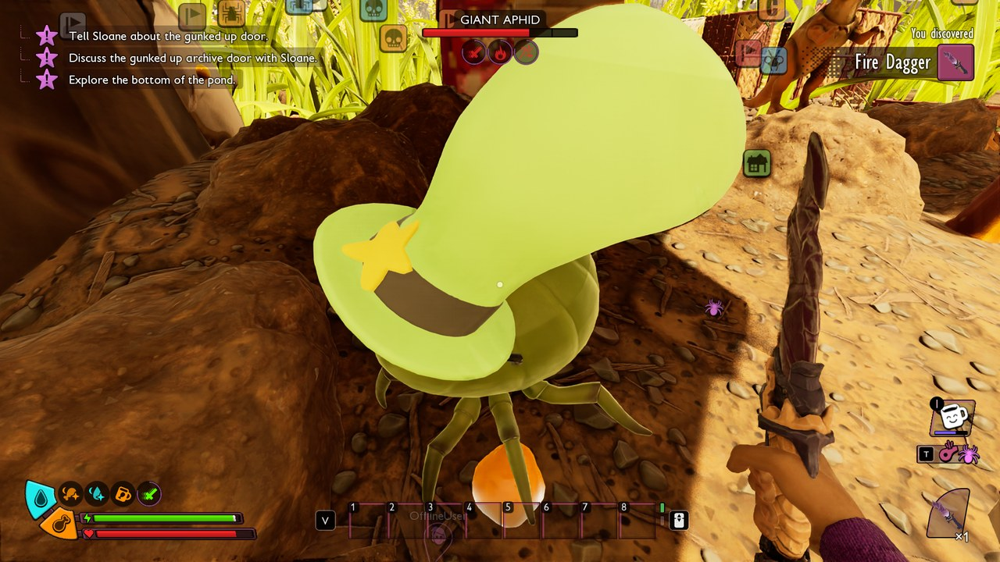
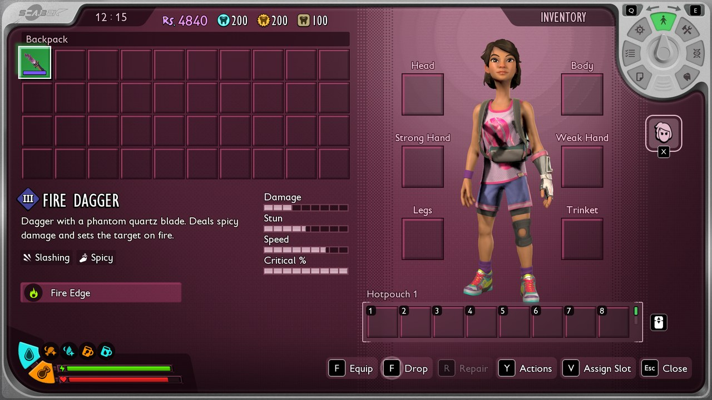



# Add a status effect

<p class="download-stub">Download the finished tutorial project: ArsenalWeapons.zip</p>

Status effects are rows of the game's `Table_StatusEffects`: buffs from food, armor set bonuses, poison, the slow of a web. A mod adds its own rows and gives them to characters the way the game does, from food, from equipment or from a script. The example `ModSource/ArsenalWeapons` gives the Fire Dagger a burn: its hits set the target on fire for 5 seconds.



Read [Add an item with a recipe](tutorial-item.md) first. Effects on food are in [Add food with an effect](tutorial-food.md).

## 1. The effect

`content/fire_dagger.lua`:

```lua
local effects = "/Game/Blueprints/Attacks/Table_StatusEffects.Table_StatusEffects"

rows = {
    {table = effects, template = "InfusionBurnDoT", name = "Burn", fields = {
        Value = -12,
        Duration = 5,
        ["DisplayData.Icon"] = asset("Icons/T_BurnIcon"),
        ["DisplayData.Name"] = {text = "burn.name"},
        ["DisplayData.Description"] = {text = "burn.description"},
    }},
},
```

The row is a copy of a game effect, `template`, with the fields you change. `InfusionBurnDoT` is the game's burn: health damage every `Interval` seconds. The target's damage modifiers still apply, so a tick can take more or less than `Value`, as with the game's own burn.

| Field | Meaning |
| --- | --- |
| `Type` | What the effect changes: `Health`, `MoveSpeed`, `AttackDamage`, `DamageReduction` and about 140 more. The template's type stays unless you set it. |
| `Value` | An amount for health, food and water (negative for damage), a multiplier for speeds and rates (0.7 is 30% slower). |
| `Duration` | Seconds. |
| `Interval` | Seconds between two ticks of an effect over time. |
| `EffectTags` | Tags of the effect that the game and other effects check, such as `StatusEffect.Infusion` on the game's weapon infusions. |
| `bShowInUI`, `bIsNegativeEffectInUI` | Whether the icon shows next to the health bar, and whether the game shows it as harmful. |

The [game data export](game-data.md) of `Table_StatusEffects` lists every game effect with its fields, a good place to find a template.

## 2. Its icon

The game's effect icons are white shapes on a transparent background, 64 by 64 pixels. `SourceArt/T_BurnIcon.png` is the dagger's flame, drawn the same way. The game tints it, red for a harmful effect. It is an entry of `SourceArt/assets.json` like an item icon:

```json
{"type": "texture", "kind": "icon", "source": "ModSource/ArsenalWeapons/SourceArt/T_BurnIcon.png", "folder": "Icons", "name": "T_BurnIcon"}
```

and the content file loads it with the mod's other assets:

```lua
assets = {
    {path = asset("Icons/T_BurnIcon"), expectedClass = "/Script/Engine.Texture2D"},
},
```

## 3. On a weapon's hits

The game's armor and weapon infusions give their targets effects through an effect of their own. While the item is equipped, the player has an effect of type `ApplyAttackEffect`, and its `ExtraData` names the effect each hit gives.

```lua
{table = effects, template = "InfusionApplyAttackEffectBurn", name = "BurnOnHit", fields = {
    ExtraData = {handle = {table = effects, row = "ArsenalWeapons_Burn"}},
    ["DisplayData.Icon"] = asset("Icons/T_BurnIcon"),
    ["DisplayData.Name"] = {text = "burnOnHit.name"},
    ["DisplayData.Description"] = {text = "burnOnHit.description"},
    EffectTags = {unreal = "()"},
    DamageTargetTags = {unreal = '(GameplayTags=((TagName="Stats.Creatures")))'},
}},
```

`DamageTargetTags` limits the effect to hits on creatures. Without it the game also gives the burn to the player who hits, as it does with the template row alone. The game's armor rows such as `BeeBowStun` limit their targets the same way. `EffectTags` is cleared because the template's `StatusEffect.Infusion` tag belongs to the game's weapon infusions.

The dagger lists it in its equipment effects, after the effect its template already had:

```lua
["EquippableData.StatusEffects"] = {handles = {
    {table = effects, row = "WeaponSword"},
    {table = effects, row = "ArsenalWeapons_BurnOnHit"},
}},
```

The item's tooltip in the inventory lists the effect with its icon and name:



`DamageSourceTags` and `AttackChargeType` limit which attacks count, as on the game's own rows (`ApplyAttackEffectStabResistDownTrigger` applies only on charged spear attacks).

## 4. From a script

`api.effects` gives and takes effects and runs a function when the game adds or removes one. `content/scripts/burn.lua` slows a burning target with the game's own slow effect:

```lua
return function(api)
    api.effects.on("ArsenalWeapons_Burn", {
        added = function(target) api.effects.add(target, "MovementSlowMediumShort") end,
    })
end
```

| Function | Does |
| --- | --- |
| `api.effects.add(target, row)` | Gives the effect. Returns `false` when the target is immune or blocks it. |
| `api.effects.remove(target, row)` | Takes every copy of it away. Returns how many. |
| `api.effects.count(target, row)` | How many copies the target has. |
| `api.effects.on(row, {added = fn, removed = fn})` | Calls `fn(target)` on the host when the game adds or removes the effect on any character. |

`target` is a character: the one a handler receives, a creature from `api.onCreature`, or `nil` for the local player. `row` is the full row name, the mod id in front for the mod's own effects.

## Check

[Build and install](build.md) the mod. The Fire Dagger's tooltip lists Fire Edge. Hit a creature with it: the flame shows under its health bar next to the slow, and it loses health every second for 5 seconds. Your own health stays as it is.

