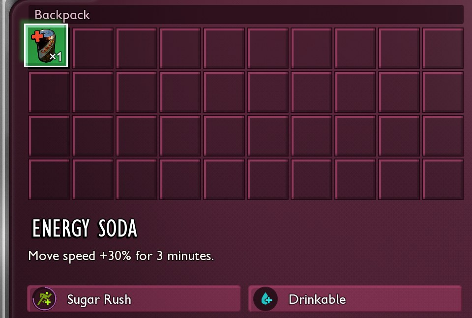



# Add food with an effect

<p class="download-stub">Download the finished tutorial project: EnergySoda.zip</p>

Food and drinks in the game work through three tables: the item points to a row of `Table_Consumables`, and that row lists effects from `Table_StatusEffects`. The example `ModSource/EnergySoda` adds a drink that gives +30% move speed for 3 minutes.



Read [Add an item with a recipe](tutorial-item.md) first. No Unreal Engine is needed. The texts are in the mod's language files ([Add text and translations](tutorial-localization.md)).

## 1. The effect

```lua
local effects = "/Game/Blueprints/Attacks/Table_StatusEffects.Table_StatusEffects"

rows = {
    {table = effects, template = "MealTier3MoveSpeed", name = "Rush", fields = {
        Value = 1.3,
        Duration = 180,
        UniqueTag = {unreal = "()"},
        ["DisplayData.Name"] = {text = "rush.name"},
        ["DisplayData.Description"] = {text = "rush.description"},
    }},
},
```

- `template` is an effect of the kind you want. Its `Type` decides what changes: `MoveSpeed`, `AttackDamage`, `Health`, `MaxStamina`, `HungerRate` and many more. The [game data export](game-data.md) of `Table_StatusEffects` lists them.
- `Value` is a multiplier for rates and speeds (1.3 = +30%) and an amount for health, food and water.
- `Duration` is in seconds.
- `UniqueTag` groups effects that replace each other: a meal buff replaces the previous meal buff. The template's tag would make the drink replace meal buffs, so the example clears it.

## 2. What eating does

```lua
local consumables = "/Game/Blueprints/Items/Table_Consumables.Table_Consumables"

{table = consumables, template = "SmoothieAttack", name = "Drink", fields = {
    StatusEffects = {handles = {{table = effects, row = "EnergySoda_Rush"}, {table = effects, row = "TinyWater"}}},
}},
```

The list can mix your effects with the game's. `TinyWater` adds a little water.

## 3. The item and recipe

```lua
items = {
    {name = "Soda", template = "SmoothieAttack", displayName = "soda.name", description = "soda.description", fields = {
        Icon = "/Game/Blueprints/Items/Icons/ICO_Soda_Can_A.ICO_Soda_Can_A",
        ConsumableData = {handles = {{table = consumables, row = "EnergySoda_Drink"}}},
    }},
},
recipes = {
    {name = "Soda", template = "SmoothieAttack", crafts = "Soda", unlocked = true,
     ingredients = {{item = "Sap", count = 2}, {item = "FiberRaw", count = 1}}},
},
```

A drink template keeps the drinking animation, and a food template such as a roasted meat keeps the eating animation. The recipe copies a smoothie recipe, so it is made at the Smoothie Station. The icon here is one of the game's. Your own works as in [Add an item with a recipe](tutorial-item.md#4-name-description-and-icon).

## Check

[Build and install](build.md) the mod. Make the soda at the Smoothie Station and drink it. The speed icon appears next to the health bars.

