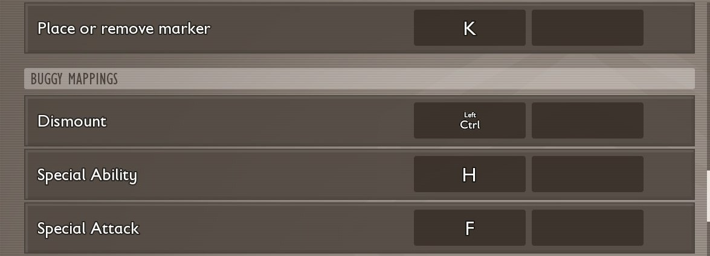



# Add a key the player can bind

<p class="download-stub">Download the finished tutorial project: QuickMarker.zip</p>

This page makes Quick Marker, a mod with one key: it puts a marker where the player stands, and pressing it again removes the marker. The key is a row in the game's Options, under Keyboard, and the player can bind it like any key of the game.

The finished mod is in `ModSource/Tutorials/QuickMarker`.



No Unreal Engine is needed.

## 1. The key

`content/scripts/quick_marker.lua`:

```lua
return function(api)
    local marker

    api.onAction{
        name = "Mark",
        label = {text = "action.mark"},
        key = "K",
        onPress = function()
            if marker then
                marker.remove()
                marker = nil
            else
                marker = api.marker(api.player(), {})
            end
        end,
    }
end
```

| Key | Meaning |
| --- | --- |
| `name` | Name of the key in this mod. Keep it once the mod is out, since the player's chosen key is saved under it. |
| `label` | The row's name in Options: a key of the mod's text files as `{text = "key"}`, or plain text. |
| `key` | The default key, an Unreal key name such as `K`, `F5`, `One` or `SpaceBar`. |
| `category` | The section of the list: `Default`, `Hotpouch`, `BuildingPlacement`, `UI`, `BuildMode` or `PhotoMode`. The default is `Default`. |
| `gamepad` | A default gamepad button, an Unreal key name such as `Gamepad_DPad_Up`. Without it the row is for the keyboard only. |
| `onPress` | Runs when the key goes down. The key goes through the game's input like its own keys, so it stops where they stop, such as in menus. |

The text goes in `text/enus.json`:

```json
{"action.mark": "Place or remove marker"}
```

## 2. A button in the settings

A setting of type `button` is a button in the mod's settings in the game's Mods screen. It holds no value. `settings.schema.json`:

```json
{"settings": [{"key": "clear", "label": "Remove the marker", "type": "button"}]}
```

Pressing it calls `api.onSettings` with its key:

```lua
api.onSettings(function(key)
    if key == "clear" and marker then
        marker.remove()
        marker = nil
    end
end)
```

## What to know

- The game saves the player's key in its own settings, so it stays through restarts.
- Without the mod the row is gone from the list.

## Check

[Build and install](build.md) the mod and load a save. Press K, walk away and look back: the marker stands where you were. In Options, under Keyboard, bind another key to Place or remove marker and press it.

