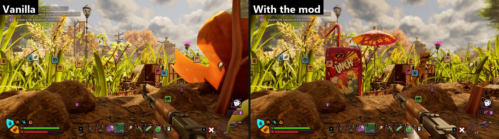
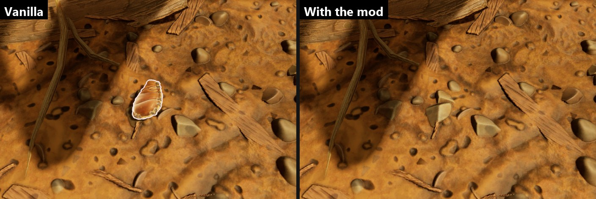
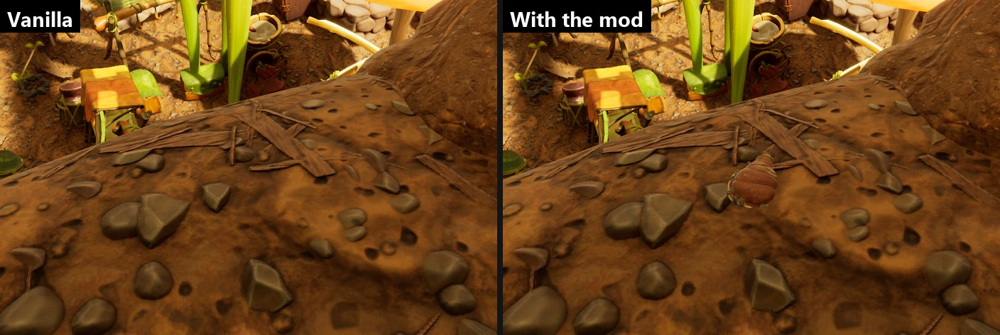



# Change the map

<p class="download-stub">Download the finished tutorial project: SnackbarMap.zip</p>

A mod can remove pieces of the game's map, hide grass and weeds, place new objects, and move or remove pickups. The example `ModSource/SnackbarMap` clears a spot by the Snackbar. A big maple leaf, a root, the weeds and the grass are gone, and a juice box, a cocktail umbrella and a toy dinosaur stand there instead. It also moves the charcoal canteen from the lawn to the rock by the Snackbar and removes one patch of slime mold.

The maple leaf and the weed on the right are gone, and a juice box, a cocktail umbrella and a toy dinosaur stand in the clearing:



The canteen's old spot:



Its new spot:



Removing and moving needs only the manifest. New objects come in a level made in Unreal Engine ([Authoring setup](authoring.md)).

## 1. Find the objects

Stand at the place in the game and use the UE4SS console:

- `cfmap` lists the map pieces (rocks, roots, walls) and the foliage within 10 m as ready entries. `cfmap 3000` searches 30 m.
- `cfnear` lists the pickups within 10 m.
- `cfwhere` prints your own position, for the place to put something.

```lua
{class = "StaticMeshActor", mesh = "SM_Root_Grp_01", near = {-115082, 121212, -2977}, radius = 100, remove = true},
{mesh = "SM_Weed_Tall_A", near = {-114700, 121200, -2840}, radius = 1000}, -- 2 instance(s)
{class = "SpawnedItem", item = "SlimeMold", near = {-112936, 120890, -3853}, radius = 100, remove = true},
```

Copy the lines you need into the manifest: lines with `class` go into `level`, lines without it into `foliage`.

## 2. Map pieces and foliage

`ModSource/SnackbarMap/content/map.lua`, the map pieces part:

```lua
local spot = {-114700, 121200, -2840}

return {
    id = "SnackbarMap",
    level = {
        {class = "StaticMeshActor", mesh = "SM_Root_Grp_01", near = {-115082, 121212, -2977}, radius = 200, remove = true},
        {class = "StaticMeshActor", mesh = "SM_Leaf_Maple_C", near = {-114234, 120796, -2861}, radius = 200, remove = true},
    },
    foliage = {
        {mesh = "SM_Weed_Tall_A", near = spot, radius = 1500},
        {mesh = "SM_Weed_Tall_C", near = spot, radius = 1500},
        {mesh = "SM_Grass_Blade_E", near = spot, radius = 900},
    },
}
```

- `level` with `mesh` removes a map piece: it is hidden and loses its collision.
- `foliage` removes every copy of one foliage mesh within `radius`, as cutting it would.

Map pieces are hidden again after each world load and are not written to the save. With the mod turned off, they are back. Removed foliage is saved with the world (see [Saves](#saves)).

## 3. New objects: a level of the mod

New objects go into a level of your mod, made in Unreal Engine like any level with meshes, lights and Blueprints. The framework streams it into the world after each world load. On the host it is streamed in before the save is applied.

```lua
levels = {"/Game/Mods/SnackbarMap/Maps/L_SnackbarPicnic"},
```

1. Create the level in `/Game/Mods/<YourMod>/Maps`. Place the actors at the world positions `cfwhere` prints. Save.
2. List it in `SourceArt/assets.json`, so the cook includes it:

```json
{"type": "level", "folder": "Maps", "name": "L_SnackbarPicnic"}
```

3. [Build and install](build.md) the mod as usual.

A level that uses the game's meshes needs something at those paths in your project to place. A `gameMesh` entry puts a 1 m box there. The box is outside your mod folder, so it is never shipped, and the game shows its own mesh:

```json
{"type": "gameMesh", "path": "/Game/BS_Assets/Art/Cocktail_Umbrella/SM_Cocktail_Umbrella_01"}
```

With `"source": "<fbx>"` the stand-in gets a shape of your choice. Paths of game meshes come from [Explore the game files](tutorial-game-files.md).

| Key | Meaning |
| --- | --- |
| `map` | The level path. A plain string is the same as `{map = "..."}`. |
| `at` | Moves the whole level by `{x, y, z}`. Default `{0, 0, 0}`, the positions as placed. |
| `rotate` | Turns the whole level, `{pitch, yaw, roll}`. |

## 4. Pickups

```lua
return {
    id = "SnackbarMap",
    level = {
        {class = "SpawnedItem", item = "CanteenCharcoal", move = {-115162, 121257, -2690}},
        {class = "SpawnedItem", item = "SlimeMold", near = {-112936, 120890, -3853}, radius = 50, remove = true},
    },
}
```

Each `level` entry first selects actors, then says what to do with them:

| Key | Meaning |
| --- | --- |
| `class` | `StaticMeshActor` for map pieces, `SpawnedItem` for items lying in the world, or the class path of a Blueprint. |
| `item` | Pickups holding this item. |
| `mesh` | Actors showing this static mesh. |
| `near`, `radius` | Actors within `radius` centimetres of a position. |
| `name` | One actor by its name. |
| `move`, `rotate`, `remove`, `set` | What to do, see [level](manifest.md#level). |

`item` alone selects every placed pickup of that item. Use it alone only for unique items, such as an optical disk. For common items add `near`.

### How a pickup moves

Far from the player the game keeps pickups only as data, which the framework cannot move. So a moved pickup works like this:

- The original is hidden within a few seconds after the game shows it.
- A copy with the same count is placed at `move` a few seconds after the world loads, once per saved world, and only while the original is still in the world. A pickup the player already took is not placed again.
- The game saves the copy like any item on the ground.

## Saves

- Removed foliage is saved with the world, like grass a player cut. It stays gone without the mod. Map pieces and the level of the mod are applied again after each load. Objects with their own state, such as mushrooms or pickups, go in `world` with `actor` instead ([Place items in the world](tutorial-world.md#game-objects)). The game saves them.
- The game may save a removed pickup as gone. Turning the mod off later does not bring it back, and a moved pickup stays at its new place.
- Back up a world before trying a pickup mod on it.
- Map changes have not been tested in multiplayer yet.

## Check

[Build and install](build.md) the mod and load a save. The UE4SS log shows:

- `Level SnackbarMap ...: hidden` for the root.
- `foliage SM_Weed_Tall_A near ...: removed 1 of 1` for each foliage entry the first time. Later loads find nothing left to remove.
- `level /Game/Mods/SnackbarMap/Maps/L_SnackbarPicnic at 0 0 0: streamed in before the save` for the level when a save is loaded, or `...: ...LevelStreamingDynamic...` when it is streamed in later.
- `Level SnackbarMap ...: hidden, a copy goes to the new place` and `world: CanteenCharcoal x1 at ...: placed` for the canteen.

At the Snackbar the maple leaf and the weeds are gone, the juice box, the umbrella and the dinosaur stand in the clearing, and the canteen lies on the rock.

