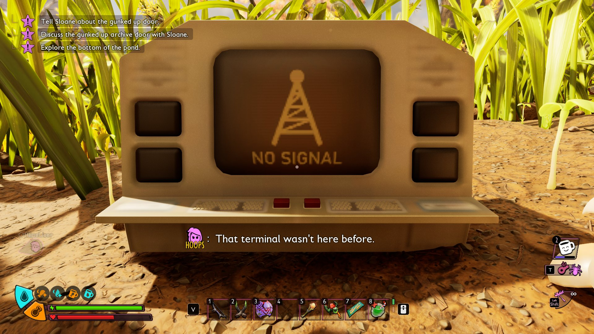
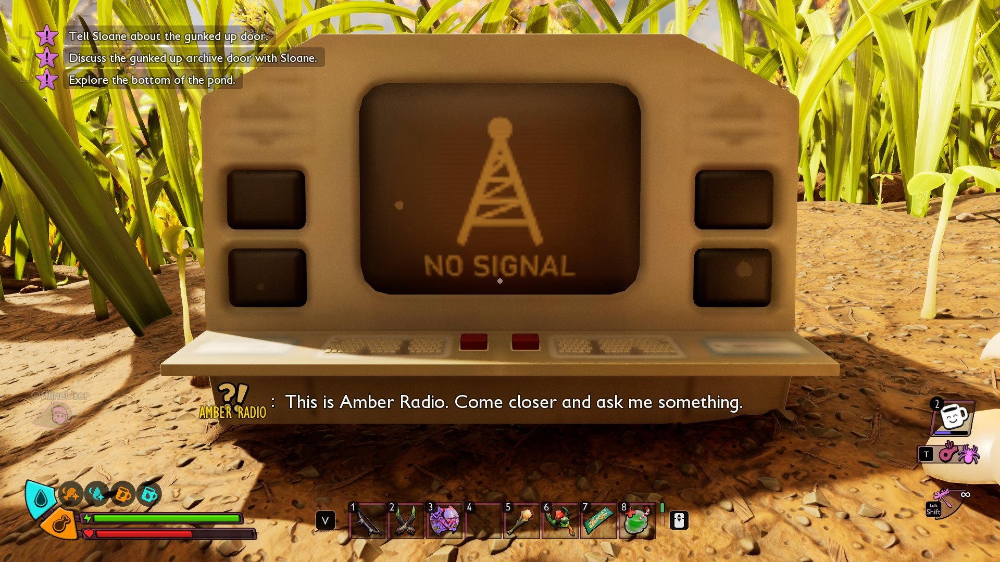



# Add character conversations

<p class="download-stub">Download the finished tutorial project: RadioDialog.zip</p>

The teens, Sloane, BURG.L or a speaker of the mod can say lines in the world as subtitles, without a dialog window and without answers. The lines play when a player walks into a place, or when a script plays them.

In the example `ModSource/RadioDialog`, a player who walks up to the radio by the Snackbar notices it, and the radio answers:





You need Unreal Engine with the authoring project and its conversation classes ([Authoring setup](authoring.md#5-dialogs-the-games-conversation-classes)), because the lines are a conversation asset of the game's own type.

## 1. Write the lines

`dialogs/arrival.json` in the mod folder:

```json
{
  "speaker": "Player",
  "start": "notice",
  "nodes": {
    "notice": {"say": "arrival.notice", "next": "answer"},
    "answer": {"say": "arrival.answer", "speaker": {"name": "radio.name"}}
  }
}
```

| Key | Meaning |
| --- | --- |
| `speaker` | Who says the lines: a game speaker by name (`Sloane`, `Player`, `Hoops`, `Max`, `Pete`, `Willow`, `Tully`, `BURG.L`, `Subject V`, `Archives`) or id, or `{"name": "<text key>"}` for a speaker of the mod. |
| `start` | The line that plays first, or a list of lines with `when` ([Add terminal dialogs](tutorial-dialogs.md#6-answers-by-condition-and-scripts-on-nodes)). |
| `nodes` | The lines. Each has `say`, a text key of the mod's text files. |
| `speaker` on a line | Who says this line instead of the file's speaker. |
| `next` | The line that follows. A line without `next` is the last one. |
| `when` | Optional. `{"variable": "radioVisited", "equals": 1}`: the line plays only while the condition holds. The conditions are listed in [Add terminal dialogs](tutorial-dialogs.md#6-answers-by-condition-and-scripts-on-nodes). |
| `set` | Optional. `{"radioVisited": 1}`: sets world variables of the mod when the line plays. |

A `Player` line is said by the teen each player plays, with that teen's name. The file name, `arrival`, is the name of the lines in scripts.

## 2. Write the text

`text/enus.json`:

```json
{
  "radio.name": "Amber Radio",
  "arrival.notice": "That terminal wasn't here before.",
  "arrival.answer": "This is Amber Radio. Come closer and ask me something."
}
```

Other languages work as in [Add text and translations](tutorial-localization.md).

## 3. Play them at a place

The game's conversation trigger box plays the lines when a player walks in. Place it in `api.onWorld`:

```lua
return function(api)
    api.onWorld(function()
        api.conversation.trigger("arrival", {-114200, 121100, -2809}, {size = {700, 700, 300}})
    end)
end
```

| Option | Meaning |
| --- | --- |
| `size` | Half the box's size in cm, `{x, y, z}`. Default `{300, 300, 200}`. |
| `when` | A condition on a [world variable](scripting.md#world-variables) of the mod: `{variable = "leverPulled", equals = 1}`. Also `notEqual`, `above`, `below`, `atLeast`, `atMost`. The box plays only while it holds. |

The game plays the lines the first time a player walks in, and not again after that. For a player who loads a save while inside the box, they play during the loading screen. The game saves the box with the world, with whether it has played. Placing it again in `api.onWorld` finds the saved box instead of adding another.

## 4. Play them from a script

`api.conversation.say(name)` plays the lines at once, for example when a lever is pulled:

```lua
api.conversation.say("arrival")
```

| Function | Meaning |
| --- | --- |
| `api.conversation.trigger(name, at, options)` | Places the trigger box at `at = {x, y, z}`. Returns the box. |
| `api.conversation.say(name[, actor])` | Plays the lines now. With `actor`, the actor's own conversation component plays them. |
| `api.conversation.on(name, node, fn)` | Calls `fn(player)` on the host when a line plays. `node` is the line's name in the file. |

## Check

[Build and install](build.md) the mod and load a save. Walk up to the radio by the Snackbar: the teen you play notices it and the radio answers in subtitles.

## What to know

- A trigger box plays its lines once per world. The save keeps that, so they do not play again on the next load.
- The lines play on the player's own game. In [Multiplayer](multiplayer.md) every player needs the mod. This is not tested with several players yet.
- A dialog window with answers is in [Add terminal dialogs](tutorial-dialogs.md).

