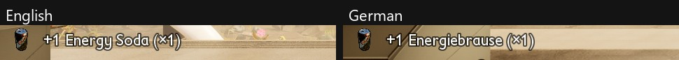



# Add text and translations

<p class="download-stub">Download the finished tutorial project: EnergySoda.zip</p>

Every text a mod shows (item names, descriptions, effect names, terminal entries, creature names) comes from the mod's language files. The game shows the language the player picked in its settings. The example `ModSource/EnergySoda` has its texts in all 11 languages.



No Unreal Engine is needed: the packer turns the language files into the game's text tables.

## 1. Language files

One file per language in the mod's `text` folder, named by the game's language code. Each file maps a key you choose to the text:

```text
EnergySoda/
  text/
    enus.json
    dede.json
    frfr.json
```

`text/enus.json`:

```json
{
  "soda.name": "Energy Soda",
  "soda.description": "Move speed +30% for 3 minutes.",
  "rush.name": "Sugar Rush"
}
```

`text/dede.json`:

```json
{
  "soda.name": "Energiebrause",
  "soda.description": "Laufgeschwindigkeit +30 % für 3 Minuten.",
  "rush.name": "Zuckerschub"
}
```

- `enus.json` is required. Every other language is optional, and a missing file or key shows the English text.
- Language codes: `enus`, `dede`, `eses`, `esmx`, `frfr`, `itit`, `jajp`, `kokr`, `ptbr`, `zhch`, `zhtw`.
- The files are UTF-8, so accents and Japanese, Korean or Chinese characters work as they are.
- A key in another language that `enus.json` does not have is an error, so a typo does not go unnoticed.

## 2. Using the keys

The manifest uses the keys:

```lua
items = {
    {name = "Soda", template = "SmoothieAttack", displayName = "soda.name", description = "soda.description"},
},
shop = {
    {name = "Arsenal", cost = 500, title = "arsenal.title", description = "arsenal.description", recipes = {"Ingot"}},
},
creatures = {
    {name = "Aphid", template = "Aphid", model = "Aphid", displayName = "aphid.name"},
},
```

A text field of a table row takes `{text = "key"}`:

```lua
rows = {
    {table = "/Game/Blueprints/Attacks/Table_StatusEffects.Table_StatusEffects", template = "MealTier3MoveSpeed", name = "Rush", fields = {
        ["DisplayData.Name"] = {text = "rush.name"},
    }},
},
```

For an item or a building, a number instead of a key for `displayName` or `description` uses a text the game already has, for example the name of a vanilla item.

## 3. Text in scripts

Scripts take the same keys. `api.text(key)` returns the text in the player's language, and a label or a window takes `{text = "key"}`. `{name}` in a text is filled from `args`:

```lua
building.label("screen", {text = "slot.bet", args = {bet = 10}}, {bone = "b_body", size = 9})
api.log(api.text("slot.bet", {bet = 10}))
```

A label with a key is drawn again when the player switches the language. `api.onLanguage(fn)` runs a script's own code then. `ModSource/SlotMachine` shows its screen texts this way.

## How keys become text

Every key gets a number from the mod's id and the key, the same on every PC. Two mods can use the same key, because their ids differ, and their numbers practically never clash. The packer stops if two keys of one mod get the same number. Changing the mod's id changes the numbers, so keep the id once the mod is published.

## Check

[Build and install](build.md) the mod. The packer builds one text table per language. Pick another language in the game's settings. The mod's texts switch together with the game's. Craft or pick up the item, and its name appears in that language, as in the picture above.

If the text stays English or empty, see [Text and names](trouble-text.md).

