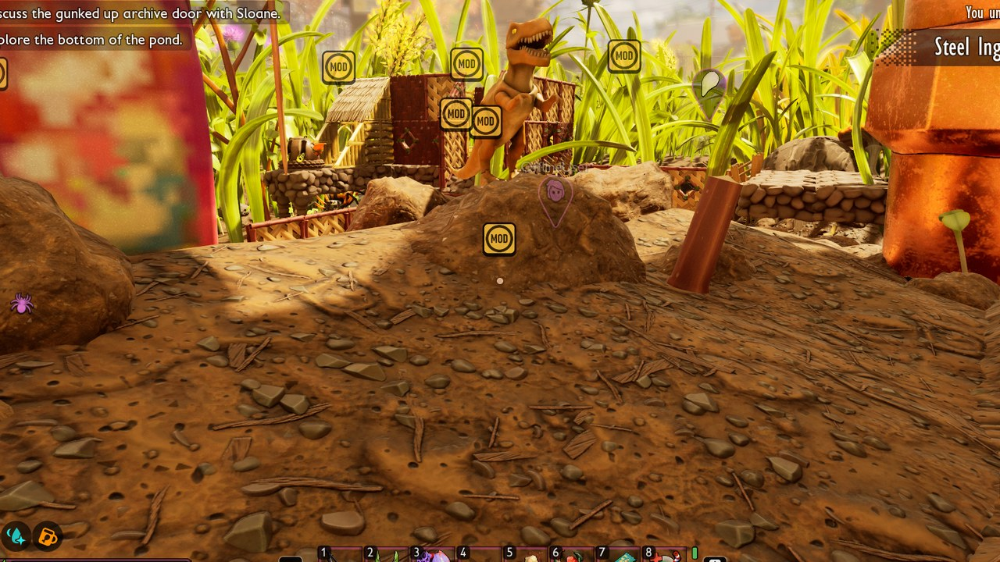
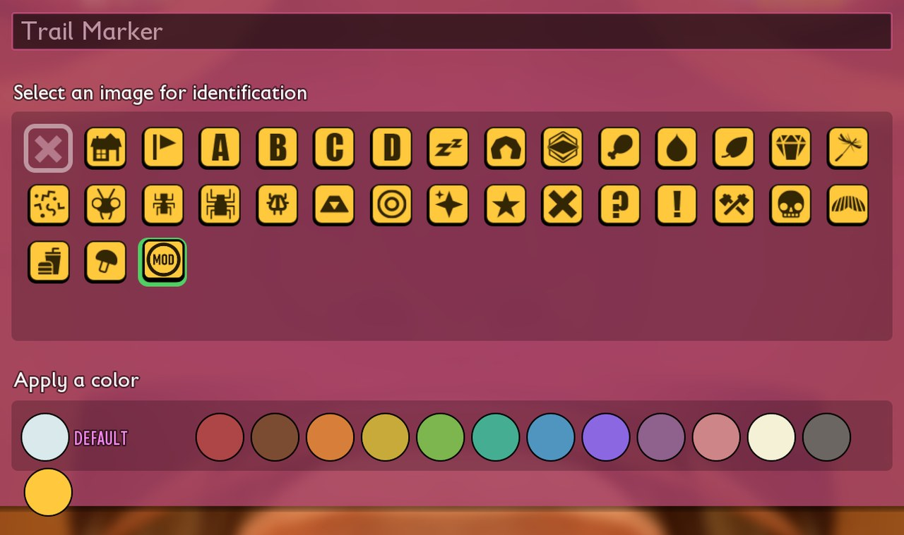
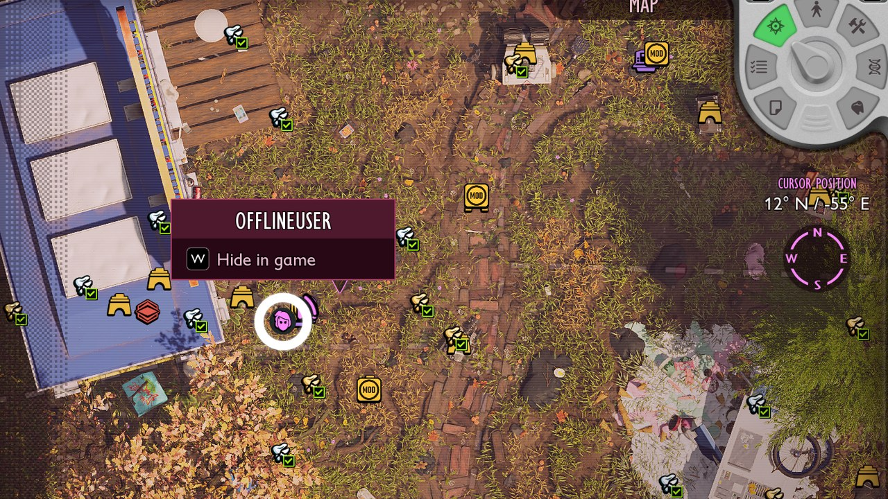
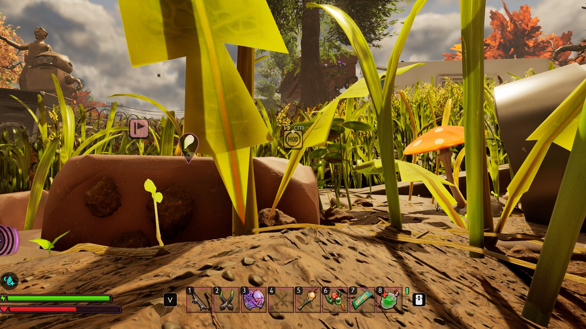
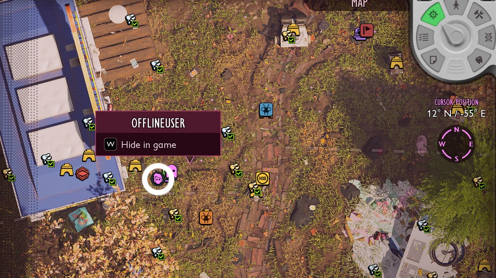



# Add marker icons and colors

<p class="download-stub">Download the finished tutorial project: MarkerIcons.zip</p>

Players pick an icon and a color for each Trail Marker they build. The marker shows them over the world and on the map. A mod can add its own icons and colors to these lists.

The finished mod is in `ModSource/Tutorials/MarkerIcons`: one icon with MOD in a ring and an amber color.



You need Unreal Engine only to cook the textures ([Authoring setup](authoring.md)).

## 1. The icon

The game tints the whole icon with the marker's color. Draw it like the game's own icons:

- A square PNG with a transparent outside, 128x128 is enough.
- A white tile with a dark outline, which takes the color.
- The symbol in dark grey on the tile, which stays dark.

A full-color picture turns into one flat color. `SourceArt/T_Marker_Mod.png` of the example is drawn this way.

`SourceArt/assets.json`:

```json
{
  "destination": "/Game/Mods/MarkerIcons",
  "assets": [
    {"type": "texture", "kind": "icon", "source": "ModSource/Tutorials/MarkerIcons/SourceArt/T_Marker_Mod.png", "folder": "Icons", "name": "T_Marker_Mod"}
  ]
}
```

## 2. The manifest

`content/markers.lua`:

```lua
return {
    id = "MarkerIcons",
    markers = {
        icons = {
            {name = "Mod", texture = "/Game/Mods/MarkerIcons/Icons/T_Marker_Mod.T_Marker_Mod", text = "marker.mod"},
        },
        colors = {"FFC83D"},
    },
}
```

`text/enus.json` holds the icon's name:

```json
{
  "marker.mod": "Mod"
}
```

| Key | Meaning |
| --- | --- |
| `icons[].name` | Short name of the icon. |
| `icons[].texture` | The icon over the world and in the list. |
| `icons[].map` | Another texture for the map. Default: `texture`. |
| `icons[].text` | Required. Text key of the icon's name. |
| `colors` | Colors as hex, like `"FFC83D"`. |

## Check

[Build and install](build.md) the mod. Build a Trail Marker and open it: the icon follows the game's own, the color is in a second row under the game's colors.



The map shows the marker with the same icon.



## A marker of the mod

A script can put a marker with the mod's icon at any place, for a spot the player should find. It shows over the world with its distance, and on the map. `content/scripts/field.lua` of the example marks the open field east of the Snackbar:

```lua
return function(api)
    api.onWorld(function()
        api.marker({-116300, 98000, -4080}, {icon = "Mod", color = "FFC83D"})
    end)
end
```

`icon` is the `name` from `markers.icons`, `color` one of `markers.colors`. The marker is not saved, so the script places it in every loaded world. `remove()` on the returned handle takes it away. Like any script, it needs the player's consent ([Game files, DLL and UE4SS mods](native-mods.md#consent-for-code)).





## Saves and other mods

A marker keeps its choice by the icon's place in the list. Mod icons come after the game's 32, in load order. When you remove the mod, its markers show no icon. The choice stays in the save and comes back with the mod. When a mod earlier in the load order adds or removes icons, the later mods' icons move, so a marker can show another mod's icon. The game keeps at most 127 icons.

