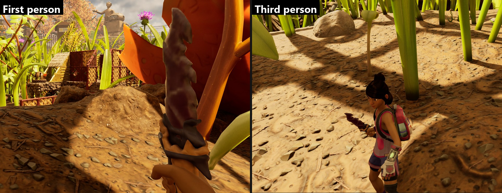
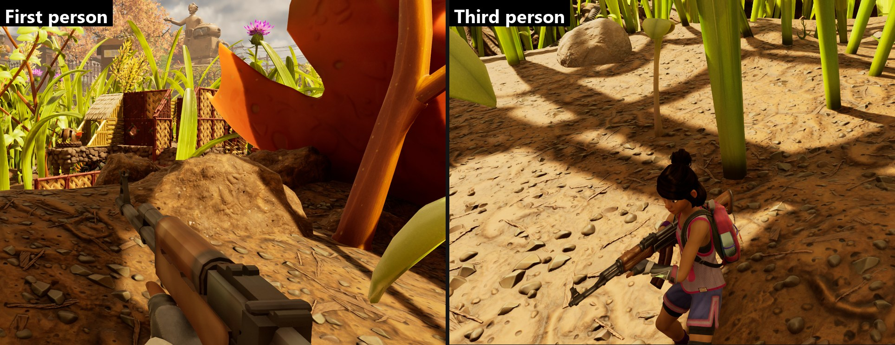



# Add a weapon with your own model

<p class="download-stub">Download the finished tutorial project: FrostBlade.zip</p>

This tutorial makes a sword with its own 3D model. It is based on the Crimson Saber, so it attacks, crafts and saves like the saber, while the game shows your model in the hand, on the ground and in the crafting menu. The finished Frost Blade is in `ModSource/Tutorials/FrostBlade`.

Another finished example is the Fire Dagger in `ModSource/ArsenalWeapons`:



The AK-74 from the same mod does the same for a ranged weapon, based on the Splinter Cannon:



You need Unreal Engine 5.7 with an authoring project and the [editor plugin](editor-plugin.md). See [Authoring setup](authoring.md).

## 1. Create the mod

In the editor, choose **Amber Framework > New Mod...**:

- Name: `Frost Blade`. The id becomes `FrostBlade`.
- Template: **New weapon**.
- Category: Weapons.

The plugin creates `ModSource/FrostBlade` with `mod.json` and `content/main.lua`, and the folder `/Game/Mods/FrostBlade` in the Content Browser. Everything the mod cooks has to be inside that folder.

## 2. Import the model

Prepare the model in your 3D program:

- One mesh, in centimeters. A one-handed sword is about 55 cm long.
- The pivot at the grip. The blade along one axis.
- A few thousand triangles at most. The LOD group below generates the smaller LODs.

Drag the FBX into `/Game/Mods/FrostBlade/Meshes` and import it as a static mesh. Open the mesh and set **LOD Group** to `SmallProp`, then save. The name `SM_FrostBlade` is used below.

## 3. Textures and material

Import the textures into `/Game/Mods/FrostBlade/Textures`:

| Texture | Settings |
| --- | --- |
| `T_FrostBlade_C`, base color | default |
| `T_FrostBlade_N`, normal map | Compression: Normalmap |
| `T_FrostBlade_RMA`, roughness in R, metallic in G, ambient occlusion in B | sRGB off |
| `T_FrostBlade_E`, glow (black where nothing glows) | default |
| `T_FrostBlade_Black`, 4x4 black | sRGB off |

You do not make a material in the editor. The mod names a game material and the framework creates an instance of it with your textures when the game runs. The paintball gun material works for most hand-held items.

## 4. The item

`content/main.lua`:

```lua
local mod = "/Game/Mods/FrostBlade/"
local function asset(path) local name = path:match("[^/]+$"); return mod .. path .. "." .. name end

return {
    id = "FrostBlade",
    items = {
        {
            name = "Blade",
            template = "SwordAntRed",
            fields = {Tier = 2},
            model = {
                mesh = asset("Meshes/SM_FrostBlade"),
                material = {
                    base = "/Game/_Augusta/Art/Items/Weapons/Gun_Paintball/Textures/MI_Weapon_Gun_Paintball_Equip.MI_Weapon_Gun_Paintball_Equip",
                    textures = {
                        Albedo = asset("Textures/T_FrostBlade_C"),
                        Normal = asset("Textures/T_FrostBlade_N"),
                        RMA = asset("Textures/T_FrostBlade_RMA"),
                        ["Emissive Texture"] = asset("Textures/T_FrostBlade_E"),
                        FresnelMask = asset("Textures/T_FrostBlade_Black"),
                        SSSMask = asset("Textures/T_FrostBlade_Black"),
                    },
                    vectors = {["Emissive Color"] = {1, 3, 6, 1}},
                },
                equipped = {location = {0, 0, 0}, rotation = {0, 0, 0}, scale = 1},
            },
        },
    },
    recipes = {
        {name = "Blade", template = "SwordAntRed", crafts = "Blade", unlocked = true,
         ingredients = {{item = "QuartzShard", count = 1}, {item = "Sap", count = 2}}},
    },
}
```

- `asset("Meshes/SM_FrostBlade")` expands to the object path `/Game/Mods/FrostBlade/Meshes/SM_FrostBlade.SM_FrostBlade`.
- `Emissive Color` makes the glow texture bright. The fourth number is alpha.
- `unlocked = true` makes the recipe known from the start, which is handy for testing. Remove it later and sell the recipe at the terminal as in [Add an item with a recipe](tutorial-item.md#5-sell-the-recipe-at-the-ranger-terminal).
- Without `displayName` the item uses the saber's name. Add your own text as in [Add an item with a recipe](tutorial-item.md#4-name-description-and-icon).

## 5. Build and try it

[Build and install](build.md) the mod. Craft the blade and take it in your hand.

## 6. Place the model in the hand

The first try usually sits at the wrong angle. Fix it in the game:

1. In the mod manager's **Settings**, turn on **Mod author tools**. Start the game, hold the blade, open the pause menu and choose **Item Placement**.
2. Drag the Position, Pitch, Yaw, Roll and Scale sliders, or type an exact number next to a slider and press Enter. The blade moves right away.
3. Switch off **First-person camera** to check the blade in third person. Both views use the same values.
4. Close the screen. The values are saved.

Saved values apply on your PC at once. To ship them with the mod, open `%LOCALAPPDATA%\G2Launcher\Tuning\FrostBlade_Blade.lua.txt`, copy the `equipped = {...}` block into the manifest in place of the old one, and pack again.

## Without the editor window

The same mod can be built from source files with the editor closed. Describe the files in `SourceArt/assets.json`:

```json
{
  "destination": "/Game/Mods/FrostBlade",
  "assets": [
    {"type": "staticmesh", "source": "ModSource/FrostBlade/SourceArt/SM_FrostBlade.fbx",
     "folder": "Meshes", "name": "SM_FrostBlade", "lodGroup": "SmallProp"},
    {"type": "texture", "kind": "color", "source": "ModSource/FrostBlade/SourceArt/T_FrostBlade_C.png",
     "folder": "Textures", "name": "T_FrostBlade_C"},
    {"type": "texture", "kind": "normal", "source": "ModSource/FrostBlade/SourceArt/T_FrostBlade_N.png",
     "folder": "Textures", "name": "T_FrostBlade_N"}
  ]
}
```

Then build it from a console, as on [Build and install](build.md).

## Automatic fire

A ranged weapon fires while the button is held when its attack row loops like the Splotcher's. The AK-74 copies the Splinter Cannon's shot and sets four fields of its own row:

```lua
rows = {
    {table = "/Game/Blueprints/Attacks/ItemAttacks.ItemAttacks", template = "SplinterCannonShot", name = "RifleShot", fields = {
        bHitFrameLoops = true,
        ChargeTime = 30,
        AttackAnim = {unreal = "/Script/Maine.AttackAnimEffect'/Game/Blueprints/Attacks/AttackAnims/AttackAnim_Paintball.AttackAnim_Paintball'"},
        WeaponAnim = "/Game/_Augusta/Art/Items/Weapons/CrossBow_Harpoon/Animation/W_AM_FP_CrossbowHarpoon_Attack.W_AM_FP_CrossbowHarpoon_Attack",
    }},
},
```

`bHitFrameLoops` makes the attack shoot on every loop of its animation, and the long `ChargeTime` keeps the loop going while the button is held. The Splotcher's animation gives about three shots a second. Each shot uses one piece of ammo. The item's `ammo` points at this row, as in `ModSource/ArsenalWeapons/content/example_rifle.lua`.

## More

- Skeletal models, animations and preview size: [Models](models.md).
- Why static meshes need PadSM2: [Models](models.md#static-meshes-and-padsm2).
- Your own attacks and damage types: see the Fire Dagger in `ModSource/ArsenalWeapons`, which adds three attack rows with fire damage and points the item's combo at them.

Next: [Make a building with a script](tutorial-building.md).

