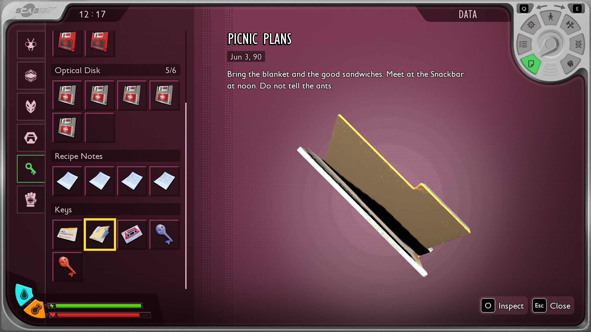
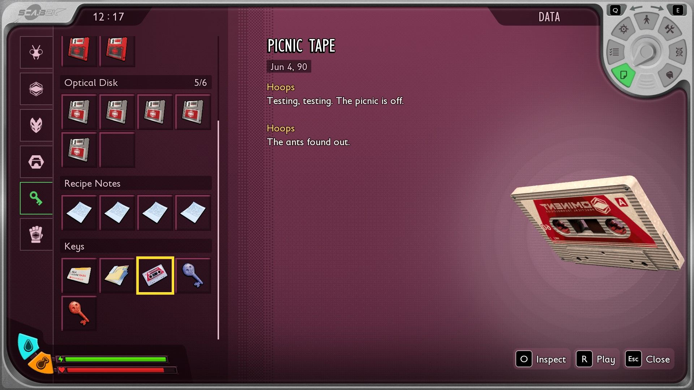



# Add a note and an audio log

<p class="download-stub">Download the finished tutorial project: ParkNotes.zip</p>

This page makes Park Notes, a mod with a note and an audio log lying by the Snackbar. The player picks them up with E like the game's own, and they stay in the Data menu.

The finished mod is in `ModSource/Tutorials/ParkNotes`.





Unreal Engine is needed to cook their world classes. See [Build and install](build.md).

## 1. The world classes

Each one needs its own class to lie in the world. `SourceArt/assets.json`:

```json
{
  "destination": "/Game/Mods/ParkNotes",
  "assets": [
    {"type": "item", "name": "Note", "template": "StatueLabNote01", "mesh": "/Game/Art/World/ZN10_Labs/Lab_Props/SM_ElectroFolder_A", "equipped": false},
    {"type": "item", "name": "Tape", "template": "AudioLogFTUE_Explosion", "mesh": "/Game/Art/Items/General/Audio_Log/SM_Cassette_Tape_A", "equipped": false}
  ]
}
```

`template` is a note or audio log of the game. A `mesh` of your own works here as in any [model](models.md).

## 2. The manifest

```lua
items = {
    {name = "Note", template = "StatueLabNote01", displayName = "note.name", description = "note.text",
     category = "Stuff", subcategory = "Stuff.Keys", model = "Note"},
    {name = "Tape", template = "AudioLogFTUE_Explosion", displayName = "tape.name", audioLog = "tape",
     category = "Stuff", subcategory = "Stuff.Keys", model = "Tape"},
},
world = {
    {actor = "/Game/Mods/ParkNotes/Items/BP_Note_World.BP_Note_World_C", at = {-114700, 121850, -2680}},
    {actor = "/Game/Mods/ParkNotes/Items/BP_Tape_World.BP_Tape_World_C", at = {-114600, 121950, -2680}},
},
```

| Key | Meaning |
| --- | --- |
| `description` | The note's text. |
| `audioLog` | Name of a dialog in the mod's `dialogs` folder, which the tape plays. See [Add spoken lines](tutorial-lines.md). |
| `category` | The Data menu's category: `Ominent`, `Stranger`, `Places` or `Stuff`. |
| `subcategory` | The section inside it, such as `Stuff.Keys` or `Ominent.Park`. |

Your own categories and sections: [Add Data menu categories and cards](tutorial-data.md).

Any of these three keys makes the item a key item, which the framework also adds to the game's key item table, the one the Data menu lists.

A key item in the world is a placed actor, like the game's notes, so `world` uses `actor` and the class from step 1. The game saves it: once picked up, it stays gone.

## 3. The tape's lines

`dialogs/tape.json`:

```json
{
  "speaker": "Hoops",
  "start": "one",
  "nodes": {
    "one": {"say": "tape.one", "next": "two"},
    "two": {"say": "tape.two"}
  }
}
```

The transcript in the Data menu stays empty when a speaker of the mod says the first line, so start with one of the game's speakers.

## The date

The Data menu shows a date under the name. Set it with `fields = {KeyItemDateDay = 3, KeyItemDateMonth = 6, KeyItemDateYear = 90}`. Without it the item shows its template's date.

## From a script

`api.giveKeyItem(row)` gives a note or tape to the party directly, for example as a reward. The game announces it and opens the note like a picked up one.

```lua
api.giveKeyItem("ParkNotes_Note")
```

## Check

[Build and install](build.md) the mod and load a save. Walk to the Snackbar and press E on the folder: the note opens with its text. Press E on the cassette, then find both in the Data menu, under Stuff, in Keys.

