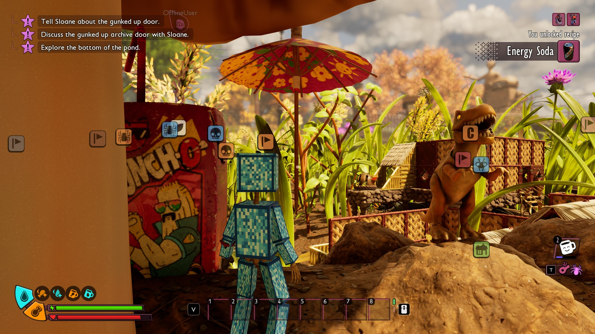
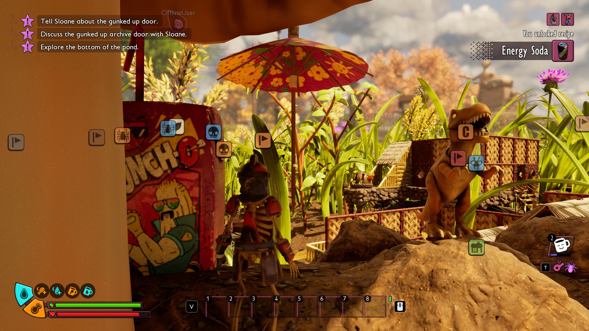



# Add an outfit

<p class="download-stub">Download the finished tutorial project: DiamondOutfit.zip</p>

This page makes Diamond Outfit, a look the player wears over any armor and switches in the mod's settings. It uses the same two slots as the game's own skins. The armor underneath keeps working, only its look changes.

The finished mod is in `ModSource/Tutorials/DiamondOutfit`.





Unreal Engine is needed to import and cook the meshes. See [Build and install](build.md).

## 1. The meshes

An outfit has a head mesh, a body mesh or both. They are skeletal meshes on the game's armor skeleton, `/Game/_Augusta/Art/Characters/Dummy/SK_Armor_Skeleton`. The mesh moves with the player because the cook gives it the game's own pose Blueprint, the one its armor uses.

In Blender, keep every bone of that skeleton and weight your mesh to them. Export the skeleton's bone positions the way [Add creatures](tutorial-creatures.md) does for its model, with `Tools/prepare_creature_model.py`:

```json
{
  "source": "ModSource/Tutorials/DiamondOutfit/SourceArt/SK_DiamondBody.blend",
  "name": "SK_DiamondBody",
  "fbx": "Build/DiamondOutfit/SK_DiamondBody.fbx",
  "gameSkeleton": "/Game/_Augusta/Art/Characters/Dummy/SK_Armor_Skeleton",
  "referencePose": "Build/DiamondOutfit/SK_Armor_Skeleton.json"
}
```

The example builds its boxes from a script, `SourceArt/make_outfit.py`, each box on one bone. A mesh made by hand works the same way.

## 2. The assets

`SourceArt/assets.json`:

```json
{"type": "skeletalmesh", "source": "Build/DiamondOutfit/SK_DiamondHead.fbx", "folder": "Meshes", "name": "SK_DiamondHead",
 "materials": {"M_Diamond": "Materials/MI_Diamond"}},
{"type": "skeletalmesh", "source": "Build/DiamondOutfit/SK_DiamondBody.fbx", "folder": "Meshes", "name": "SK_DiamondBody",
 "materials": {"M_Diamond": "Materials/MI_Diamond"}},
{"type": "outfit", "name": "Diamond", "head": "Meshes/SK_DiamondHead", "body": "Meshes/SK_DiamondBody"}
```

| Key | Meaning |
| --- | --- |
| `materials` | On a mesh: its material slots by name. The game shows an outfit's mesh as it is, so the mesh carries its materials itself. |
| `head`, `body` | On the outfit: the meshes. One of them is enough. |
| `femaleHead`, `femaleBody` | Other meshes for female characters. Default: `head` and `body`. |

## 3. The manifest

```lua
outfits = {
    {name = "Diamond", choice = "look", value = "Diamond"},
},
```

`settings.schema.json`:

```json
{"key": "look", "label": "Outfit", "type": "choice", "choices": ["Off", "Diamond"], "default": "Diamond"}
```

The outfit is worn while the setting has that value, and it changes as soon as the player changes the setting. Without `choice` it is always worn. With several outfits, the first one in the last mod of the load order whose setting matches is worn.

An outfit that is on stays on over a skin chosen in the game's Options. Turning it off shows that skin.

An outfit with `model = "Other"` uses the `outfit` entry with that name. `head = false` or `body = false` leaves that part out.

## Check

[Build and install](build.md) the mod and load a save. Press the camera key to see the player from behind. Set Outfit to Off in the mod's settings: the outfit comes off at once.

