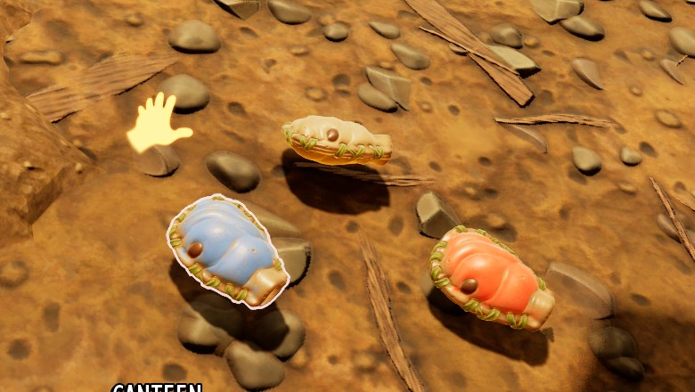



# A choice of looks in the settings

This page makes Canteen Colors, a mod with a setting that paints the canteen blue or red. All looks ship in one mod, and the player picks one in the mod's settings, also while playing. The finished mod is in `ModSource/Tutorials/CanteenColors`. Unreal Engine is needed for the materials and classes.



The same works for any choice of looks: textures, materials or whole models of an item or a building.

## 1. The setting

`settings.schema.json` in the mod folder:

```json
{
  "settings": [
    { "key": "color", "label": "Canteen color", "type": "choice", "choices": ["Natural", "Blue", "Red"], "default": "Natural",
      "description": "The look of the canteen. Natural is the game's own." }
  ]
}
```

The mod manager and the game's Mods screen show it as a list to pick from ([Settings](create-a-mod.md#settings)).

## 2. One model for each look

Each look is a model of the canteen in `SourceArt/assets.json`. Both use the game's canteen mesh with a material of their own, which is the game's canteen material with another color texture:

```json
{"type": "gameMesh", "path": "/Game/Art/Items/General/Canteen01/SM_Canteen01"},
{"type": "texture", "kind": "color", "source": "ModSource/Tutorials/CanteenColors/SourceArt/T_Canteen_Blue_C.png", "folder": "Textures", "name": "T_Canteen_Blue_C"},
{"type": "material", "folder": "Materials", "name": "MI_Canteen_Blue",
 "parent": "/Game/Art/Items/General/Canteen01/Textures/V01/MI_Canteen01_V01_World.MI_Canteen01_V01_World",
 "textures": {"Albedo": "/Game/Mods/CanteenColors/Textures/T_Canteen_Blue_C.T_Canteen_Blue_C"}},
{"type": "item", "name": "BlueCanteen", "row": "Canteen", "template": "Canteen",
 "mesh": "/Game/Art/Items/General/Canteen01/SM_Canteen01", "material": "Materials/MI_Canteen_Blue"}
```

Red is the same with its own texture. The textures are the game's canteen texture with the gourd painted over. [Explore the game files](tutorial-game-files.md) shows how to find a game item's mesh, material and textures.

## 3. The manifest

```lua
return {
    id = "CanteenColors",
    skins = {
        {item = "Canteen", choice = "color", models = {Blue = "BlueCanteen", Red = "RedCanteen"}},
    },
}
```

A value without a model, here `Natural`, keeps the game's canteen. See [skins](manifest.md#skins).

## When the look changes

A change in the Mods screen applies at once to canteens made from then on, such as one dropped from the backpack. All looks are the same game item, the Canteen, so the save keeps canteens as the game's own.

## Check

[Build and install](build.md) the mod, start a game and pick Blue in the mod's settings. The UE4SS log shows `Skin Canteen: Blue`. Drop a canteen: it is blue.

