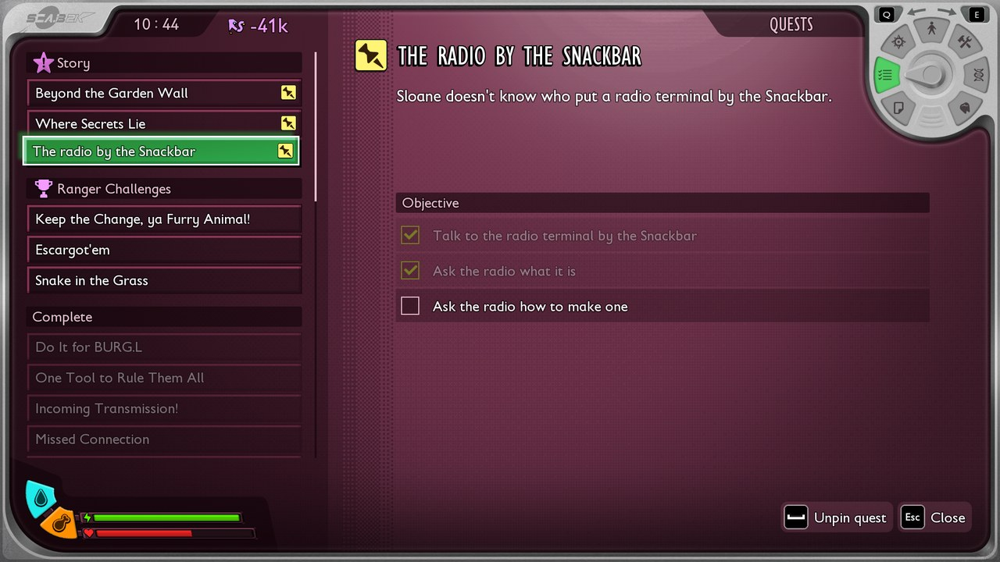
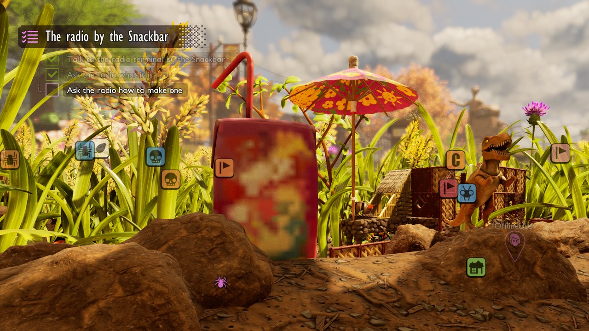



# Add quests

<p class="download-stub">Download the finished tutorial project: RadioDialog.zip</p>

A mod can have its own quests in the game's quest list, each with a title, a description and objectives with a marker in the world. They run on the game's own quest system, which starts and completes quests by world variables. The mod sets those variables from its scripts or from its dialogs.

The example is part of `ModSource/RadioDialog`: Sloane's answer to "Who put it there?" starts the quest "The radio by the Snackbar". Its three steps are to talk to the radio, then ask it what it is and how to make one.



Read [Add terminal dialogs](tutorial-dialogs.md) first. Unreal Engine is needed to cook the world variables and the dialogs ([Authoring setup](authoring.md)).

## 1. World variables

The quest's state lives in world variables of the mod, saved with the world. `variables.json` in the mod folder:

```json
{
  "radioQuest": 0,
  "radioVisited": 0,
  "radioAskedWhat": 0,
  "radioAskedHow": 0
}
```

More about variables: [World variables](scripting.md#world-variables).

## 2. The quest

`content/main.lua`:

```lua
quests = {
    {
        name = "Radio",
        title = "quest.title",
        description = "quest.description",
        start = {variable = "radioQuest", equals = 1},
        objectives = {
            {text = "quest.visit", done = {variable = "radioVisited", equals = 1}, marker = "AmberRadio"},
            {text = "quest.what", done = {variable = "radioAskedWhat", equals = 1}, marker = "AmberRadio"},
            {text = "quest.how", done = {variable = "radioAskedHow", equals = 1}, marker = "AmberRadio"},
        },
    },
},
```

| Key | Meaning |
| --- | --- |
| `name` | Short name. The quest's row becomes `<namespace>_<name>` in the game's side quest table. |
| `title`, `description` | Text keys of the mod's language files. |
| `start` | When the quest starts: a condition on a world variable of the mod. |
| `objectives` | The steps, in order. Each one starts when the one before it is done and stays hidden until then, like the game's own quests. The quest is done with its last one. |
| `sticky` | `false` keeps the quest out of the list on the screen until the player pins it. Default `true`. |

Each objective:

| Key | Meaning |
| --- | --- |
| `text` | Text key of the line in the quest list. |
| `done` | When the objective is done: a condition on a world variable. |
| `count` | Instead of `done`: `{variable = "parts", max = 3}` shows "0/3" and is done when the variable reaches `max`. |
| `marker` | An actor tag. The game shows a marker with the distance over actors with this tag while the objective is open. |

A condition is `{variable = "name", equals = 1}`, or the same with `notEqual`, `above`, `below`, `atLeast` or `atMost`. The value is a whole number, `true` or `false`.

## 3. Set the variables

From a dialog: a line or an answer with `set` changes variables when it plays. In `dialogs/sloane.json`, Sloane's last line starts the quest:

```json
"mod": {"say": "sloane.mod", "answers": ["thanks"], "set": {"radioQuest": 1}}
```

and in `dialogs/radio.json` the radio's lines complete the steps:

```json
"helloPete": {"say": "radio.helloPete", "when": {"teen": "Pete"}, "answers": ["what", "how", "bye"], "set": {"radioVisited": 1}},
"whatInfo": {"say": "radio.whatInfo", "answers": ["how", "bye"], "set": {"radioAskedWhat": 1}},
"howInfo":  {"say": "radio.howInfo", "answers": ["what", "bye"], "set": {"radioAskedHow": 1}}
```

Each of the four greetings sets `radioVisited`, whichever teen the player plays.


From a script: `api.variables.set("radioQuest", 1)`, for example when a building is placed or a lever is pulled.

## 4. The marker

The objective's marker points at actors with the tag `AmberRadio`. The script tags the terminal when it places it:

```lua
local terminal = api.conversation.terminal("radio", {-114200, 121100, -2809}, {0, 180, 0}, "radio.name", look) -- look: see step 4 of Add terminal dialogs
api.tag(terminal, "AmberRadio")
```

`api.tag(actor, name)` works on any actor the script has. A building of the mod in `api.onBuilding` has `building.tag(name)`.

## Check

[Build and install](build.md) the mod and load a save. Talk to Sloane at a Ranger terminal and pick "What is the radio terminal by the Snackbar?", then "Who put it there?". After her answer the quest appears on the screen with a marker over the radio. Talk to the radio: the first step is done and the next one appears. Ask the radio both questions to finish the quest. The states stay after saving and loading, because the game saves the variables.



