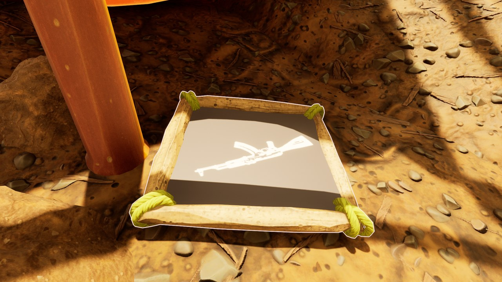
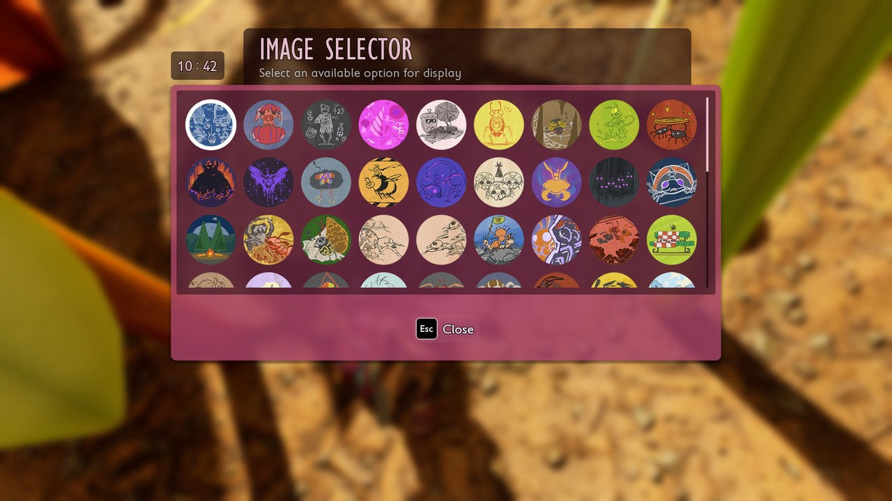



# Add pictures for signs

<p class="download-stub">Download the finished tutorial project: ArmorySigns.zip</p>

Players label chests with Sign Frames and Picture Frames and pick a picture for each. A mod can add its own pictures to that list. The example is part of `ModSource/BaseBuildings`, three pictures with the rifle, the dagger and the chest of the other examples. The steps below build them as a separate mod, ArmorySigns.

The finished mod is in `ModSource/Tutorials/ArmorySigns`.



You need Unreal Engine only to cook the textures ([Authoring setup](authoring.md)).

## 1. The pictures

Each picture needs two textures:

- The picture on the frame: a square PNG, 512x512 is enough. The game's pictures are light shapes on a dark background, or plain colors. The sign material brightens the picture, so a light background turns white. Use a dark one.
- The icon in the picture list: a round picture with a transparent outside, 256x256, like the game's icons.

`SourceArt/assets.json`, shown for the rifle sign. The dagger and the chest have the same two entries:

```json
{
  "destination": "/Game/Mods/ArmorySigns",
  "assets": [
    {"type": "texture", "kind": "color", "source": "ModSource/Tutorials/ArmorySigns/SourceArt/T_Sign_Rifle.png", "folder": "Textures", "name": "T_Sign_Rifle"},
    {"type": "texture", "kind": "icon", "source": "ModSource/Tutorials/ArmorySigns/SourceArt/T_SignIcon_Rifle.png", "folder": "Icons", "name": "T_SignIcon_Rifle"}
  ]
}
```

## 2. The manifest

```lua
local function texture(folder, name) return "/Game/Mods/ArmorySigns/" .. folder .. "/" .. name .. "." .. name end

return {
    id = "ArmorySigns",
    signs = {
        {name = "Rifle", picture = texture("Textures", "T_Sign_Rifle"), icon = texture("Icons", "T_SignIcon_Rifle")},
        {name = "Dagger", picture = texture("Textures", "T_Sign_Dagger"), icon = texture("Icons", "T_SignIcon_Dagger")},
        {name = "Chest", picture = texture("Textures", "T_Sign_Chest"), icon = texture("Icons", "T_SignIcon_Chest")},
    },
}
```

| Key | Meaning |
| --- | --- |
| `name` | Short name. The row becomes `<namespace>_<name>`. |
| `picture` | The texture shown on the frame. |
| `material` | A ready material instead of `picture`. |
| `icon` | The texture in the picture list. Default: `picture`. |

The pictures join the game's default set, so every player has them without unlocking anything. The framework makes the frame material from the game's own sign material with your picture.

## Check

[Build and install](build.md) the mod. Build a Sign Frame and open it: the pictures follow the game's own in the Image Selector.



Pick one. It stays after saving and loading. A frame keeps the chosen picture by its row name. Without the mod, the frame shows the empty plate and keeps the choice in the save.

