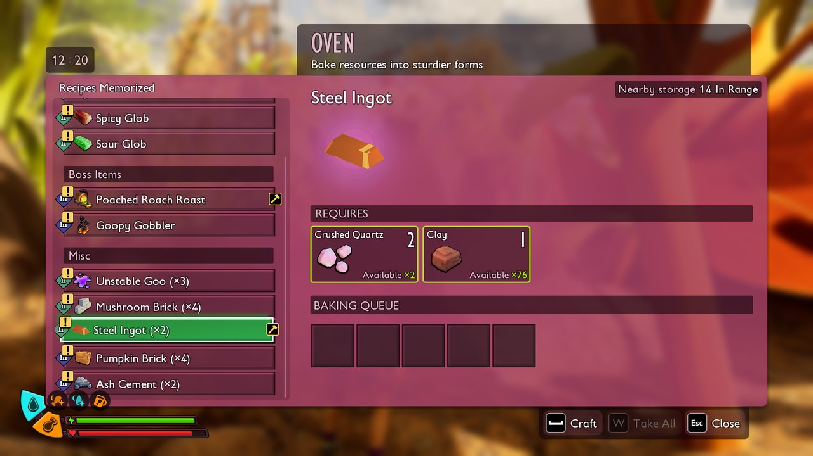



# Add recipes to a station

<p class="download-stub">Download the finished tutorial project: SteelSmelting.zip</p>

Every recipe belongs to a station, such as the Workbench, the Oven, the Jerky Rack or the Cookery. This page adds a recipe to the Oven. The mod built here, Steel Smelting, makes the Oven turn 2 Crushed Quartz and 1 Clay into 2 Steel Ingots in one game hour. The ingot comes from `SteelGear`.

The finished mod is in `ModSource/Tutorials/SteelSmelting`. Steel Gear already has the same recipe, so with both mods installed the Oven lists it twice.

Read [Add an item with a recipe](tutorial-item.md) first. No Unreal Engine is needed.

## The recipe

`content/smelting.lua`:

```lua
return {
    id = "SteelSmelting",
    recipes = {
        {name = "Ingot", template = "FireBrick", result = "SteelGear_Ingot", station = "Forge", hours = 1, count = 2,
         unlocked = true, ingredients = {{item = "CrushedQuartz", count = 2}, {item = "Clay", count = 1}}},
    },
}
```

| Key | Meaning |
| --- | --- |
| `template` | A vanilla recipe made at the same station. `FireBrick` is an Oven recipe, so the copy keeps the Oven's crafting tab. |
| `result` | The item it makes: a game item or another mod's item, by full row name. For an item of your own mod use `crafts` with the short name. |
| `station` | Which station makes it. See the table below. |
| `hours` | Production time in game hours. |
| `count` | How many items one craft makes. |
| `unlocked` | Known from the start. Without it, sell the recipe at the Ranger terminal ([Sell recipes at the Ranger terminal](tutorial-shop.md)). |

`mod.json` lists `SteelGear` as a dependency, because the recipe makes its ingot.

## Stations

`station` is the station tag without the `CraftingBuilding.` prefix. A full tag such as `ItemProcessing.Refining` is used as written.

| `station` | Buildings | Example vanilla recipe |
| --- | --- | --- |
| `Workbench` | Workbench, Lab Workbench, Marine Workbench | Canteen |
| `Forge` | Oven | Fire Brick |
| `Kiln` | Kiln | Glass |
| `DryingRack` | Jerky Rack | Fabric |
| `CookingStation` | Cookery, Pressure Cooker | Gnatchos |
| `RoastingSpit` | Roasting Spit, EverChar Roasting Spit | Cooked Aphid Meat |
| `Mixer` | Smoothie Station, Centipede Cauldron | Fiber Smoothie |
| `Glue` | Glue Masher | Spicy Glue |
| `PaintMixer` | Splotch Mixer | Blue Paintball |
| `Quern` | Quern | Crushed Quartz |
| `Hatchery` | Hatchery | Ant egg hatching |
| `BuggyBuffing` | Buffin' Barrel | Buggy evolutions |
| `WorkbenchSubjectV` | Forbidden Workbench | Accessories |
| `ItemProcessing.Refining` | Grinder | Raw fiber |
| `ItemProcessing.Spinning` | Spinning Wheel | Woven Web |

Use a template from the same station, so the recipe keeps a crafting tab that station shows.

## Check

[Build and install](build.md) the mod, start the game, build an Oven and open it. The recipe is in the list, in the Misc group with the template's other bricks:



Put in the ingredients. After one game hour the Oven holds 2 Steel Ingots.

`cfinspect CraftingRecipeTable SteelSmelting_Ingot` prints the recipe row with its values.

