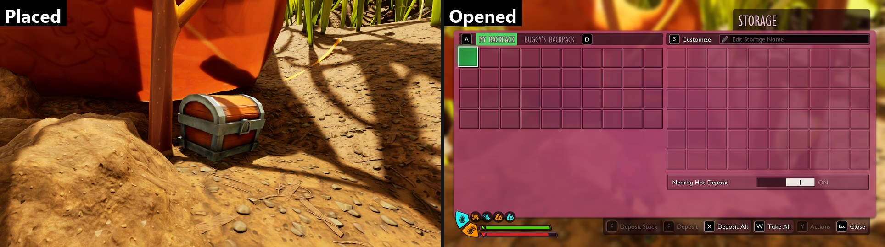



# Add a storage chest

<p class="download-stub">Download the finished tutorial project: TreasureChest.zip</p>

This page builds the Treasure Chest from `ModSource/BaseBuildings` as a separate mod, TreasureChest: a storage building with its own model and 60 slots, sold at the Ranger terminal. It uses the game's own storage window and keeps its contents in saves.

The finished mod is in `ModSource/Tutorials/TreasureChest`.



Read [Make a building with a script](tutorial-building.md) first. This page uses the same building class setup without a script.

## 1. The class

A chest needs its own Blueprint class, like every new building. Its parent is the game's storage Blueprint, so the chest gets the inventory, the storage window and the deposit buttons of the game's chests:

```json
{"type": "blueprint", "folder": "Blueprints", "name": "BP_TreasureChest",
 "parent": "/Game/Blueprints/Items/BaseBlueprints/BP_BaseItemStorageBuilding.BP_BaseItemStorageBuilding_C",
 "nativeParent": "/Script/Maine.StorageBuilding"}
```

`nativeParent` is the C++ class under the game Blueprint, see [blueprint](create-a-mod.md#blueprint). The project needs the game's building classes from [Authoring setup](authoring.md#4-buildings-the-games-building-class).

## 2. The model

`SourceArt/model.json` is the spec of a Blender step, `{"script": "Tools/ExampleArt/prepare_model.py", "spec": "SourceArt/model.json"}` in `assets.json`, which prepares it before the import:

```json
{
  "name": "SM_TreasureChest",
  "kind": "building",
  "source": "ModSource/TreasureChest/SourceArt/Chest/stylized-chest.fbx",
  "frontAxis": "+X",
  "widthCm": 150,
  "albedo": "ModSource/TreasureChest/SourceArt/Chest/textures/chest_baseColor.png",
  "iconSize": 512, "iconRoll": 0, "iconDirection": [1.0, -0.6, 0.5],
  "fbx": "Build/TreasureChest/SM_TreasureChest.fbx",
  "icon": "Build/TreasureChest/T_TreasureChestIcon.png"
}
```

| Key | Meaning |
| --- | --- |
| `kind` | `building`: the origin goes to the bottom centre and the widest side is scaled to `widthCm`. The game's Storage Chest is about 150 cm wide. |
| `frontAxis` | The side of the source model that faces the player. |
| `albedo` | The color texture, for the icon. Needed when the source file does not link its textures, as with most FBX files. |

The textures are packed into the game's material inputs with `Tools/ExampleArt/pack_textures.py`, as in [Add a weapon with your own model](tutorial-model.md#3-textures-and-material).

## 3. The manifest

```lua
buildings = {
    {
        name = "Chest",
        template = "StorageBig",
        displayName = "chest.name",
        description = "chest.description",
        storage = {slots = 60},
        fields = {
            ["IconSoft"] = asset("Icons/T_TreasureChestIcon"),
            ["PlacementData.Actor"] = mod .. "Blueprints/BP_TreasureChest.BP_TreasureChest_C",
        },
        model = {mesh = asset("Meshes/SM_TreasureChest"), material = {...}, building = {component = "RootComponent", hide = {}}},
    },
},
rows = {
    {table = "BuildingRecipeTable", template = "StorageBig", name = "Chest", fields = {
        ["Building"] = {handle = {table = "BuildingsTable", row = "TreasureChest_Chest"}},
        ["Requirements"] = {ingredients = {{item = "SteelGear_Ingot", count = 2}, {item = "GrassPlank", count = 6}}},
    }},
},
shop = {
    {name = "Vault", cost = 200, title = "vault.title", description = "vault.description", buildings = {"Chest"}},
},
```

- `template = "StorageBig"` copies the Storage Chest row. The framework also copies what the Storage Chest's Blueprint sets on its use component, such as which window opens.
- `storage = {slots = 60}` sets the size. The game's chests have 20, 40 and 60 slots.
- The building recipe and the terminal entry work as in [Sell recipes at the Ranger terminal](tutorial-shop.md#a-building-at-the-terminal).

## Sizes of the game's chests

A mod can change the size of a chest from the game without a new building:

```lua
storage = {
    {building = "StorageBig", slots = 50},
}
```

The size applies to new chests and to chests already built, also in old saves. Items past a lowered size stay in the save. See [storage](manifest.md#storage).

## Check

[Build and install](build.md) the mod. Buy the Vault at the Ranger terminal, build the chest and open it: the storage window shows 6 rows of 10 slots. Put items in, save, load the save: the items are still there.

