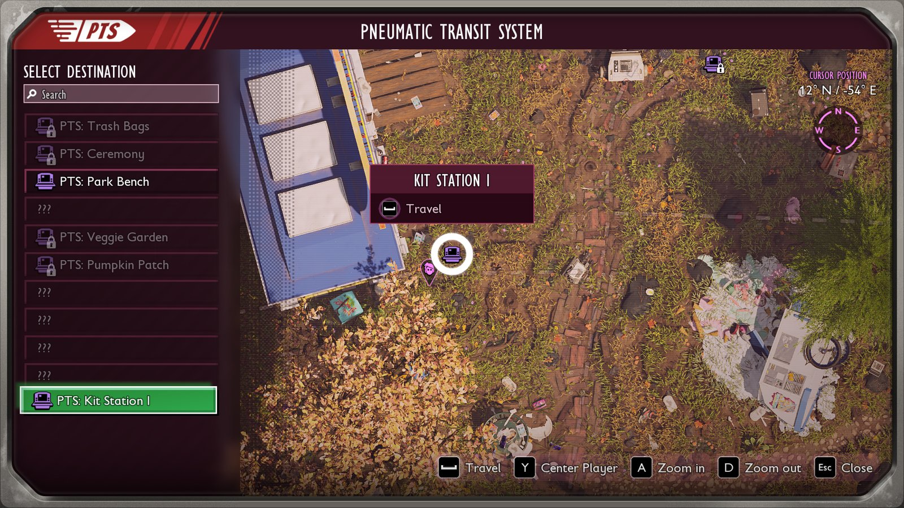



# Add a fast-travel station to build

<p class="download-stub">Download the finished tutorial project: StationKit.zip</p>

This page makes Station Kit, a mod that adds a PTS Station to the build menu. Every station the player builds is a working station of the game's Pneumatic Transit System, with its own name in the travel list and its own map icon. The finished mod is in `ModSource/Tutorials/StationKit`.



Unreal Engine is needed for the building's class. A station at a fixed place needs none, see [Add a fast-travel station](tutorial-teleport.md).

## 1. The building's class

The building uses the base of the game's station as its mesh, so the player sees where the station goes while placing it. In `SourceArt/assets.json`:

```json
{"type": "gameMesh", "path": "/Game/Art/World/ZN10_Labs/Lab_Props/Teleporter/SM_Teleporter_Base"},
{"type": "building", "name": "Station", "template": "StatueAphid",
 "mesh": "/Game/Art/World/ZN10_Labs/Lab_Props/Teleporter/SM_Teleporter_Base"}
```

`StatueAphid` is a decoration of the game. The building gets its build menu tab, health and placement rules.

## 2. The manifest

The building, its recipe and terminal entry work as in [Add a decoration](tutorial-decor.md). The `teleports` entry puts a station on it:

```lua
buildings = {
    {name = "Station", template = "StatueAphid", displayName = "station.name", description = "station.description",
        fields = {["IconSoft"] = "/Game/UI/Images/MapIcons/T_UI_MapMarker_FieldStation.T_UI_MapMarker_FieldStation"},
        model = "Station"},
},
teleports = {
    {name = "Station", building = "Station", titles = {"station.title.1", "station.title.2", "station.title.3"},
        places = {"station.place.1", "station.place.2", "station.place.3"}},
},
```

| Key | Meaning |
| --- | --- |
| `building` | The building the station stands on. |
| `titles` | Names in the travel list, given out in the order the stations are built. After the last one, stations share the last name. |
| `places` | Names on the map and in the "You discovered" banner, one for each title. |

The names in `text/enus.json`:

```json
{
  "station.title.1": "PTS: Kit Station I",
  "station.title.2": "PTS: Kit Station II",
  "station.title.3": "PTS: Kit Station III",
  "station.place.1": "Kit Station I",
  "station.place.2": "Kit Station II",
  "station.place.3": "Kit Station III"
}
```

## 3. In the game

When the building is finished, the game's station stands on it, already repaired, since the player paid for it with the recipe. The game shows "You discovered Kit Station I", and the station is in the travel window of every repaired PTS. Destroying the building removes the station. The save keeps each station with its name.

The [travel rules](tutorial-teleport.md#travel-rules) `travel` and `requires` work on these stations too.

## Check

[Build and install](build.md) the mod, unlock the Station Kit at the Ranger terminal and build a PTS Station. The UE4SS log shows `StationKit: teleport Station on ...`. Open its door: the travel window lists the game's repaired outposts.

