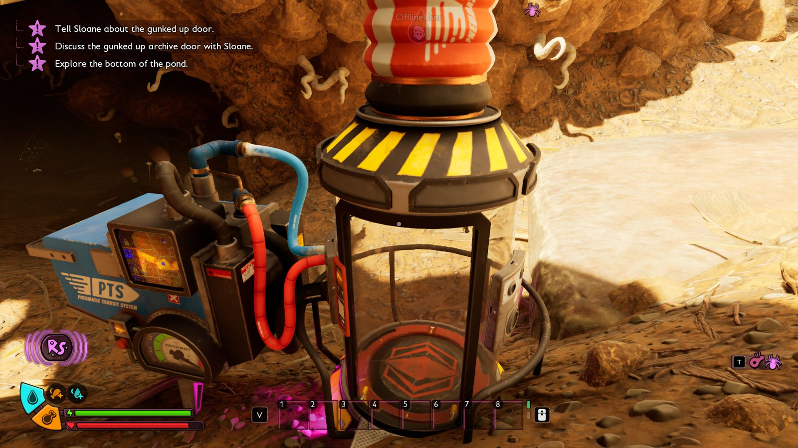
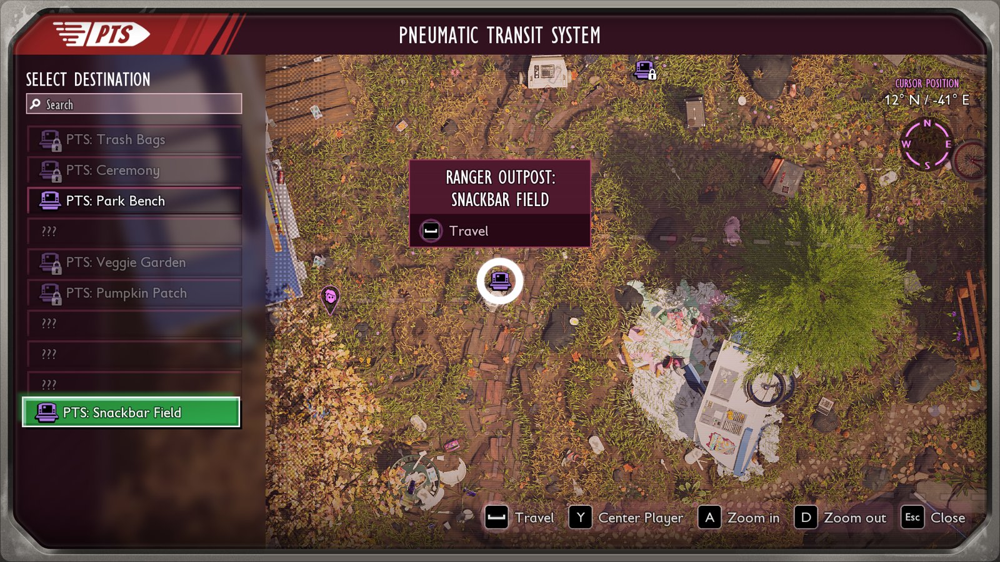



# Add a fast-travel station

A mod can place a station of the game's Pneumatic Transit System (PTS) anywhere on the map. It is the game's own outpost station: the player repairs it, finds it on the map and travels to and from the game's outposts. The example mod `ModSource/SnackbarMap` has one in the field by the Snackbar, called Snackbar Field.



No Unreal Engine is needed.

## 1. Find the spot

Go to the spot in the game and run the UE4SS console command `cfwhere`. It prints the player's position. The station needs flat ground, and the position is its floor. Look which way the open ground is, since the player walks out of the tube through its door.

## 2. The manifest

```lua
teleports = {
    {name = "Field", title = "teleport.field.title", place = "teleport.field.place", at = {-114480, 98330, -4850}, yaw = 240, cost = 300},
},
```

| Key | Meaning |
| --- | --- |
| `name` | Name of the station in this mod. Keep it once the mod is out, since the save keeps the repair and the discovery under it. |
| `title`, `place` | Keys of the mod's text files: the name in the travel list and the name on the map. |
| `at` | Position `{x, y, z}` of the station's floor. |
| `yaw` | The direction the station's door faces, in degrees. |
| `cost` | Raw Science to repair it. The game's outposts cost 700. |

The names go in `text/enus.json`:

```json
{
  "teleport.field.title": "PTS: Snackbar Field",
  "teleport.field.place": "Ranger Outpost: Snackbar Field"
}
```

All keys are in the [manifest reference](manifest.md#teleports).

## 3. In the game

The station stands at its place in every world. The player repairs it at its door for the Raw Science of `cost`, and the game shows "You discovered Ranger Outpost: Snackbar Field". From then on it has its icon on the map and in the travel window of every repaired PTS.



The save keeps the repair and the discovery. The station itself is placed again with each world, so removing the mod leaves nothing behind in the world.

## Travel rules

Two keys limit where a station sends the player:

```lua
teleports = {
    {name = "Field", title = "teleport.field.title", at = {-114480, 98330, -4850}, travel = "mod"},
    {name = "Vault", title = "teleport.vault.title", at = {-112000, 97000, -4800}, requires = "vaultOpen"},
},
```

- `travel = "mod"` lists only this mod's stations in the station's window. A list of names, such as `travel = {"Vault"}`, lists only those. The game's outposts still send the player to the station.
- `requires` names a [world variable](scripting.md#world-variables) of the mod. While it is 0 the station is no destination and its window lists nothing. A script opens it with `api.variables.set("vaultOpen", true)`.

The window then lists only the allowed stations, and the map in it shows only their icons. The host refuses any other travel request.

## Check

[Build and install](build.md) the mod and load a save. The UE4SS log shows `SnackbarMap: teleport Field placed`. Go to the station, repair it and open its travel window.

