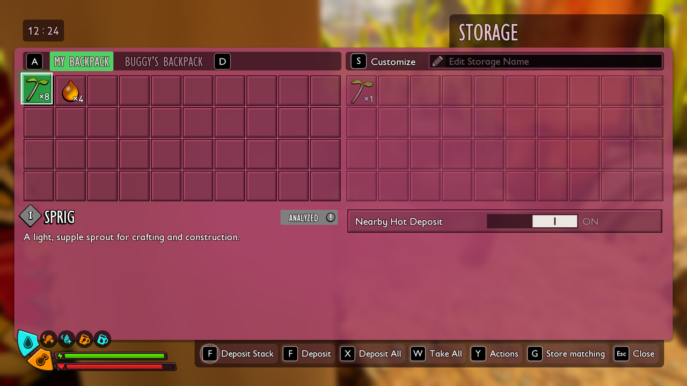
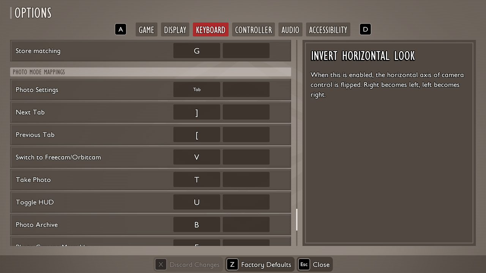



# Add a button to a building window

<p class="download-stub">Download the finished tutorial project: StoreMatching.zip</p>

This page makes Store Matching, a mod that adds a **Store matching** button to chest windows. A click moves the backpack items the chest already holds into the chest. The mod is only a script, so it needs no Unreal Engine.



## 1. The mod folder

Make `ModSource/StoreMatching` with this `mod.json`:

```json
{
  "id": "StoreMatching",
  "name": "Store Matching",
  "version": "1.0.0",
  "apiVersion": 2,
  "author": "You",
  "description": "Adds a Store matching button to chest windows. It moves the backpack items the chest already holds into the chest.",
  "multiplayer": "both"
}
```

The button text goes in `text/enus.json`, so it can be translated as in [Add text and translations](tutorial-localization.md):

```json
{
  "button.store": "Store matching"
}
```

## 2. The script

Save this as `content/scripts/store_matching.lua`:

```lua
return function(api)
    local CHESTS = {"Storage", "StorageBig", "StorageTier3", "BaseBuildings_Chest"}
    local INVENTORY = StaticFindObject("/Script/Maine.InventoryComponent")

    api.windowButton{
        building = CHESTS,
        label = {text = "button.store"},
        key = "G",
        onPress = function(chest)
            local storage = chest.actor:GetComponentByClass(INVENTORY)
            local backpack = FindFirstOf("SurvivalPlayerController").Pawn.InventoryComponent
            local held = {}
            for _, entry in ipairs(storage:GetItems()) do held[api.itemRow(entry:get())] = true end
            for _, entry in ipairs(backpack:GetItems()) do
                local item = entry:get()
                if held[api.itemRow(item)] then
                    backpack:ServerTransferItemTo(item, storage, item.StackSize, false)
                end
            end
        end,
    }
end
```

- `building` names the rows of `BuildingsTable` whose window gets the button. `Storage`, `StorageBig` and `StorageTier3` are the game's chests. `BaseBuildings_Chest` is the Treasure Chest of [Base Buildings](tutorial-storage.md), a row of another mod with its prefix. A row that is not installed is skipped.
- `label` is the button text, here a key of the text files.
- `key = "G"` shows the key on the button, as the game's own buttons do, and the key presses it while the window is open. The game lists it under the UI controls in **Options**, where the player can bind another key, and keeps that key in its own settings.
- `onPress` runs when the player clicks the button. `chest.actor` is the building in the game, and its inventory is its `InventoryComponent`.
- `GetItems()` returns a list whose entries hold the items, and `:get()` takes each item out. `api.itemRow` gives the item's row, such as `Twig`.
- `ServerTransferItemTo` is the game's own transfer between inventories. In multiplayer the host carries it out.

Find more rows in the [game data export](game-data.md): `BuildingsTable` lists every building. The same button works in the windows of production stations such as the Oven and of crafting stations such as the workbench.

## 3. Check it in the game

Install the mod as in [Make your first mod](tutorial-first-mod.md). Before the first game the mod manager lists its script and asks you to allow it. Put one item in a chest, carry more of it, open the chest and click **Store matching** or press G. The items move into the chest, and the other items stay in the backpack.




