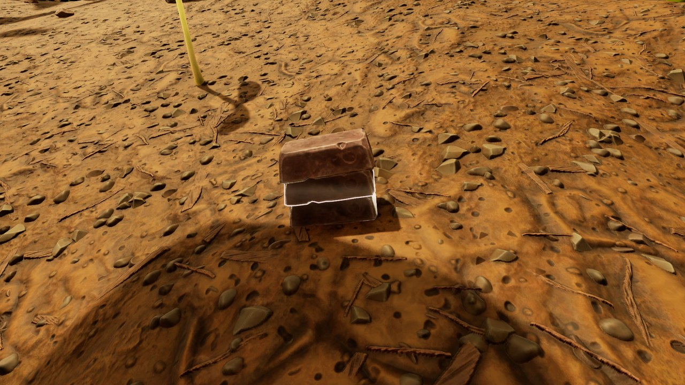
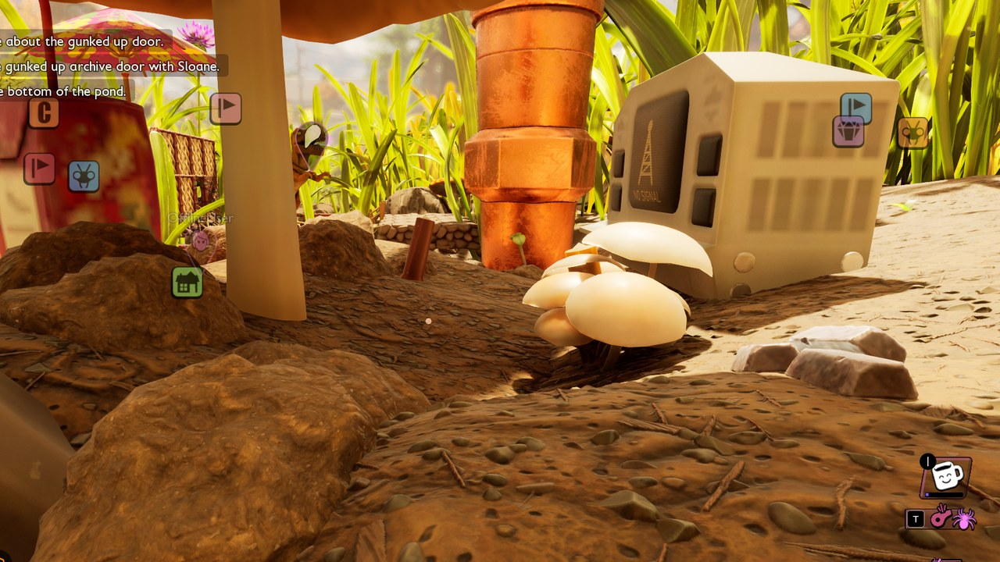



# Place items in the world

<p class="download-stub">Download the finished tutorial project: SupplyDrop.zip</p>

A mod can put items on the ground somewhere in the world for the player to find. The mod built here, Supply Drop, places an AK-74 from Arsenal Weapons and 3 Steel Ingots at a fixed spot of the map. The example `ModSource/SnackbarMap` does the same with 3 Mighty Globs (row `IngotQuartzite`) near the Snackbar.

The finished mod is in `ModSource/Tutorials/SupplyDrop`.



No Unreal Engine is needed.

## 1. Find the spot

Go to the spot in the game and run the UE4SS console command `cfwhere`. It prints the player's position as a ready entry:

```lua
{item = "Twig", at = {-114600, 121950, -2780}},
```

Raise `z` by a little. The items fall to the ground.

## 2. The manifest

```lua
return {
    id = "SupplyDrop",
    world = {
        {item = "ArsenalWeapons_Rifle", at = {-114700, 121850, -2680}},
        {item = "SteelGear_Ingot", count = 3, at = {-114600, 121950, -2680}},
    },
}
```

| Key | Meaning |
| --- | --- |
| `item` | Full row name of a game item or another mod's item, or the short name of an item of this mod. |
| `count` | How many, 1 to 999. Default 1. |
| `at` | Position `{x, y, z}` in centimetres. |

`mod.json` lists the mods whose items it places as dependencies.

## Game objects

An entry with `actor` instead of `item` places a game object of that Blueprint class: a mushroom, a grass stem, a resource pickup. Snackbar Map places two mushrooms in the clearing by the Snackbar:

```lua
world = {
    {actor = "/Game/Blueprints/Environment/FoliageActors/BP_Mushroom_Roundcap_A.BP_Mushroom_Roundcap_A_C", at = {-114950, 121500, -2870}, rotate = {0, 40, 0}},
    {actor = "/Game/Blueprints/Environment/FoliageActors/BP_Mushroom_Cluster.BP_Mushroom_Cluster_C", at = {-114500, 121550, -2870}},
}
```



| Key | Meaning |
| --- | --- |
| `actor` | Class path of a game Blueprint, ending in `_C`. Class paths are in the game data export and in FModel ([Explore the game files](tutorial-game-files.md)). |
| `at` | Position `{x, y, z}`. The object does not fall: put `z` on the ground. |
| `rotate` | `{pitch, yaw, roll}`. Default `{0, 0, 0}`. |

The game saves these objects like its own: a mushroom the player cuts down stays gone after saving and loading, and is not placed again. Use classes the game saves, such as plants, mushrooms and pickups.

## When items appear

- Each entry is placed once per saved world, a few seconds after the world loads. Items the player picks up and objects the player destroys do not come back.
- The game saves the items like any item on the ground.
- Loading a save from before the placement places the items again, because that save does not have them.
- Changing an entry's item, count or position makes it a new entry, placed again in worlds that had the old one.
- Only the host places items in multiplayer.

The record of which entries a world has is part of its save, so every save knows its own.

## Check

[Build and install](build.md) the mod and load a save. The UE4SS log shows `world: ArsenalWeapons_Rifle x1 at ...: placed`. Save, load again: the log shows no new placement and the items are still there.

